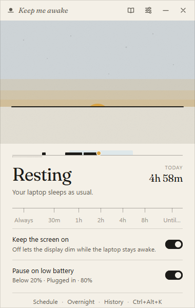
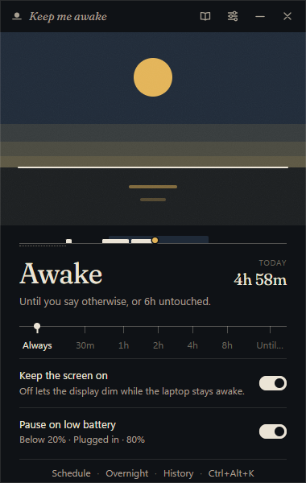
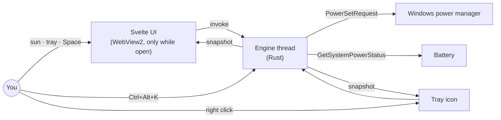

# Keep me awake

A small Windows app that keeps my laptop from sleeping while I need it up, and
gets out of the way the rest of the time. By [Akshay Bajpai](https://akshaybajpai.com).

It holds a Windows **power request**, the same mechanism a video player uses,
instead of faking keystrokes. The request is reference counted, shows up by
name in `powercfg /requests`, and is released the instant it is turned off or
the app exits. Nothing is typed, nothing moves, and nothing fights you when you
actually want the machine to sleep.

 

## At a glance

| Area      | What you get                                                                                                                |
| --------- | --------------------------------------------------------------------------------------------------------------------------- |
| Control   | One sun. Click it, press Space, or use the tray.                                                                            |
| Hotkey    | `Ctrl+Alt+K` toggles from any app; record your own.                                                                         |
| Time      | 30m · 1h · 2h · 4h · 8h · until a time of day. The sun sets as the time runs out.                                           |
| Schedule  | Awake during chosen hours on chosen days, resting outside them. Click the sun to skip a day.                                |
| Safety    | Pauses below a battery level (20% by default) or whenever unplugged; resumes when plugged in.                               |
| Screen    | Keep the display on, or let it dim while the machine keeps running.                                                         |
| Tray      | Left click opens the window. Right click does everything else. Starts at sign-in, quietly. Follows a light or dark taskbar. |
| Toasts    | Optional: when a timer ends, the battery pauses or resumes, or a schedule starts or ends.                                   |
| Footprint | One native process of about 5 MB while in the tray. No polling. The UI exists only while it is open.                        |
| Look      | Paper and Night, following Windows. A horizon, a sun, a serif, and nothing else.                                            |

## How it works



The engine owns one `Session` (off, indefinite, or timed) and applies a policy
each time something changes: if the session is active and the battery rules
allow it, hold a system request, plus a display request when "Keep the screen
on" is set. Everything the UI and tray show comes from a single `Snapshot` the
engine produces. The full picture is in [docs/architecture.md](docs/architecture.md).

## Install

Grab the latest installer from the
[releases page](https://github.com/ax5hay/KeepMeAwake/releases). It is
per-user and needs no administrator rights. Windows 10 (1809+) or Windows 11.

Or build it from source: see [Development](#development).

## Use

The [field guide](docs/guide.md) covers every control, including the things
that are not labelled. The short version:

| Want to…                        | Do…                                        |
| ------------------------------- | ------------------------------------------ |
| keep the laptop awake           | click the sun, or press **Space**          |
| for a fixed time                | pick a stop on the rule under the status   |
| until a time of day             | pick **Until…** and type a time            |
| let it sleep again              | click the sun again                        |
| keep it up during working hours | Settings → **Schedule**                    |
| toggle from another app         | **Ctrl+Alt+K**                             |
| get the window out of the way   | **Esc** or ×; the sun stays up in the tray |
| do all of this without a window | right-click the sun in the tray            |
| change defaults                 | gear, or **Ctrl+,**                        |

Settings live at `%APPDATA%\dev.bajpai.keepmeawake\settings.json`, logs at
`%LOCALAPPDATA%\dev.bajpai.keepmeawake\logs`.

## Why not just press Alt every fifteen minutes

That is how this started; the script is in [`legacy/`](legacy/keepmeawake.py).
It works, but it injects input into whatever has focus, it has to run visibly
in a console, it cannot be turned off from the tray, and Windows has no idea
why the laptop never sleeps. A power request is the API Windows provides for
exactly this: explicit, inspectable, self-cleaning.

## Development

Prerequisites: Node 22+, Rust stable 1.90+, the MSVC build tools with a Windows
SDK. The [development guide](docs/development.md) has setup, the daily commands
and the conventions this repo follows.

```powershell
npm install        # also wires the git hooks
npm run dev        # Vite + Tauri dev build; UI hot-reloads
npm run verify     # lint, type-check and test both halves
npm run build      # installers in src-tauri/target/release/bundle
```

## Documentation

| Doc                                        | Read it for                                         |
| ------------------------------------------ | --------------------------------------------------- |
| [Field guide](docs/guide.md)               | every control, shortcut and hidden thing            |
| [Architecture](docs/architecture.md)       | layers, the engine loop, IPC, window lifecycle      |
| [Design](docs/design.md)                   | the horizon, palette, type, motion, and the reasons |
| [Roadmap](docs/roadmap.md)                 | what is next and what was decided against           |
| [Development](docs/development.md)         | setup, commands, style, testing, commits            |
| [Releasing](docs/releasing.md)             | versions, changelog, the release workflow           |
| [Resource budget](docs/resource-budget.md) | what "tiny" means and how it is kept                |
| [Decisions](docs/adr/README.md)            | the five choices that shaped the project            |
| [Specs](docs/specs/README.md)              | implementation specs for the next releases          |
| [Handoff](docs/HANDOFF.md)                 | where the last session stopped and where to start   |
| [Changelog](CHANGELOG.md)                  | what changed, by version                            |

## License

[MIT](LICENSE) · Keep me awake is a personal project by
[Akshay Bajpai](https://akshaybajpai.com).
