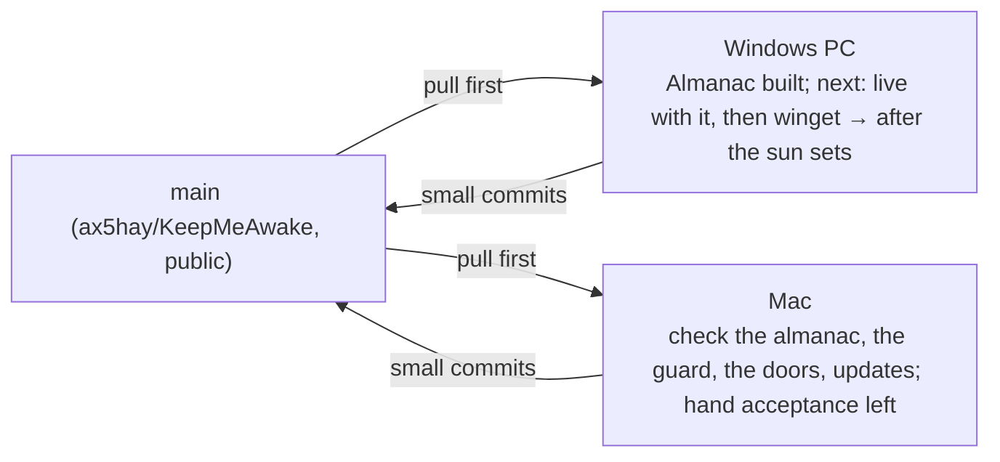

# Handoff

The one page every agent or session reads first and updates last. Keep it
short; link out for detail.

**Last updated:** 2026-11-12 · by Claude Opus 5.5 (Mac session: repo admin tasks, a plain-words pass over every piece of copy; Windows checks it next)
**Release:** [v0.7.0](https://github.com/ax5hay/KeepMeAwake/releases/tag/v0.7.0), a **full** release and the latest (0.3.0 was the first); `releases/latest/download/latest.json` serves it, so installs from here on are offered each new release. (v0.2.0 stays a pre-release.)
**Repo state:** `main` is green (`npm run verify` on Windows: vitest 212, cargo test 249;
the Mac runs its own platform tests in place of the Windows ones; CI green on both runners).
**v0.3.0** carries session history, the sunset warning, the overnight guard, auto-update,
the settings sliders and Home's doors: Windows `.exe` / `.msi`, macOS `.dmg` /
`.app.tar.gz` (Apple Silicon, ad hoc signed, not notarized), each updater artifact signed,
and `latest.json` for both. In 0.4.0: the **Almanac** (days and hours
worked, leave, the night, today on Home, days put right by hand, Set with
me) and a fix for a schedule with equal times; built on Windows and waiting
for the Mac. The project is under its own
license, not MIT (see `LICENSE`).

## Two tracks, two machines

Pull before you start. Platform work stays in `platform/` and `cfg` blocks;
anything shared (`core`, `engine`, `copy.ts`, docs) is where the two tracks
can collide, so commit it small and push it soon.

## Where to start

### On the machine where the owner is the repo admin

The Mac is signed in as the admin (the Windows PC's login can push and
release but not change settings). What was left for the admin:

| To do                                                  | Status                                                                                                                                            |
| ------------------------------------------------------ | ------------------------------------------------------------------------------------------------------------------------------------------------- |
| The repo's About text and topics                       | done on the Mac (admin login): 20 topics, and the description rewritten in plain words (see `gh repo view`)                                       |
| The social preview image                               | **owner, by hand**: repo Settings → General → Social preview → upload `design/social-preview.png` (1280 × 640). No API; needs a signed-in browser |
| Look at the README on github.com, in light and in dark | done: all five diagrams render, no broken images. Light reads well. Dark has three faults, below                                                  |
| Update an installed copy to 0.7.0                      | **not done**: no installed copy on the Mac. Install the 0.6.0 DMG, then Settings → About → **Check for updates**                                  |

The README's diagrams in GitHub's dark mode (they wear Paper's colours on a
dark page):

| Diagram               | Fault                                                                                          | Likely fix                                                                      |
| --------------------- | ---------------------------------------------------------------------------------------------- | ------------------------------------------------------------------------------- |
| One click, end to end | the `You` stick figure's label and the lifelines are dark ink on the dark page: near-invisible | `participant You` (a box) instead of `actor`; `actorLineColor` set to `#9a948a` |
| The sun's states      | GitHub's always-on zoom buttons cover `Paused` and `Asking` at the right edge                  | a layout that keeps those states off the right edge, or a narrower diagram      |
| The parts             | too wide for the column, so it shrinks until the labels are tiny (light mode too)              | `flowchart TB`                                                                  |

Then, by hand in the real 0.7.0 window, the things no harness could show
(each is an unticked box in [`specs/small-things.md`](specs/small-things.md)
or [`specs/themes.md`](specs/themes.md)):

| Check                                                                   | Where                                                                |
| ----------------------------------------------------------------------- | -------------------------------------------------------------------- |
| The mini window stays above other windows, and drags by its line        | title bar, first button                                              |
| **Print month** opens a real print dialog and the page is the timesheet | Almanac, beside Copy month as CSV                                    |
| The colour picker opens and a picked colour is worn                     | Settings → Theme → Yours                                             |
| The two notes are heard, rising and falling                             | Settings → Theme → Sounds, then click the sun                        |
| The Almanac and Settings read well in each theme                        | Settings → Theme; only Home was looked at in every theme             |
| The setup's finish page, and the MSI's dialogs                          | run the 0.7.0 installers; only the setup's welcome page was seen     |
| An AI answer from a real service                                        | Settings → AI, with a key; none has ever come back, from any service |

If the admin machine is the Mac, all of this doubles as the Mac's first look
at 0.4.0 to 0.7.0: see the next section.

### On the Mac (macOS track)

Paused: development is on the Windows PC. When back on the Mac, pull,
then work **Waiting for the other machine**: the Almanac first (it is the
newest, and its night depends on how the Mac's idle clock behaves across
sleep; see its table below), then the overnight guard (its
`MacIdle` probe is compiled and tested only by CI's `macos-latest` so far),
the UI pass (sliders, the doors line in SF Pro at 340 px, `⌥⌘K` as the
hotkey door), and auto-update (install the 0.3.0 DMG from the release; its
check runs about 30 s after launch). Setup is done here (rustup via
Homebrew, librsvg). Two things the next session needs that this one did
not have:

1. `export PATH="/opt/homebrew/opt/rustup/bin:$PATH"` in `~/.zshrc` (Homebrew's
   rustup is keg-only; without it `npm run verify` and the pre-commit hook
   cannot find cargo). This session could not edit `~/.zshrc`.
2. Screen Recording and Accessibility for the terminal (System Settings →
   Privacy & Security), so screenshots and menu bar clicks can be scripted.

Then walk the by-hand acceptance in [`specs/macos.md`](specs/macos.md):

| Item                                                             | Status                                                     |
| ---------------------------------------------------------------- | ---------------------------------------------------------- |
| `npm run verify` green on the Mac                                | done                                                       |
| `pmset -g assertions` shows both, gone on toggle off and on quit | done (release app, quit via Apple Event = ⌘Q path)         |
| No Dock icon                                                     | done (`lsappinfo` type UIElement)                          |
| Window drops down centred under the icon, reopens there          | **by hand**: placement fixed in review, unit tested only   |
| Icon legible on light, dark and busy menu bars, three states     | **by hand**                                                |
| `⌥⌘K` with window closed, record `⇧⌘K`, `⌘Space` refused         | **by hand** (`Cmd+Alt+K` registers, per the log)           |
| `⌘,` `⌘W` `⌘M` `⌘Q` in the real window                           | **by hand**; in a browser harness ⌘W/⌘M/⌘, route correctly |
| Timer toast from the bundled `.app`                              | **by hand**                                                |
| Launch at sign-in writes a LaunchAgent, starts hidden            | **by hand**                                                |
| Unplug below the threshold pauses (needs a MacBook)              | **by hand**; this Mac has no battery                       |
| Schedule window raises the sun                                   | **by hand**                                                |
| Paper and Night screenshots, `-mac` suffix, under `docs/assets/` | **by hand** (needs Screen Recording)                       |
| DMG background shows at 540 × 380 in Finder                      | **by hand**                                                |
| Resource numbers recorded                                        | done; menu bar footprint 16–17 MB is over the 12 MB budget |
| CI matrix green on both runners                                  | done                                                       |

### On the Windows PC (Windows track): start here

Development continues on Windows: what is left on the roadmap is mostly
Windows-first. The Windows PC is set up as [`development.md`](development.md)
describes; work through this in order.

**History was rewritten on 2026-11-07** to take private details out of
every commit. On any clone made before that:
`git fetch && git reset --hard origin/main && git fetch --tags --force`.
Commit with the ax5hay noreply address as `user.email`
(`git config --local`).

The updater signing key never goes in the repo, in docs or in commit
messages, nor does where it is kept; CI reads it from the repository
secrets. Ask the owner for it. A shell opened before rustup was installed
has no `cargo` on PATH and the pre-commit hook then fails with
`cargo: command not found`; a new terminal fixes it.

1. **Live with the Almanac** (it needs real days, so no script can): open
   it from the open book in the title bar; set your working hours in
   Settings → Almanac; walk its acceptance table below over a day and a
   night. An installed 0.3.0 does not have it: run `npm run dev` (after
   `taskkill /IM keepmeawake.exe /F`), or cut 0.4.0.
2. **Hand checks left on Windows** (no script can do these: they need a
   click on the tray, a look at the taskbar or a battery):
   - right-click the tray: **Give it another 30m** near a timer's end, and
     **Keep it up** while the guard asks, each doing what it says;
   - the tray icons on a light and a dark taskbar, all three states;
   - press `Ctrl+Alt+K` with the window closed;
   - the overnight guard's acceptance (table below): set
     `overnight_guard_hours` to 1 in the settings file, start Always, and
     leave the PC untouched for an hour;
   - on a laptop: unplug below the threshold (history: one row, one pause).
3. **Install 0.3.0** from the releases page once (a dev build's toasts say
   "Windows PowerShell"; an installed one should name the app). It is a
   full release, so the next one (0.3.1) is what proves auto-update end to
   end: publish it through [`releasing.md`](releasing.md) and the installed
   0.3.0 should offer it within a minute of launch (acceptance below).
4. **Build, in this order:**

   | Spec                                  | State        | How, on Windows                                                                                                                                                                                         |
   | ------------------------------------- | ------------ | ------------------------------------------------------------------------------------------------------------------------------------------------------------------------------------------------------- |
   | [winget-scoop](specs/winget-scoop.md) | spec, 0 of n | unblocked: 0.3.0 is a full release. The first winget submission is by hand (`wingetcreate new` on the 0.3.0 NSIS URL), with `License: Proprietary`                                                      |
   | After the sun sets (roadmap 0.4)      | needs a spec | Windows-first: `LockWorkStation`, `SetSuspendState`. macOS has no public lock API and system sleep may need privileges; spec it as Windows-only with a macOS note, or `pmset sleepnow`-style sleep only |
   | Sleep detection (roadmap 0.4)         | needs a spec | `PowerRegisterSuspendResumeNotification` on Windows; the macOS equivalent is `IORegisterForSystemPower` (IOKit). Closes the history gap noted in the guide                                              |

5. **Each feature:** spec → bottom-up commits → `npm run verify` → push →
   add it to **Waiting for the other machine** for the Mac → update this
   page. A Mac can't type-check the Windows build (Tauri's build script needs
   the Windows SDK), and the reverse is true too, so CI on both runners is
   the cross-platform compile check: watch it after each push.
6. Driving the UI: `taskkill /IM keepmeawake.exe /F` before a dev build
   (or leave the installed app running and give the dev build its own
   identity and data: `npx tauri dev --config '{"identifier":"dev.bajpai.keepmeawake.devcheck"}'`);
   `WEBVIEW2_ADDITIONAL_BROWSER_ARGUMENTS=--remote-debugging-port=9222` before
   `npm run dev` lets you drive and inspect it over the DevTools protocol.
   From `http://127.0.0.1:9222/json`, `Runtime.evaluate` can call
   `window.__TAURI_INTERNALS__.invoke(...)` and click the DOM;
   `Page.captureScreenshot` gives the 380 × 600 docs shots. A second launch
   of the exe reopens a closed window. Toasts appear about a second after
   their log line.

## Waiting for the other machine

Built on one machine, not yet built and checked on the other. A row goes
when the other machine has run `npm run verify` and the acceptance items that
apply there (see [`development.md`](development.md#two-machines-one-main)).

| What                    | Built on | Waits for | Check there                                                                                                                                                              |
| ----------------------- | -------- | --------- | ------------------------------------------------------------------------------------------------------------------------------------------------------------------------ |
| Plain-words copy pass   | Mac      | Windows   | `npm run verify`; the tray menu (**Add 30 minutes**, **I'm here, stay awake**, **Until I turn it off**); a toast; the installer's welcome and finish (**All set**) pages |
| Almanac                 | Windows  | Mac       | `npm run verify`; its acceptance (below) on the Mac; the title bar button and the pane in SF Pro at 340 px; a night across sleep                                         |
| Overnight guard         | Windows  | Mac       | `npm run verify` (includes the real `MacIdle` reading); the guard's acceptance (below) on the Mac, menu bar item                                                         |
| UI pass, sliders, doors | Windows  | Mac       | the icon; the doors fit one line in SF Pro at 340 px and show `⌥⌘K`; each opens its section; Esc in Until…                                                               |
| Auto-update             | Windows  | Mac       | the 0.3.0 DMG installs; its check runs and stamps `last_update_check_unix_ms`; About shows the switch; menu bar line                                                     |

Checked on Windows this session, so these rows came off: the **macOS
track** (`npm run verify` green; toasts and the hotkey as in 0.2), **session
history** and the **sunset warning** (tables below). What is still by hand
on Windows is listed under **Where to start**.

## In progress

| Spec                     | Track   | Commit reached | Notes                                                                                                           |
| ------------------------ | ------- | -------------- | --------------------------------------------------------------------------------------------------------------- |
| schedule                 | Windows | 7 of 7         | done; shipped in 0.2.0                                                                                          |
| notifications            | Windows | 5 of 5         | done; battery toasts verified by unit tests only                                                                |
| global-hotkey            | Windows | 3 of 3         | done                                                                                                            |
| tray-icons-light-taskbar | Windows | 4 of 4         | done; paused-state ink icon verified by unit test only                                                          |
| macos                    | macOS   | 12 of 12       | built, reviewed, four review fixes in; shipped in 0.2.0 as a pre-release; hand acceptance above is what is left |
| auto-update              | Windows | 6 of 6         | built, plus a perf fix; shipped in 0.3.0; signatures checked against the app's key; acceptance below            |
| session-history          | shared  | 5 of 5         | built on the Mac, reviewed, two review fixes in; checked on Windows; acceptance below                           |
| sunset-warning           | shared  | 6 of 6         | spec written and built on the Mac, reviewed, two review fixes in; checked on Windows; acceptance below          |
| overnight-guard          | shared  | 7 of 7         | built on Windows, reviewed, two review fixes in; CI green on both runners; hand acceptance below                |
| almanac                  | shared  | 7 of 7, then 4 | built on Windows, then extended; not yet reviewed, not yet lived with; acceptance below                         |

## Done this cycle

| Date       | What                                                                                                         | By               |
| ---------- | ------------------------------------------------------------------------------------------------------------ | ---------------- |
| 2026-11-07 | 0.1.0 built end to end; docs, CI, specs for 0.2 and 0.3; roadmap to 0.5                                      | Claude Fable 5.1 |
| 2026-11-07 | 0.2 built: schedule, notifications, global hotkey, taskbar-aware tray icons; engine wake-up fix              | Claude Opus 5.5  |
| 2026-11-07 | Repo moved to `ax5hay` and made public; every link updated; bundle metadata made honest                      | Claude Fable 5.1 |
| 2026-11-07 | macOS scoped: `specs/macos.md`, Mac setup in `development.md`, two-track handoff                             | Claude Fable 5.1 |
| 2026-11-07 | macOS built (12 commits), reviewed and fixed; own license; GitHub repo extras; v0.2.0 pre-release            | Claude Opus 5.5  |
| 2026-11-07 | Session history built (5 commits) on the Mac, reviewed; stretches end when due across sleep                  | Claude Opus 5.5  |
| 2026-11-07 | Sunset warning: spec, built (6 commits) on the Mac, reviewed; two-machine rule written into the docs         | Claude Opus 5.5  |
| 2026-11-07 | Overnight guard specced; Mac session wrapped up, Windows start list rewritten                                | Claude Opus 5.5  |
| 2026-11-07 | Windows PC set up; the Mac's macOS, history and sunset work checked on Windows; History screenshots          | Claude Opus 5.5  |
| 2026-11-07 | Overnight guard built on Windows (6 commits + 2 review fixes), CI green on both runners                      | Claude Opus 5.5  |
| 2026-11-07 | Settings button as sliders (a gear read as a sun); Home's doors into Settings; Home shots recaptured         | Claude Opus 5.5  |
| 2026-11-07 | UI pass: the guard on Home, five fixes (Esc, errors, stale history, presets, paused extend)                  | Claude Opus 5.5  |
| 2026-11-07 | Auto-update built (6 commits + a runtime fix), key in secrets; v0.3.0 released                               | Claude Opus 5.5  |
| 2026-11-07 | v0.3.0 made the full, latest release; the updater endpoint serves it                                         | Claude Opus 5.5  |
| 2026-11-10 | Almanac: spec, built (7 commits) on Windows; days, hours over, leave and the night read backwards            | Claude Fable 5.2 |
| 2026-11-10 | Schedule fix (equal times); today on Home; days corrected by hand; Sleep when I'm away (4 commits)           | Claude Fable 5.2 |
| 2026-11-10 | v0.4.0 released (full, latest). Claude behind three locks; Check for updates; break reminder; month as CSV   | Claude Fable 5.2 |
| 2026-11-11 | AI by any service (Claude, OpenAI, other); product names back; v0.5.0 released (full, latest)                | Claude Fable 5.2 |
| 2026-11-11 | Themes (27, on four shelves); a weekday nobody works reads as a day off; both unreleased                     | Claude Fable 5.2 |
| 2026-11-12 | Windows installers redrawn; README rewritten; v0.6.0 released (full, latest)                                 | Claude Fable 5.2 |
| 2026-11-12 | Twelve small things built; v0.7.0 released (full, latest)                                                    | Claude Fable 5.2 |
| 2026-11-12 | Mac: old clone reset to the rewritten history; repo About and topics set; README checked on github.com       | Claude Opus 5.5  |
| 2026-11-12 | Plain words everywhere: window, tray, toasts, installer, README, guide, repo description; rules in design.md | Claude Opus 5.5  |

## Plain words (unreleased)

Asked for by the owner: every line a person reads should be understood in
one go, with flair only where nobody has to act on it. The rule and a table
of examples are in [`design.md`](design.md#copy); the changelog lists the
renamed labels.

- Kept by request: the Almanac and the other named features (Ask the
  almanac, Tell the sun, Morning whisper, Sleep when I'm away, Overnight
  guard), the states Resting / Awake / Paused, theme names, easter eggs.
- Seen in a browser harness at 340 and 380 px (Home near a timer's end and
  with the guard asking, Settings, themes, Almanac); three lines were
  shortened after that look. Not seen: the real window, the tray menu, a
  toast, the installer. Specs under `docs/specs/` keep the old wording on
  purpose: they record what was built.
- No setting or identifier changed (`keep_it_up`, `sunset_warning_mins`
  and the rest), so no settings version bump.

## Small things (released in 0.7.0)

[Spec](specs/small-things.md). Twelve: a sun shaped by its theme, the moon,
a shooting star, themes previewed on hover, a theme of your own, a theme
after dark, the `?` key sheet, a year looked back on, a printed month,
sounds, a mini window, credits.

- Settings gained `own_theme`, `after_dark`, `sounds` and `Theme::Own`; all
  default, no version bump. `App.svelte` now decides what is worn (preview,
  then the evening, then the choice) and `theme.ts`'s `wear` puts it on;
  `watchTheme` is gone.
- Seen in the harness: all twelve but the shooting star and the sounds. In
  the real app on Windows: the mini window's size, there and back.
- Not checked: always-on-top and dragging the mini window; a real print
  dialog (`print_window` calls the webview's own `print`, which is what the
  Mac needs, since `window.print()` does nothing in WKWebView); the system
  colour dialog; sounds; anything on the Mac.
- `VERSIONS` in `copy.ts` (the credits' timeline) names 0.7 already: keep it
  in step with the changelog at each release.

## Themes, and what counts as leave (released in 0.6.0)

- **Themes** ([spec](specs/themes.md)): `theme` gained twenty-four values; each is a block of
  the same tokens in `src/styles/themes.css`, on a bare `[data-theme]` so the
  picker's swatches wear their own. Checked: every theme on Home in the
  harness. Not checked: the real window, the Almanac and Settings in each
  theme, anything on the Mac. Hot Dog Stand came and went (its sun
  vanished on its own ground); the contrast test in `theme.test.ts` now keeps
  a theme like that out.
- **Leave**: weekends were never counted as leave (not a working day reads
  `Day off`); that was already so. New: `usual_off` in `src/lib/almanac.ts`, a
  working weekday the record says is not worked reads as a day off. UI only;
  no Rust or settings change. Open: public holidays are still marked by hand
  (**Not a leave**), and alternate-week days off (every other Saturday) are
  not inferred.
- **Installers**: `design/installer/` holds four pictures of the horizon
  (`draw.py` draws the SVG and the BMP of each): NSIS sidebar and header,
  MSI dialog and banner, set in `tauri.conf.json`. Shapes only, since the
  installers scale bitmaps without smoothing. The setup's wording and paper
  colour are in `src-tauri/windows/installer.nsh` (`installerHooks`: Tauri
  includes it ahead of the pages). Built locally on Windows and the setup's
  welcome page looked at (`docs/assets/installer-welcome.png`); the finish
  page and the MSI's dialogs have not been seen, since that means installing. The DMG
  background is unchanged.
- **README**: rewritten around a cover (`docs/assets/cover.png`), a tour, a
  gallery of every theme (`docs/assets/themes/<id>.png`, Home in each, from
  the harness with seeded data) and five Mermaid diagrams in Paper's colours
  (an `init` block per diagram; all five were rendered with Mermaid 11
  before pushing). The repo's description and topics were brought up to date.
  Not done, because only the owner can: upload `design/social-preview.png`
  as the social preview in the repo's settings.
- Vitest now runs with `css: true`, because the theme tests read the
  stylesheets.

## Updates and wording, third round

- **Check for updates** is a button in Settings → About, and the app also
  checks when the window opens if the last check is an hour old
  (`update::check_on_open`, one check at a time). There is no push: a
  release cannot announce itself without a server. Tested: `due_on_open`;
  the button answered "nothing newer" in the real app before this round.
  **By hand:** open the window an hour after a check with a newer release
  out, and see it offered.
- The almanac's and Claude's wording was made plain throughout (see the
  changelog and `design.md` → Copy). The names in code and settings are
  unchanged (`rest_after_mins`, `tell_the_sun`, `whisper_night`): only what
  is shown changed. Older specs still use the first names in places.

## AI services and names, fourth round

- AI is no longer only Claude: **Service** in Settings → AI chooses Claude,
  OpenAI, or Other (any service in the OpenAI chat format, at an address
  of one's own). Each has its own key. Tested with fakes on both sides;
  **no real request to OpenAI or to another service has been made**, and
  still no real answer from Claude either. The OpenAI shape is from its
  reference (`max_completion_tokens`, a `developer` message, a strict
  `json_schema`); its default model, `gpt-5.4-nano`, was marked deprecated
  on OpenAI's own page with no successor named, so expect to change it.
- Code is `core::ai` (one `Ask`, shaped per service) and `app::ai`
  (`Assistant`); in the window `ai.ts`, `AiGroup`, `AiFeature`. The spec is
  still `specs/claude-integration.md`.
- Wording: facts are plain, the product's own names are back (Keep an
  almanac, Ask the almanac, Tell the sun, Morning whisper), each with a
  plain hint. See `design.md` → Copy.

## Claude: acceptance and decisions

Spec: [`specs/claude-integration.md`](specs/claude-integration.md). (It is
not named `claude.md`: on a case-insensitive file system that is the same
name as a `CLAUDE.md` instructions file, and it was read as one.)

| Acceptance (spec)                                             | Status                                                                                                                   |
| ------------------------------------------------------------- | ------------------------------------------------------------------------------------------------------------------------ |
| No key: both features locked, with Add a key                  | seen in the harness, both themes; the real app answers `Claude is locked: no API key…`                                   |
| A key, Claude off: Claude is switched off, with Switch it on  | seen in the harness; the real app answers `AI is switched off.`                                                          |
| Switched on: a week in words; a sentence understood           | **by hand, needs a real API key**: no successful answer from Anthropic has been seen yet                                 |
| A wrong key says so                                           | done in the real app on Windows: a real request with a made-up key came back as `Anthropic did not accept that API key.` |
| Each feature's switch turns only that feature off             | keeper and store tested                                                                                                  |
| Use AI off: no request by any path                            | tested (`unlock` refuses before a request is built)                                                                      |
| The key is in the OS credential store, not in `settings.json` | done on Windows: stored, read back as `has_key`, removed; not in the settings file                                       |

The one thing nobody has seen is a real answer. The request follows the
documented shape (`claude-haiku-5-5`, `anthropic-version: 2026-10-21`,
`thinking: {"type": "disabled"}`, `effort: low`, a small `max_tokens`, a
JSON schema for the plan), and the wrong-key round trip (made before the
move to Haiku, which changed only the body) proves the endpoint, the TLS
and the error path; the first run with a real key is the test of the rest.
If a request is rejected, look first at `thinking` with `effort`, then at
the plan's schema. If an answer comes back cut short, raise that request's
cap in `core/ai.rs`: they are tight on purpose.

Second round, the same day: every request moved to the smallest model with
thinking off and capped answers; two more features (**The day, in a
line**, **Ask the almanac**); features grouped under one chip
(`ClaudeGroup`, `ClaudeFeature`); answers remembered for the session by
what was asked; and **Hide AI**, off by default. All tested and seen in the
harness in both themes; none of it yet in the real window.

Decisions, each in its commit body: Claude is off by default and locked
without a key, and a feature is shown in every state rather than hidden;
the model is fixed (`claude-haiku-5-5`, the cheapest) and not a setting; requests go from
Rust, so the webview's CSP and permissions are unchanged and the key never
reaches it; the same HTTPS client as the updater; `keyring` is the one new
crate; Tell the sun never starts a plan without Start; while a plan is
typed, Home's rows and doors step aside.

For the Mac: `npm run verify`; the key goes into the Keychain (expect one
permission prompt the first time); the chip, lock and switch in SF Pro at
340 px.

Also built this round, released in 0.5.0: **Check for updates** in Settings → About (done
in the real app: answers "nothing newer" on 0.4.0), a **break reminder**
(keeper tested; the toast **by hand**), and **Copy month as CSV** (tested;
the clipboard **by hand** in the real window).

## Almanac: acceptance and decisions

Second round, the same day (asked for once the first build was seen):

| What                                                                 | Status                                                                                                              |
| -------------------------------------------------------------------- | ------------------------------------------------------------------------------------------------------------------- |
| Schedule with From = Until stuck off                                 | fixed: equal times are the whole day and the switch is never touched; core tested; **by hand** in Settings          |
| Today on Home: the strip under the scene, the figure by the word     | seen in the harness, Paper and Night, 380 × 600 and 340 × 520 (strip hidden); seen once in the real window, Night   |
| Edit hours, Nobody here, Undo my edit                                | core, keeper and UI logic tested; clicked through in the harness; `fix_day` answered and refused in the real window |
| Sleep when I'm away: asks at night after 30m, sets, rises at a touch | engine tested with fakes (six tests, including a wake in the night); **by hand**, needs a real night                |
| Morning whisper has a switch; a full day is whispered once           | store tested                                                                                                        |

Sleep when I'm away is **off by default** and is the one part of this that changes
what the sun does; it deserves a real night on each machine before 0.4.0.
It reuses the overnight guard (question, ten minutes, Keep it up, `idle` in
history), so a session it ends is logged as `idle`, not as something of its
own.

The Home screenshots `home-*` and `resting-*` were retaken from the harness
with a seeded almanac. `schedule-home-*`, `overnight-home-*` and
`update-home-*` still show Home before it had today on it: retake them from
the real window.

| Acceptance (spec)                                                  | Status                                                                                              |
| ------------------------------------------------------------------ | --------------------------------------------------------------------------------------------------- |
| Leave it 15 minutes, come back: two runs of ink, no growth between | **by hand**; core tested (a quiet over ten minutes opens a new span, ended at the last touch)       |
| Always overnight: the whisper names the night, the strip dots it   | **by hand**, needs a night; UI tested with seeded spans, store tested (whispers once)               |
| The same with the sun down and the laptop asleep                   | **by hand**; core tested (a span opened after sleep starts at most a look before its input)         |
| 3:00 pm – 12:00 am, work past midnight: stays on its day, as over  | UI tested; seen in the browser harness; **by hand** in the real window                              |
| Mark a day as leave, then not                                      | done in the real window on Windows over the DevTools port (`mark_day`), and by click in the harness |
| Switch it off: the thread stops waking; the pane says it is closed | keeper tested; **by hand** with Resource Monitor                                                    |
| Clear the almanac empties the pane and the file                    | keeper tested; by click in the harness; **by hand** in the real window                              |
| Paper and Night, at 380 × 600 and 340 × 520                        | seen in the harness, both themes and both sizes; the real window seen once in Night                 |

What was checked on the real app (a dev build under its own identifier, so
the installed app and its data were left alone): the keeper opened a span
from the real `GetLastInputInfo` reading within a second of launch,
`get_almanac`, `mark_day` (and its refusal of a non-date) answered, the pane
drew, and quitting wrote the grown span to `almanac.json`.

The guide's six screenshots are the real UI in a browser with a fake backend
and a seeded almanac, not the real window: a fresh install has no days to
show. Retake them from the real window once there are a few weeks in it.

Decisions, each in its commit body: the keeper is beside the engine, not in
it (presence is not a power decision; the engine and its tests are
untouched); nights are never recorded, only read from the gaps, so the rule
can change without touching the file; a day turns over opposite the middle
of the working hours, on the hour, and the resting hours are the ten around
that turn; under five minutes is not a day's work; "no input since the last
look" is judged on the monotonic clock, because an idle clock that stands
still during sleep would otherwise turn a wake in the night into a touch;
the almanac is on by default; the pane is behind a title bar button, not a
fifth door.

**For the Mac in particular:** the monotonic check exists for
`CGEventSourceSecondsSinceLastEventType`, whose behaviour across sleep and
dark wakes was not seen here. Leave the Mac asleep overnight with Power Nap
on and check that the night is one dotted run with no specks of ink in it.

Also deferred from the second round: the editor sets a day to one stretch,
not several; a day set by hand that crosses the turn is cut at the turn; the
sun rising at a touch says nothing when it does (the window is usually
closed), and history shows it only as a new `Always` row; with the sun down
and the window left open, today's figure waits for the window to be looked
at again.

Not done, and worth a look: the resting-minute numbers with the almanac on
(the budget says "to be measured"); a review pass like the other specs had;
`Almanac.svelte` has no component test of its own (its parts and its logic
do); an early riser's work before the turn of the day lands on the day
before; the week's sum counts the hours of a day marked as leave while its
row says `leave`.

## Decisions made on the macOS track

Each is in its commit body; the ones a person might disagree with:

- Mac glyphs follow menu order, so the default shows as `⌥⌘K` (spec: `⌘⌥K`).
- The Mac Esc tip says "Back, or close the window" (the spec's text wraps).
- No `[data-platform]` letter-spacing: SF Pro is ~14% wider than Segoe, so
  long hints wrap to two lines instead of being squeezed.
- The bundle is signed ad hoc (`signingIdentity: "-"`): an unsigned one reads
  as "damaged" when downloaded on Apple Silicon.
- Control-click on the menu bar icon opens the window, not the menu
  (tray-icon reports it as a left click). Right click shows the menu.
- Clicking the icon while the window is open focuses it rather than hiding it.

## Session history: acceptance and what is deferred

| Acceptance (spec)                                         | Status                                                                                            |
| --------------------------------------------------------- | ------------------------------------------------------------------------------------------------- |
| 30 m timer ends: a `timer` row with the right span        | done on the real app, Mac and Windows (Windows: one row across a timer, an extend and a new plan) |
| Unplug below threshold, plug in, stop: one row, one pause | **by hand** on a laptop; unit tested                                                              |
| Kill while Always, relaunch: a `sleep` row, end `–`       | done on the real app, Mac (`kill -9`) and Windows (`taskkill /F`)                                 |
| Clear history empties the list and the file               | done on Windows: the link clicked in the window empties both                                      |
| Screenshots of Settings → History, Paper and Night        | done from the real window on Windows: `docs/assets/history-*.png`                                 |

Decisions, each in its commit body: History sits after Hotkey (the spec
predates that section); `battery` applies to any stretch that ends while
paused for the battery; `SessionStarted` carries `paused` and both events
carry the engine's time; `Engine::start_with` attaches the listener before
the first step; a stretch ended by its timer or window is logged as ending
when it was due, even if the machine slept through it.

Deferred from review, all minor:

- A machine that sleeps and wakes inside the next window shows one row
  across both days; needs the 0.4 sleep detection.
- Turning the schedule off (or moving its hours) mid-window logs `schedule`,
  not `you`.
- The list does not refresh while Settings stays open, and a running row
  shows `–` for its length instead of a live one.
- The rows are rebuilt on each 1 Hz tick while a countdown runs, even with
  Settings off screen (cheap, but wasted).
- An unreadable `history.json` (corrupt, or from a newer build) is replaced
  on the next save without a backup; `Entry` has no `serde(default)` yet.

## Sunset warning: acceptance and what is deferred

| Acceptance (spec)                                             | Status                                                                                             |
| ------------------------------------------------------------- | -------------------------------------------------------------------------------------------------- |
| 6-minute timer: at 5 left a toast, the status line, the link  | done on Windows with a 1-minute warning: toast seen, line and link in the window; tray **by hand** |
| Give it another 30m from the window moves the end, re-warns   | done on Windows: the link moved the end exactly 30 min (plan 1920 s); re-warn engine tested        |
| The same from the tray                                        | **by hand** (needs a tray click)                                                                   |
| 2-minute timer never warns; Off never warns; timer switch off | unit tested; **by hand** on the real app                                                           |

Decisions (each in its commit body): the toast follows the existing
**When a timer ends** switch; no warning while an open schedule window
outlasts the timer; `Session::extend` keeps the plan's start, so the arc
grows (progress jumps back) rather than restarting.

Deferred from review, all minor: the link also shows while paused ("Holding
off while … Give it another 30m"); the click always whispers "Another 30
minutes." and keyboard focus drops to the page; a hand-edited warning
outside 2/5/10 selects no segment; under a minute the toast says "1 minute"
while the line says "under a minute".

## Overnight guard: acceptance and decisions

| Acceptance (spec), with `overnight_guard_hours` at 1            | Status                                                                                    |
| --------------------------------------------------------------- | ----------------------------------------------------------------------------------------- |
| An hour untouched: the toast, the status line and the tray item | **by hand**; engine and toast text tested; line, link and setting seen in the real window |
| Touch the mouse: the question goes away                         | **by hand**; engine tested                                                                |
| Keep it up: no question again until the session ends            | link clicked in the real window answers the guard; **by hand** end to end and from tray   |
| Ten minutes untouched after it: session ends, history `idle`    | **by hand**; engine tested, including a late wake (ends when it was due)                  |
| Off in Settings: never asks. Timed sessions: never asks         | engine tested past a whole grace; the setting's four segments saved in the real window    |

The real `GetLastInputInfo` reading is tested on Windows, and the real
`CGEventSource` reading on CI's macOS runner. The hour untouched is still
to be waited out by hand.

Decisions, each in its commit body: a paused session let go by the guard
ends as `idle`, not `battery`; an Always session inside an open schedule
window is still guarded, and ending it hands over to the window (the sun
stays up); the toast's hours are the setting's, and it has no switch of its
own; the snapshot field lives in `core`, added with the setting; the
question outranks the paused line. From review: a command that starts or
ends a session clears any question, and a Windows reading a few
milliseconds negative reads as zero, not 49.7 days.

Deferred, minor: a hand-edited guard outside 4/6/8 (the acceptance's 1)
selects no segment, as with the sunset warning; Keep it up outlasts
Always → timer → Always without an Off, since the session keeps its start.

## Auto-update: acceptance and decisions

| Acceptance (spec)                                                   | Status                                                                                           |
| ------------------------------------------------------------------- | ------------------------------------------------------------------------------------------------ |
| Publish 0.3.0, then 0.3.1; a 0.3.0 install shows it within a minute | **by hand** with the next full release; 0.3.0 is full and the endpoint serves it (checked)       |
| With the switch off, no request is made                             | by construction (the thread never asks while off); **by hand** with the debug log                |
| A signature mismatch is refused and logged                          | **by hand**; the plugin verifies before installing, and the install path logs the error at warn  |
| The check runs, fails quietly offline, and is stamped               | done on Windows: 30 s after launch, no `latest.json` on 0.2.0 → nothing shown, timestamp written |
| The release signs every updater artifact with the app's key         | done: `latest.json` lists Windows NSIS/MSI and Apple Silicon, each signed by the app's key       |

Decisions, each in its commit body: no `tauri-plugin-process` (Tauri's own
`restart`) and no webview updater permission (the UI calls the app's own
commands); `createUpdaterArtifacts` lives in `tauri.updater.conf.json`, an
overlay CI passes, so local builds work without the key; the plugin's own
log is off (it reports an offline check as an error); the daily check runs
on a current-thread runtime (Tauri's shared one started 37 more threads);
Home's doors lead with a waiting update and drop the hotkey door to stay
one line; the whisper is once per version, remembered in localStorage.

## Open questions for Akshay

- Claude's answers are capped hard (120, 300 and 200 tokens). If a real
  answer ever comes back cut off, which cap to raise, and by how much?
- 0.4.0 went out the same day the almanac was built, before a real night
  with Sleep when I'm away or a check on the Mac. Anything found goes in 0.4.1.

- The almanac is **on by default**, which gives every install its first
  wake-up at rest (one idle reading a minute). On, or off until someone
  opens the pane and says yes?
- Leave is counted, not budgeted: no allowance, no balance, no half days.
  Wanted?
- Sleep when I'm away is off by default and offers 30m, 1h and 2h. Right values,
  and should it ever be on for a new install?
- The day's total in the tray menu (`4h 29m today`) needs the day-bucketing
  in Rust as well. Wanted?

- GitHub still holds the pre-rewrite commits under the six closed
  Dependabot pull requests (`refs/pull/1…6/head`), which only GitHub
  Support can remove; a request is drafted for you outside the repo.

- Paid signing, to drop the first-open warnings: Apple Developer Program
  ($99 a year, includes notarization) and a Windows certificate (Azure
  Artifact Signing about $10 a month, but for individuals only in the US or
  Canada; otherwise an OV certificate, roughly $130–440 a year on a hardware
  token or cloud HSM). Neither blocks auto-update. Prices checked 2026-11-07.
- The macOS menu bar footprint (16–17 MB `phys_footprint`) is over the 12 MB
  budget written for Windows. A macOS line in the budget, or work to cut it?
- Should a second click on the menu bar icon hide the window, like a popover?
- Upload `design/social-preview.png` under GitHub → Settings → General →
  Social preview (the API cannot).
- The new `LICENSE` is a plain-words personal license, not legal advice; if
  the project ever earns money, have a lawyer read it.
- Confirm the default for **Check for updates automatically** (auto-update spec says on).

## How to update this page

At the end of every session: set **Last updated**, move your spec's row in
**In progress** (commit number reached, anything half-done), append to **Done
this cycle**, add what you built to **Waiting for the other machine** (and
tick off what you checked from the other side), and rewrite **Where to
start** for both machines so either can begin in one step. Commit it as `docs(handoff): …` and push.

---

_Keep me awake · [Akshay Bajpai](https://akshaybajpai.com)_
