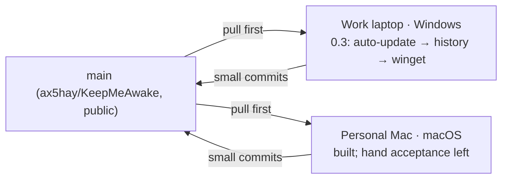

# Handoff

The one page every agent or session reads first and updates last. Keep it
short; link out for detail.

**Last updated:** 2026-11-07 (IST) · by Claude Opus 5.5 (macOS track, review fixes, 0.2.0 pre-release)
**Release:** [v0.2.0](https://github.com/ax5hay/KeepMeAwake/releases/tag/v0.2.0), pre-release.
**Repo state:** `main` is green on both CI runners (`npm run verify` on the Mac: vitest 75,
cargo test 120; Windows runs its own platform tests in place of the Mac ones). **v0.2.0 is
published as a pre-release** with Windows (`.exe`, `.msi`) and macOS (`.dmg`, `.app.tar.gz`,
Apple Silicon, ad-hoc signed, not notarized) assets. The project is under its own license now,
not MIT (see `LICENSE`).

## Two tracks, two machines

Pull before you start. Platform work stays in `platform/` and `cfg` blocks;
anything shared (`core`, `engine`, `copy.ts`, docs) is where the two tracks
can collide, so commit it small and push it soon.

## Where to start

### On the Mac (macOS track)

Setup is done on the Mac mini (rustup via Homebrew, librsvg). Two things
the next session needs that this one did not have:

1. `export PATH="/opt/homebrew/opt/rustup/bin:$PATH"` in `~/.zshrc` (Homebrew's
   rustup is keg-only; without it `npm run verify` and the pre-commit hook
   cannot find cargo). This session could not edit `~/.zshrc`.
2. Screen Recording and Accessibility for the terminal (System Settings →
   Privacy & Security), so screenshots and menu bar clicks can be scripted.

Then walk the by-hand acceptance in [`specs/macos.md`](specs/macos.md):

| Item                                                             | Status                                                     |
| ---------------------------------------------------------------- | ---------------------------------------------------------- |
| `npm run verify` green on the Mac                                | done                                                       |
| `pmset -g assertions` shows both, gone on toggle off and on quit | done (release app, quit via Apple Event = ⌘Q path)         |
| No Dock icon                                                     | done (`lsappinfo` type UIElement)                          |
| Window drops down centred under the icon, reopens there          | **by hand**: placement fixed in review, unit tested only   |
| Icon legible on light, dark and busy menu bars, three states     | **by hand**                                                |
| `⌥⌘K` with window closed, record `⇧⌘K`, `⌘Space` refused         | **by hand** (`Cmd+Alt+K` registers, per the log)           |
| `⌘,` `⌘W` `⌘M` `⌘Q` in the real window                           | **by hand**; in a browser harness ⌘W/⌘M/⌘, route correctly |
| Timer toast from the bundled `.app`                              | **by hand**                                                |
| Launch at sign-in writes a LaunchAgent, starts hidden            | **by hand**                                                |
| Unplug below the threshold pauses (needs a MacBook)              | **by hand**; the mini has no battery                       |
| Schedule window raises the sun                                   | **by hand**                                                |
| Paper and Night screenshots, `-mac` suffix, under `docs/assets/` | **by hand** (needs Screen Recording)                       |
| DMG background shows at 540 × 380 in Finder                      | **by hand**                                                |
| Resource numbers recorded                                        | done; menu bar footprint 16–17 MB is over the 12 MB budget |
| CI matrix green on both runners                                  | done                                                       |

### On the work laptop (Windows track)

0. **History was rewritten on 2026-11-07** (this session's 26 commits were
   re-authored from a stray identity to ax5hay; trees and
   messages unchanged). Before anything else, on any clone made earlier:
   `git fetch && git reset --hard origin/main && git fetch --tags --force`.
   Commit as `Akshay Bajpai <71986942+ax5hay@users.noreply.github.com>`
   (`git config --local user.email …`) so GitHub links commits to ax5hay.
1. Install the v0.2.0 pre-release from the releases page and check it
   once on Windows (toasts name the app when installed, per the old open
   question). When both platforms are happy, untick **pre-release** on GitHub.
2. Then [`specs/auto-update.md`](specs/auto-update.md) at commit 1. The
   updater needs only Tauri's own free key pair (`tauri signer generate`,
   stored as `TAURI_SIGNING_PRIVATE_KEY`); a paid OS certificate removes the
   install warnings but is not a prerequisite. Check the spec still agrees.
3. `taskkill /IM keepmeawake.exe /F` before testing a dev build;
   `WEBVIEW2_ADDITIONAL_BROWSER_ARGUMENTS=--remote-debugging-port=9222` before
   `npm run dev` lets you drive the UI over the DevTools protocol.

## In progress

| Spec                     | Track   | Commit reached | Notes                                                                                                           |
| ------------------------ | ------- | -------------- | --------------------------------------------------------------------------------------------------------------- |
| schedule                 | Windows | 7 of 7         | done; shipped in 0.2.0                                                                                          |
| notifications            | Windows | 5 of 5         | done; battery toasts verified by unit tests only                                                                |
| global-hotkey            | Windows | 3 of 3         | done                                                                                                            |
| tray-icons-light-taskbar | Windows | 4 of 4         | done; paused-state ink icon verified by unit test only                                                          |
| macos                    | macOS   | 12 of 12       | built, reviewed, four review fixes in; shipped in 0.2.0 as a pre-release; hand acceptance above is what is left |
| auto-update              | Windows | 0 of 6         | ready: needs the free updater key                                                                               |

## Done this cycle

| Date       | What                                                                                              | By               |
| ---------- | ------------------------------------------------------------------------------------------------- | ---------------- |
| 2026-11-07 | 0.1.0 built end to end; docs, CI, specs for 0.2 and 0.3; roadmap to 0.5                           | Claude Fable 5.1 |
| 2026-11-07 | 0.2 built: schedule, notifications, global hotkey, taskbar-aware tray icons; engine wake-up fix   | Claude Opus 5.5  |
| 2026-11-07 | Repo moved to `ax5hay` and made public; every link updated; bundle metadata made honest           | Claude Fable 5.1 |
| 2026-11-07 | macOS scoped: `specs/macos.md`, Mac setup in `development.md`, two-track handoff                  | Claude Fable 5.1 |
| 2026-11-07 | macOS built (12 commits), reviewed and fixed; own license; GitHub repo extras; v0.2.0 pre-release | Claude Opus 5.5  |

## Decisions made on the macOS track

Each is in its commit body; the ones a person might disagree with:

- Mac glyphs follow menu order, so the default shows as `⌥⌘K` (spec: `⌘⌥K`).
- The Mac Esc tip says "Back, or close the window" (the spec's text wraps).
- No `[data-platform]` letter-spacing: SF Pro is ~14% wider than Segoe, so
  long hints wrap to two lines instead of being squeezed.
- The bundle is signed ad hoc (`signingIdentity: "-"`): an unsigned one reads
  as "damaged" when downloaded on Apple Silicon.
- Control-click on the menu bar icon opens the window, not the menu
  (tray-icon reports it as a left click). Right click shows the menu.
- Clicking the icon while the window is open focuses it rather than hiding it.

## Open questions for Akshay

- Paid signing, to drop the first-open warnings: Apple Developer Program
  ($99 a year, includes notarization) and a Windows certificate (Azure
  Artifact Signing about $10 a month, but for individuals only in the US or
  Canada; otherwise an OV certificate, roughly $130–440 a year on a hardware
  token or cloud HSM). Neither blocks auto-update. Prices checked 2026-11-07.
- The macOS menu bar footprint (16–17 MB `phys_footprint`) is over the 12 MB
  budget written for Windows. A macOS line in the budget, or work to cut it?
- Should a second click on the menu bar icon hide the window, like a popover?
- Upload `design/social-preview.png` under GitHub → Settings → General →
  Social preview (the API cannot).
- The new `LICENSE` is a plain-words personal license, not legal advice; if
  the project ever earns money, have a lawyer read it.
- Confirm the default for **Check for updates daily** (auto-update spec says on).

## How to update this page

At the end of every session: set **Last updated**, move your spec's row in
**In progress** (commit number reached, anything half-done), append to **Done
this cycle**, and rewrite the **Where to start** list for your track so the
next agent can begin in one step. Commit it as `docs(handoff): …` and push.

---

_Keep me awake · [Akshay Bajpai](https://akshaybajpai.com)_
