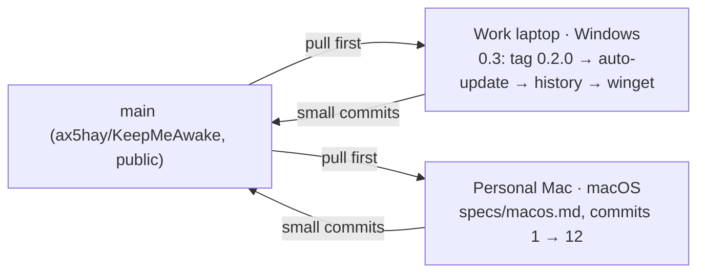

# Handoff

The one page every agent or session reads first and updates last. Keep it
short; link out for detail.

**Last updated:** 2026-11-07 (IST) · by Claude Fable 5.1 (repo move and macOS scoping)
**Repo state:** `main` is green (`npm run verify`: vitest 54, cargo test 111), pushed. Public at
[github.com/ax5hay/KeepMeAwake](https://github.com/ax5hay/KeepMeAwake). All four 0.2 specs
are built and under Unreleased in `CHANGELOG.md`; 0.2.0 is not tagged (version is still 0.1.0).

## Two tracks, two machines

Pull before you start. Platform work stays in `platform/` and `cfg` blocks;
anything shared (`core`, `engine`, `copy.ts`, docs) is where the two tracks
can collide, so commit it small and push it soon.

## Where to start

### On the Mac (macOS track)

1. Clone `https://github.com/ax5hay/KeepMeAwake.git`, follow **Setup (macOS)** in
   [`development.md`](development.md), run `npm run verify`. Expect it green:
   the crate already gates Win32 behind `cfg(windows)` and falls back to
   `NullPowerGuard` / `AlwaysOnMains` elsewhere, so it should compile and the
   window should open with the sun doing nothing. If it does not compile, that
   is commit 1.
2. Read [`specs/BRIEF.md`](specs/BRIEF.md), then [`specs/macos.md`](specs/macos.md),
   and start at commit 1 of its list. Build bottom-up: platform first, prove it
   with `pmset -g assertions`, then the menu bar, then copy and type.
3. Screenshots at 380 × 600 in Paper and Night with a `-mac` suffix under
   `docs/assets/`. Compare type against the Windows captures before calling
   the type stack done.

### On the work laptop (Windows track)

1. Tag 0.2.0 when Akshay is happy with it: [`releasing.md`](releasing.md) (bump
   the version, move Unreleased to `[0.2.0]`, build, tag). The macOS line in
   the roadmap ships with whichever release follows its acceptance.
2. Then [`specs/auto-update.md`](specs/auto-update.md) at commit 1. It needs a
   signing decision first (open questions).
3. Before testing on the real app: `taskkill /IM keepmeawake.exe /F` (a 0.2
   release build may still be running hidden in the tray).
   `WEBVIEW2_ADDITIONAL_BROWSER_ARGUMENTS=--remote-debugging-port=9222` before
   `npm run dev` lets you drive and inspect the UI over the DevTools protocol.

## In progress

| Spec                     | Track   | Commit reached | Notes                                                                                                                                                                                       |
| ------------------------ | ------- | -------------- | ------------------------------------------------------------------------------------------------------------------------------------------------------------------------------------------- |
| schedule                 | Windows | 7 of 7         | done; also a separate engine fix (lost wake-up) before commit 3                                                                                                                             |
| notifications            | Windows | 5 of 5         | done; battery toasts verified by unit tests only (no unplugging in the session)                                                                                                             |
| global-hotkey            | Windows | 3 of 3         | done                                                                                                                                                                                        |
| tray-icons-light-taskbar | Windows | 4 of 4         | done; paused-state ink icon verified by unit test only (could not pause without battery)                                                                                                    |
| macos                    | macOS   | 0 of 12        | spec written on Windows; nothing built yet. A `cargo check --target aarch64-apple-darwin` from Windows stops at a C dependency (no `cc` here), so the first real compile happens on the Mac |
| auto-update              | Windows | 0 of 6         | waits on the signing decision                                                                                                                                                               |

## Done this cycle

| Date       | What                                                                                            | By               |
| ---------- | ----------------------------------------------------------------------------------------------- | ---------------- |
| 2026-11-07 | 0.1.0 built end to end; docs, CI, specs for 0.2 and 0.3; roadmap to 0.5                         | Claude Fable 5.1 |
| 2026-11-07 | 0.2 built: schedule, notifications, global hotkey, taskbar-aware tray icons; engine wake-up fix | Claude Opus 5.5  |
| 2026-11-07 | Repo moved to `ax5hay` and made public; every link updated; bundle metadata made honest         | Claude Fable 5.1 |
| 2026-11-07 | macOS scoped: `specs/macos.md`, Mac setup in `development.md`, two-track handoff                | Claude Fable 5.1 |

## Open questions for Akshay

- Signing: a Windows code-signing certificate (needed before auto-update ships)
  and an Apple Developer account for notarizing the macOS build. Unsigned
  builds work on both with a warning.
- Confirm the default for **Check for updates daily** (spec says on).
- Toasts name "Windows PowerShell" as their source unless the app is installed
  (the plugin only sets the app id outside `target/`). Expected, but worth a
  look in an installed 0.2 build.
- 0.2 spec choices made on the way, each noted in its commit body: skip is
  stored as wall-clock ms, not an `Instant`; the wait for the next window is
  capped at 5 minutes so sleep cannot make it hours late; the tray's skip item
  shows only while a window is open; no `notification:default` capability
  (toasts are sent from Rust); ink tray icons are monochrome because the
  shipped ones have no amber.
- macOS: the spec makes it a pure menu bar app (no Dock icon). If you want a
  Dock icon while the window is open, that is `ActivationPolicy::Regular`
  toggled on show and hide; say so before commit 4.

## How to update this page

At the end of every session: set **Last updated**, move your spec's row in
**In progress** (commit number reached, anything half-done), append to **Done
this cycle**, and rewrite the **Where to start** list for your track so the
next agent can begin in one step. Commit it as `docs(handoff): …` and push.

---

_Keep me awake · [Akshay Bajpai](https://akshaybajpai.com)_
