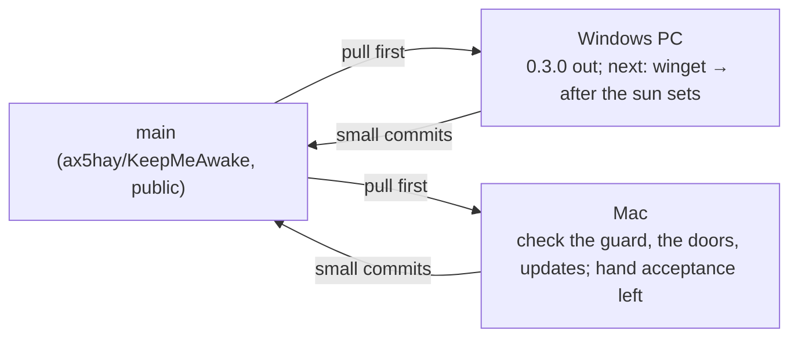

# Handoff

The one page every agent or session reads first and updates last. Keep it
short; link out for detail.

**Last updated:** 2026-11-07 · by Claude Opus 5.5 (Windows session: UI pass, auto-update built, v0.3.0 released)
**Release:** [v0.3.0](https://github.com/ax5hay/KeepMeAwake/releases/tag/v0.3.0), the first **full** release and the latest; `releases/latest/download/latest.json` serves it, so installs from here on are offered each new release. (v0.2.0 stays a pre-release.)
**Repo state:** `main` is green (`npm run verify` on Windows: vitest 108, cargo test 180;
the Mac runs its own platform tests in place of the Windows ones; CI green on both runners).
**v0.3.0** carries session history, the sunset warning, the overnight guard, auto-update,
the settings sliders and Home's doors: Windows `.exe` / `.msi`, macOS `.dmg` /
`.app.tar.gz` (Apple Silicon, ad hoc signed, not notarized), each updater artifact signed,
and `latest.json` for both. Nothing is under Unreleased. The project is under its own
license, not MIT (see `LICENSE`).

## Two tracks, two machines

Pull before you start. Platform work stays in `platform/` and `cfg` blocks;
anything shared (`core`, `engine`, `copy.ts`, docs) is where the two tracks
can collide, so commit it small and push it soon.

## Where to start

### On the Mac (macOS track)

Paused: development is on the Windows PC. When back on the Mac, pull,
then work **Waiting for the other machine**: the overnight guard (its
`MacIdle` probe is compiled and tested only by CI's `macos-latest` so far),
the UI pass (sliders, the doors line in SF Pro at 340 px, `⌥⌘K` as the
hotkey door), and auto-update (install the 0.3.0 DMG from the release; its
check runs about 30 s after launch). Setup is done here (rustup via
Homebrew, librsvg). Two things the next session needs that this one did
not have:

1. `export PATH="/opt/homebrew/opt/rustup/bin:$PATH"` in `~/.zshrc` (Homebrew's
   rustup is keg-only; without it `npm run verify` and the pre-commit hook
   cannot find cargo). This session could not edit `~/.zshrc`.
2. Screen Recording and Accessibility for the terminal (System Settings →
   Privacy & Security), so screenshots and menu bar clicks can be scripted.

Then walk the by-hand acceptance in [`specs/macos.md`](specs/macos.md):

| Item                                                             | Status                                                     |
| ---------------------------------------------------------------- | ---------------------------------------------------------- |
| `npm run verify` green on the Mac                                | done                                                       |
| `pmset -g assertions` shows both, gone on toggle off and on quit | done (release app, quit via Apple Event = ⌘Q path)         |
| No Dock icon                                                     | done (`lsappinfo` type UIElement)                          |
| Window drops down centred under the icon, reopens there          | **by hand**: placement fixed in review, unit tested only   |
| Icon legible on light, dark and busy menu bars, three states     | **by hand**                                                |
| `⌥⌘K` with window closed, record `⇧⌘K`, `⌘Space` refused         | **by hand** (`Cmd+Alt+K` registers, per the log)           |
| `⌘,` `⌘W` `⌘M` `⌘Q` in the real window                           | **by hand**; in a browser harness ⌘W/⌘M/⌘, route correctly |
| Timer toast from the bundled `.app`                              | **by hand**                                                |
| Launch at sign-in writes a LaunchAgent, starts hidden            | **by hand**                                                |
| Unplug below the threshold pauses (needs a MacBook)              | **by hand**; this Mac has no battery                       |
| Schedule window raises the sun                                   | **by hand**                                                |
| Paper and Night screenshots, `-mac` suffix, under `docs/assets/` | **by hand** (needs Screen Recording)                       |
| DMG background shows at 540 × 380 in Finder                      | **by hand**                                                |
| Resource numbers recorded                                        | done; menu bar footprint 16–17 MB is over the 12 MB budget |
| CI matrix green on both runners                                  | done                                                       |

### On the Windows PC (Windows track): start here

Development continues on Windows: what is left on the roadmap is mostly
Windows-first. The Windows PC is set up as [`development.md`](development.md)
describes; work through this in order.

**History was rewritten on 2026-11-07** to take private details out of
every commit. On any clone made before that:
`git fetch && git reset --hard origin/main && git fetch --tags --force`.
Commit with the ax5hay noreply address as `user.email`
(`git config --local`).

The updater signing key never goes in the repo, in docs or in commit
messages, nor does where it is kept; CI reads it from the repository
secrets. Ask the owner for it. A shell opened before rustup was installed
has no `cargo` on PATH and the pre-commit hook then fails with
`cargo: command not found`; a new terminal fixes it.

1. **Hand checks left on Windows** (no script can do these: they need a
   click on the tray, a look at the taskbar or a battery):
   - right-click the tray: **Give it another 30m** near a timer's end, and
     **Keep it up** while the guard asks, each doing what it says;
   - the tray icons on a light and a dark taskbar, all three states;
   - press `Ctrl+Alt+K` with the window closed;
   - the overnight guard's acceptance (table below): set
     `overnight_guard_hours` to 1 in the settings file, start Always, and
     leave the PC untouched for an hour;
   - on a laptop: unplug below the threshold (history: one row, one pause).
2. **Install 0.3.0** from the releases page once (a dev build's toasts say
   "Windows PowerShell"; an installed one should name the app). It is a
   full release, so the next one (0.3.1) is what proves auto-update end to
   end: publish it through [`releasing.md`](releasing.md) and the installed
   0.3.0 should offer it within a minute of launch (acceptance below).
3. **Build, in this order:**

   | Spec                                  | State        | How, on Windows                                                                                                                                                                                         |
   | ------------------------------------- | ------------ | ------------------------------------------------------------------------------------------------------------------------------------------------------------------------------------------------------- |
   | [winget-scoop](specs/winget-scoop.md) | spec, 0 of n | unblocked: 0.3.0 is a full release. The first winget submission is by hand (`wingetcreate new` on the 0.3.0 NSIS URL), with `License: Proprietary`                                                      |
   | After the sun sets (roadmap 0.4)      | needs a spec | Windows-first: `LockWorkStation`, `SetSuspendState`. macOS has no public lock API and system sleep may need privileges; spec it as Windows-only with a macOS note, or `pmset sleepnow`-style sleep only |
   | Sleep detection (roadmap 0.4)         | needs a spec | `PowerRegisterSuspendResumeNotification` on Windows; the macOS equivalent is `IORegisterForSystemPower` (IOKit). Closes the history gap noted in the guide                                              |

4. **Each feature:** spec → bottom-up commits → `npm run verify` → push →
   add it to **Waiting for the other machine** for the Mac → update this
   page. A Mac can't type-check the Windows build (Tauri's build script needs
   the Windows SDK), and the reverse is true too, so CI on both runners is
   the cross-platform compile check: watch it after each push.
5. Driving the UI: `taskkill /IM keepmeawake.exe /F` before a dev build;
   `WEBVIEW2_ADDITIONAL_BROWSER_ARGUMENTS=--remote-debugging-port=9222` before
   `npm run dev` lets you drive and inspect it over the DevTools protocol.
   From `http://127.0.0.1:9222/json`, `Runtime.evaluate` can call
   `window.__TAURI_INTERNALS__.invoke(...)` and click the DOM;
   `Page.captureScreenshot` gives the 380 × 600 docs shots. A second launch
   of the exe reopens a closed window. Toasts appear about a second after
   their log line.

## Waiting for the other machine

Built on one machine, not yet built and checked on the other. A row goes
when the other machine has run `npm run verify` and the acceptance items that
apply there (see [`development.md`](development.md#two-machines-one-main)).

| What                    | Built on | Waits for | Check there                                                                                                          |
| ----------------------- | -------- | --------- | -------------------------------------------------------------------------------------------------------------------- |
| Overnight guard         | Windows  | Mac       | `npm run verify` (includes the real `MacIdle` reading); the guard's acceptance (below) on the Mac, menu bar item     |
| UI pass, sliders, doors | Windows  | Mac       | the icon; the doors fit one line in SF Pro at 340 px and show `⌥⌘K`; each opens its section; Esc in Until…           |
| Auto-update             | Windows  | Mac       | the 0.3.0 DMG installs; its check runs and stamps `last_update_check_unix_ms`; About shows the switch; menu bar line |

Checked on Windows this session, so these rows came off: the **macOS
track** (`npm run verify` green; toasts and the hotkey as in 0.2), **session
history** and the **sunset warning** (tables below). What is still by hand
on Windows is listed under **Where to start**.

## In progress

| Spec                     | Track   | Commit reached | Notes                                                                                                           |
| ------------------------ | ------- | -------------- | --------------------------------------------------------------------------------------------------------------- |
| schedule                 | Windows | 7 of 7         | done; shipped in 0.2.0                                                                                          |
| notifications            | Windows | 5 of 5         | done; battery toasts verified by unit tests only                                                                |
| global-hotkey            | Windows | 3 of 3         | done                                                                                                            |
| tray-icons-light-taskbar | Windows | 4 of 4         | done; paused-state ink icon verified by unit test only                                                          |
| macos                    | macOS   | 12 of 12       | built, reviewed, four review fixes in; shipped in 0.2.0 as a pre-release; hand acceptance above is what is left |
| auto-update              | Windows | 6 of 6         | built, plus a perf fix; shipped in 0.3.0; signatures checked against the app's key; acceptance below            |
| session-history          | shared  | 5 of 5         | built on the Mac, reviewed, two review fixes in; checked on Windows; acceptance below                           |
| sunset-warning           | shared  | 6 of 6         | spec written and built on the Mac, reviewed, two review fixes in; checked on Windows; acceptance below          |
| overnight-guard          | shared  | 7 of 7         | built on Windows, reviewed, two review fixes in; CI green on both runners; hand acceptance below                |

## Done this cycle

| Date       | What                                                                                                 | By               |
| ---------- | ---------------------------------------------------------------------------------------------------- | ---------------- |
| 2026-11-07 | 0.1.0 built end to end; docs, CI, specs for 0.2 and 0.3; roadmap to 0.5                              | Claude Fable 5.1 |
| 2026-11-07 | 0.2 built: schedule, notifications, global hotkey, taskbar-aware tray icons; engine wake-up fix      | Claude Opus 5.5  |
| 2026-11-07 | Repo moved to `ax5hay` and made public; every link updated; bundle metadata made honest              | Claude Fable 5.1 |
| 2026-11-07 | macOS scoped: `specs/macos.md`, Mac setup in `development.md`, two-track handoff                     | Claude Fable 5.1 |
| 2026-11-07 | macOS built (12 commits), reviewed and fixed; own license; GitHub repo extras; v0.2.0 pre-release    | Claude Opus 5.5  |
| 2026-11-07 | Session history built (5 commits) on the Mac, reviewed; stretches end when due across sleep          | Claude Opus 5.5  |
| 2026-11-07 | Sunset warning: spec, built (6 commits) on the Mac, reviewed; two-machine rule written into the docs | Claude Opus 5.5  |
| 2026-11-07 | Overnight guard specced; Mac session wrapped up, Windows start list rewritten                        | Claude Opus 5.5  |
| 2026-11-07 | Windows PC set up; the Mac's macOS, history and sunset work checked on Windows; History screenshots  | Claude Opus 5.5  |
| 2026-11-07 | Overnight guard built on Windows (6 commits + 2 review fixes), CI green on both runners              | Claude Opus 5.5  |
| 2026-11-07 | Settings button as sliders (a gear read as a sun); Home's doors into Settings; Home shots recaptured | Claude Opus 5.5  |
| 2026-11-07 | UI pass: the guard on Home, five fixes (Esc, errors, stale history, presets, paused extend)          | Claude Opus 5.5  |
| 2026-11-07 | Auto-update built (6 commits + a runtime fix), key in secrets; v0.3.0 released                       | Claude Opus 5.5  |
| 2026-11-07 | v0.3.0 made the full, latest release; the updater endpoint serves it                                 | Claude Opus 5.5  |

## Decisions made on the macOS track

Each is in its commit body; the ones a person might disagree with:

- Mac glyphs follow menu order, so the default shows as `⌥⌘K` (spec: `⌘⌥K`).
- The Mac Esc tip says "Back, or close the window" (the spec's text wraps).
- No `[data-platform]` letter-spacing: SF Pro is ~14% wider than Segoe, so
  long hints wrap to two lines instead of being squeezed.
- The bundle is signed ad hoc (`signingIdentity: "-"`): an unsigned one reads
  as "damaged" when downloaded on Apple Silicon.
- Control-click on the menu bar icon opens the window, not the menu
  (tray-icon reports it as a left click). Right click shows the menu.
- Clicking the icon while the window is open focuses it rather than hiding it.

## Session history: acceptance and what is deferred

| Acceptance (spec)                                         | Status                                                                                            |
| --------------------------------------------------------- | ------------------------------------------------------------------------------------------------- |
| 30 m timer ends: a `timer` row with the right span        | done on the real app, Mac and Windows (Windows: one row across a timer, an extend and a new plan) |
| Unplug below threshold, plug in, stop: one row, one pause | **by hand** on a laptop; unit tested                                                              |
| Kill while Always, relaunch: a `sleep` row, end `–`       | done on the real app, Mac (`kill -9`) and Windows (`taskkill /F`)                                 |
| Clear history empties the list and the file               | done on Windows: the link clicked in the window empties both                                      |
| Screenshots of Settings → History, Paper and Night        | done from the real window on Windows: `docs/assets/history-*.png`                                 |

Decisions, each in its commit body: History sits after Hotkey (the spec
predates that section); `battery` applies to any stretch that ends while
paused for the battery; `SessionStarted` carries `paused` and both events
carry the engine's time; `Engine::start_with` attaches the listener before
the first step; a stretch ended by its timer or window is logged as ending
when it was due, even if the machine slept through it.

Deferred from review, all minor:

- A machine that sleeps and wakes inside the next window shows one row
  across both days; needs the 0.4 sleep detection.
- Turning the schedule off (or moving its hours) mid-window logs `schedule`,
  not `you`.
- The list does not refresh while Settings stays open, and a running row
  shows `–` for its length instead of a live one.
- The rows are rebuilt on each 1 Hz tick while a countdown runs, even with
  Settings off screen (cheap, but wasted).
- An unreadable `history.json` (corrupt, or from a newer build) is replaced
  on the next save without a backup; `Entry` has no `serde(default)` yet.

## Sunset warning: acceptance and what is deferred

| Acceptance (spec)                                             | Status                                                                                             |
| ------------------------------------------------------------- | -------------------------------------------------------------------------------------------------- |
| 6-minute timer: at 5 left a toast, the status line, the link  | done on Windows with a 1-minute warning: toast seen, line and link in the window; tray **by hand** |
| Give it another 30m from the window moves the end, re-warns   | done on Windows: the link moved the end exactly 30 min (plan 1920 s); re-warn engine tested        |
| The same from the tray                                        | **by hand** (needs a tray click)                                                                   |
| 2-minute timer never warns; Off never warns; timer switch off | unit tested; **by hand** on the real app                                                           |

Decisions (each in its commit body): the toast follows the existing
**When a timer ends** switch; no warning while an open schedule window
outlasts the timer; `Session::extend` keeps the plan's start, so the arc
grows (progress jumps back) rather than restarting.

Deferred from review, all minor: the link also shows while paused ("Holding
off while … Give it another 30m"); the click always whispers "Another 30
minutes." and keyboard focus drops to the page; a hand-edited warning
outside 2/5/10 selects no segment; under a minute the toast says "1 minute"
while the line says "under a minute".

## Overnight guard: acceptance and decisions

| Acceptance (spec), with `overnight_guard_hours` at 1            | Status                                                                                    |
| --------------------------------------------------------------- | ----------------------------------------------------------------------------------------- |
| An hour untouched: the toast, the status line and the tray item | **by hand**; engine and toast text tested; line, link and setting seen in the real window |
| Touch the mouse: the question goes away                         | **by hand**; engine tested                                                                |
| Keep it up: no question again until the session ends            | link clicked in the real window answers the guard; **by hand** end to end and from tray   |
| Ten minutes untouched after it: session ends, history `idle`    | **by hand**; engine tested, including a late wake (ends when it was due)                  |
| Off in Settings: never asks. Timed sessions: never asks         | engine tested past a whole grace; the setting's four segments saved in the real window    |

The real `GetLastInputInfo` reading is tested on Windows, and the real
`CGEventSource` reading on CI's macOS runner. The hour untouched is still
to be waited out by hand.

Decisions, each in its commit body: a paused session let go by the guard
ends as `idle`, not `battery`; an Always session inside an open schedule
window is still guarded, and ending it hands over to the window (the sun
stays up); the toast's hours are the setting's, and it has no switch of its
own; the snapshot field lives in `core`, added with the setting; the
question outranks the paused line. From review: a command that starts or
ends a session clears any question, and a Windows reading a few
milliseconds negative reads as zero, not 49.7 days.

Deferred, minor: a hand-edited guard outside 4/6/8 (the acceptance's 1)
selects no segment, as with the sunset warning; Keep it up outlasts
Always → timer → Always without an Off, since the session keeps its start.

## Auto-update: acceptance and decisions

| Acceptance (spec)                                                   | Status                                                                                           |
| ------------------------------------------------------------------- | ------------------------------------------------------------------------------------------------ |
| Publish 0.3.0, then 0.3.1; a 0.3.0 install shows it within a minute | **by hand** with the next full release; 0.3.0 is full and the endpoint serves it (checked)       |
| With the switch off, no request is made                             | by construction (the thread never asks while off); **by hand** with the debug log                |
| A signature mismatch is refused and logged                          | **by hand**; the plugin verifies before installing, and the install path logs the error at warn  |
| The check runs, fails quietly offline, and is stamped               | done on Windows: 30 s after launch, no `latest.json` on 0.2.0 → nothing shown, timestamp written |
| The release signs every updater artifact with the app's key         | done: `latest.json` lists Windows NSIS/MSI and Apple Silicon, each signed by the app's key       |

Decisions, each in its commit body: no `tauri-plugin-process` (Tauri's own
`restart`) and no webview updater permission (the UI calls the app's own
commands); `createUpdaterArtifacts` lives in `tauri.updater.conf.json`, an
overlay CI passes, so local builds work without the key; the plugin's own
log is off (it reports an offline check as an error); the daily check runs
on a current-thread runtime (Tauri's shared one started 37 more threads);
Home's doors lead with a waiting update and drop the hotkey door to stay
one line; the whisper is once per version, remembered in localStorage.

## Open questions for Akshay

- GitHub still holds the pre-rewrite commits under the six closed
  Dependabot pull requests (`refs/pull/1…6/head`), which only GitHub
  Support can remove; a request is drafted for you outside the repo.

- Paid signing, to drop the first-open warnings: Apple Developer Program
  ($99 a year, includes notarization) and a Windows certificate (Azure
  Artifact Signing about $10 a month, but for individuals only in the US or
  Canada; otherwise an OV certificate, roughly $130–440 a year on a hardware
  token or cloud HSM). Neither blocks auto-update. Prices checked 2026-11-07.
- The macOS menu bar footprint (16–17 MB `phys_footprint`) is over the 12 MB
  budget written for Windows. A macOS line in the budget, or work to cut it?
- Should a second click on the menu bar icon hide the window, like a popover?
- Upload `design/social-preview.png` under GitHub → Settings → General →
  Social preview (the API cannot).
- The new `LICENSE` is a plain-words personal license, not legal advice; if
  the project ever earns money, have a lawyer read it.
- Confirm the default for **Check for updates daily** (auto-update spec says on).

## How to update this page

At the end of every session: set **Last updated**, move your spec's row in
**In progress** (commit number reached, anything half-done), append to **Done
this cycle**, add what you built to **Waiting for the other machine** (and
tick off what you checked from the other side), and rewrite **Where to
start** for both machines so either can begin in one step. Commit it as `docs(handoff): …` and push.

---

_Keep me awake · [Akshay Bajpai](https://akshaybajpai.com)_
