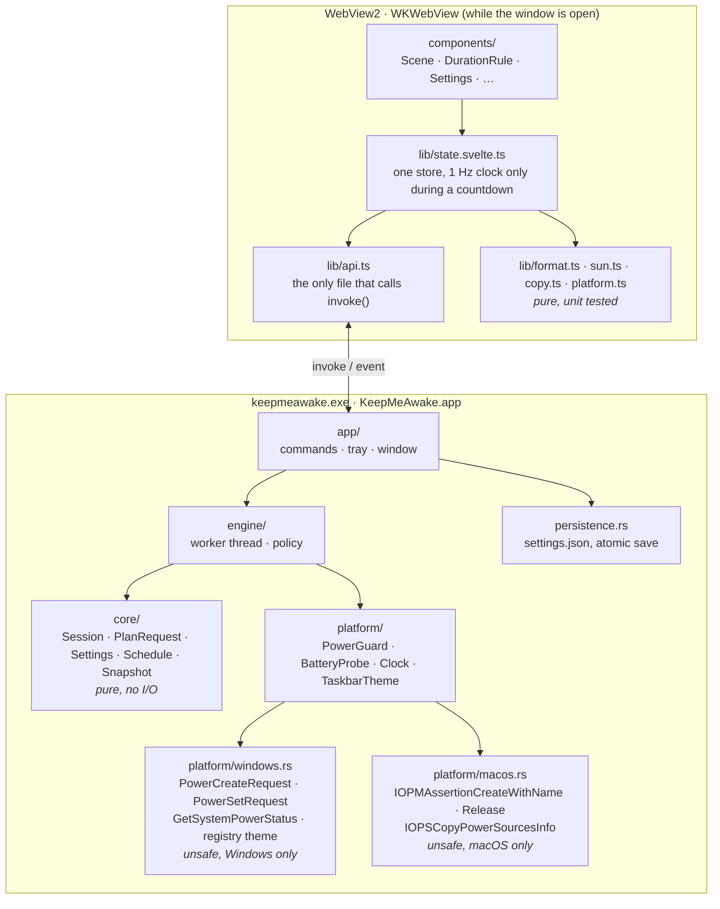
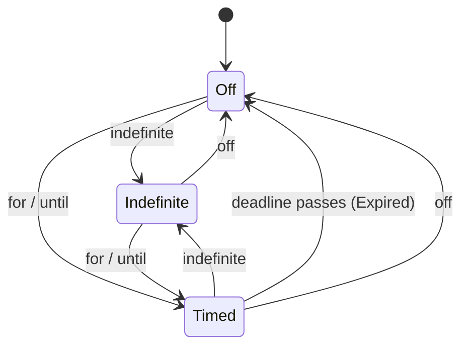
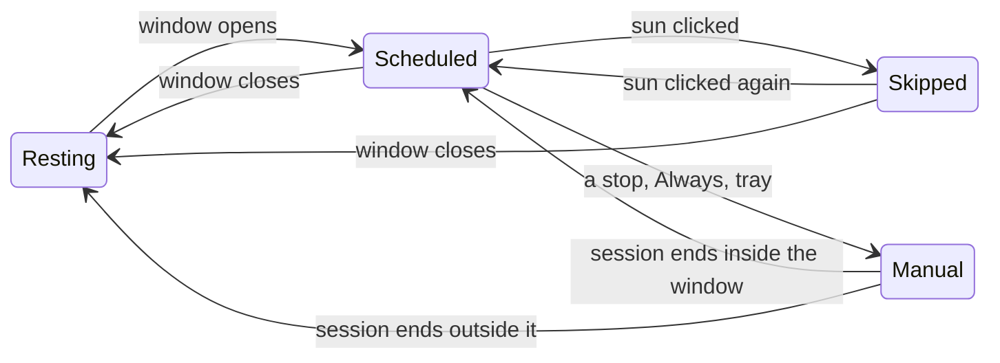
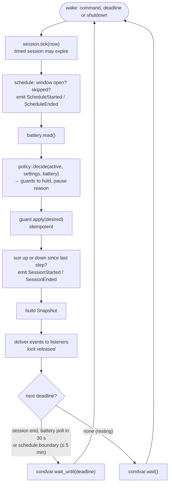
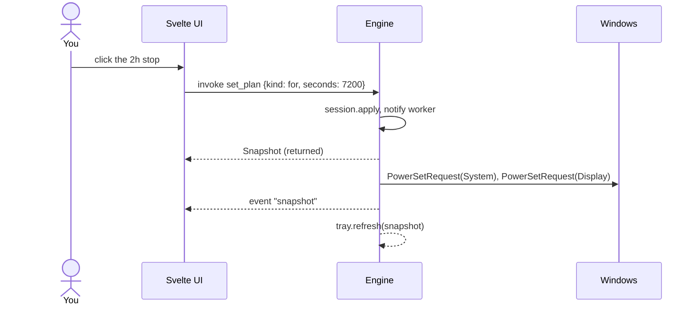
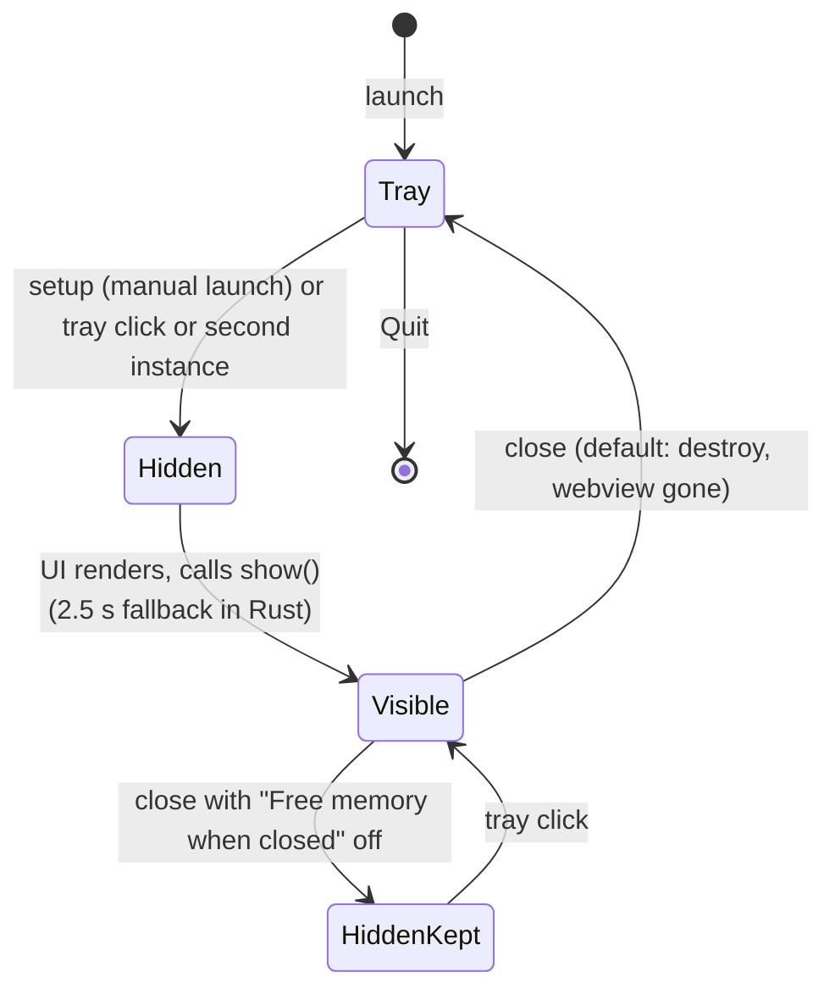

# Architecture

Keep me awake is a [Tauri 2](https://v2.tauri.app) application: a Rust core
that owns all behaviour and a Svelte UI rendered by the system webview
(WebView2 on Windows, WKWebView on macOS) that exists only while the window is
open. Everything above `platform/` is shared between the two.

## Layers

Dependencies point down only: `app → engine → core` and `engine → platform`.
`core` imports nothing from the other layers and performs no I/O; that is what
makes the state machine, the policy and the snapshot trivially testable, and it
is the first thing to check in a review.

### core

| Type          | Role                                                                                                   |
| ------------- | ------------------------------------------------------------------------------------------------------ |
| `PlanRequest` | the only mutation the UI can send: `off`, `indefinite`, `for {seconds}`, `until {unix_ms}`             |
| `Session`     | off, indefinite, or timed with a deadline; remembers when it started and when the current plan was set |
| `Settings`    | versioned, every field defaulted, `sanitized()` clamps ranges                                          |
| `schedule`    | `current_window`, `next_window`, `next_boundary`: pure local-time arithmetic, generic over the zone    |
| `Snapshot`    | everything the UI and tray render, in one message                                                      |

`until` is resolved to `for` against the wall clock before it reaches the state
machine, which only knows monotonic time.

The schedule sits beside the session rather than inside it. The engine
derives a fourth mode, `Scheduled`, when no manual session is on and a window
is open and not skipped. Precedence, highest first: manual session → skip →
schedule → resting.

A skip is stored as the window's end in wall-clock milliseconds, so it lapses
with the window even across sleep.

### platform

Four traits so the engine and the tray never call the OS directly.

| Trait          | Windows                                            | macOS                                                                     | Test double      |
| -------------- | -------------------------------------------------- | ------------------------------------------------------------------------- | ---------------- |
| `PowerGuard`   | `PowerCreateRequest` + `PowerSetRequest` / `Clear` | two IOPMAssertions: `PreventUserIdleSystemSleep`, `…DisplaySleep`         | `FakePowerGuard` |
| `BatteryProbe` | `GetSystemPowerStatus`                             | first source of `IOPSCopyPowerSourcesInfo`; none means mains              | `FakeBattery`    |
| `Clock`        | `Instant::now`, `SystemTime`                       | same                                                                      | `ManualClock`    |
| `TaskbarTheme` | `RegGetValueW` on `SystemUsesLightTheme`           | `DarkTaskbar` (unused: the menu bar icon is a template image macOS tints) | `FakeTaskbar`    |

`unsafe` lives only in `windows.rs` and `macos.rs`, each compiled only on its
own OS. Every block carries a `SAFETY:` comment; clippy's
`undocumented_unsafe_blocks` is `deny`.

`windows.rs` also exposes `wait_for_theme_change`, which blocks in
`RegNotifyChangeKeyValue` on the Personalize key. A thread named
`keepmeawake-theme` loops on it and refreshes the tray, so the icon set
follows the taskbar with no polling.

### engine

One thread, one loop, no polling while idle.

Commands from the UI and tray mutate state under the lock, mark it dirty,
notify the condvar and return the fresh snapshot immediately, so callers never
wait on the worker. The loop re-evaluates instead of waiting when a change
landed while it was delivering events. The thread is named
`keepmeawake-engine`.

With a schedule on and no window open, the wait for the next window is capped
at five minutes: Windows stops counting wait timeouts while the machine
sleeps, and the cap bounds how late a window can be noticed after the lid
opens.

The policy, as a table:

`active` is a manual session, or an open schedule window that was not skipped.

| Session | Schedule               | On mains           | On battery, above threshold | On battery, below threshold | "Pause whenever unplugged" |
| ------- | ---------------------- | ------------------ | --------------------------- | --------------------------- | -------------------------- |
| off     | off, closed or skipped | nothing            | nothing                     | nothing                     | nothing                    |
| off     | window open            | system (+ display) | system (+ display)          | nothing · `LowBattery`      | nothing · `OnBattery`      |
| active  | any (the session wins) | system (+ display) | system (+ display)          | nothing · `LowBattery`      | nothing · `OnBattery`      |

If the OS refuses the request the snapshot says `PowerRequestFailed` rather
than pretending.

The engine also reports each stretch with the sun up exactly once:
`SessionStarted { mode, paused, at_unix_ms }` when it rises and
`SessionEnded { ended, at_unix_ms }` when it sets, including on quit.
`SunsetSoon { ends_at_unix_ms, secs_left }` comes once per deadline when a
timed session reaches its warning (`policy::sunset_warning_at`); the worker
wakes for it, and `Engine::extend` re-arms it by moving the deadline. A
`State::awake` flag holds what was last reported, so a startup plan or a
window already open at launch is reported too. `Ended` is `Timer`, `Schedule`
or `User`, or `Battery` if the stretch was still paused for the battery as it
ended.

### app

`app/mod.rs` builds the Tauri app. Plugins in order: single-instance (must be
first), autostart (passes `--hidden`), opener, notification, global-shortcut,
log. `setup` loads settings and the session log (marking an entry left open by
the last run as `sleep`), starts the engine with its listener already
attached (`Engine::start_with`, so the first events are heard), creates the
tray, registers the hotkey (`app/hotkey.rs`), and opens the window unless
launched hidden. The listener writes session events to the log
(`app/history.rs`, saved as each stretch starts and ends), refreshes the
tray, emits `snapshot` to the window and hands the other events to
`app/notify.rs` for toasts.
`RunEvent::ExitRequested` with no exit code (the last window closed) is vetoed
so the app lives in the tray.

## IPC

| Command           | Arguments              | Returns                                                                                 |
| ----------------- | ---------------------- | --------------------------------------------------------------------------------------- |
| `get_snapshot`    |                        | `Snapshot` (also re-reads battery)                                                      |
| `set_plan`        | `request: PlanRequest` | `Snapshot`                                                                              |
| `toggle_session`  |                        | `Snapshot`; skips or resumes an open schedule window                                    |
| `skip_schedule`   |                        | `Snapshot`                                                                              |
| `resume_schedule` |                        | `Snapshot`                                                                              |
| `update_settings` | `settings: Settings`   | `Snapshot`, or an error string if the file could not be saved or the hotkey was refused |
| `quit_app`        |                        |                                                                                         |
| `extend_session`  |                        | `Snapshot`: a timed session's end moved 30 minutes later                                |
| `get_history`     |                        | `History`: the session log, oldest entry first                                          |
| `clear_history`   |                        | `History` (empty), also written to disk                                                 |

Field names are `snake_case` on both sides and cross the boundary untouched.
`src/lib/types.ts` mirrors `core` one to one; a test on each side pins the
JSON shape, because a mismatch here would be silent.

## Window lifecycle

The window is declared with `create: false` and built on demand. During
`setup` it is created directly on the main thread; from tray and plugin
callbacks it is created on a spawned thread on Windows, because creating
windows from a synchronous event handler can deadlock there, and queued with
`run_on_main_thread` on macOS, because AppKit wants windows made on the main
thread itself.

On macOS the app runs with `ActivationPolicy::Accessory` (no Dock icon, no
Cmd-Tab entry), and a click on the menu bar icon places the window centred
beneath it, inside the work area of that screen, every time
(`core::placement::under_icon`, pure and tested). Windows reopens the window
where it last was.

## Security posture

- Runs as the signed-in user, never elevated.
- No network access. Fonts and assets are bundled. Toasts go to the local
  notification centre; they are sent from Rust, so the webview has no
  notification permission.
- One settings file and one log, per user (see **On disk**).
- A handful of OS calls, one file per OS: on Windows power requests, power
  status, two registry reads and a registry change notification; on macOS
  two power assertions and the power sources snapshot.
- No input is ever sent to other applications. The global hotkey is
  registered from Rust (`RegisterHotKey` on Windows, a Carbon hot key on
  macOS), which only listens, so the webview has no shortcut permission.
- CSP is `default-src 'self'`; the capability file grants only window
  dragging and visibility, autostart toggling, the commands above, and
  opening two allow-listed `https` origins.
- Dependencies are locked (`package-lock.json`, `Cargo.lock`) and bumped by
  Dependabot in grouped PRs.

## On disk

| What      | Windows                                                      | macOS                                                                   |
| --------- | ------------------------------------------------------------ | ----------------------------------------------------------------------- |
| Settings  | `%APPDATA%\dev.bajpai.keepmeawake\settings.json`             | `~/Library/Application Support/dev.bajpai.keepmeawake/settings.json`    |
| Log       | `%LOCALAPPDATA%\dev.bajpai.keepmeawake\logs\keepmeawake.log` | `~/Library/Logs/dev.bajpai.keepmeawake/keepmeawake.log`                 |
| History   | `%APPDATA%\dev.bajpai.keepmeawake\history.json`              | `~/Library/Application Support/dev.bajpai.keepmeawake/history.json`     |
| Autostart | `HKCU\Software\Microsoft\Windows\CurrentVersion\Run`         | a LaunchAgent plist in `~/Library/LaunchAgents/`, written by the plugin |

---

_Keep me awake · [Akshay Bajpai](https://akshaybajpai.com)_
