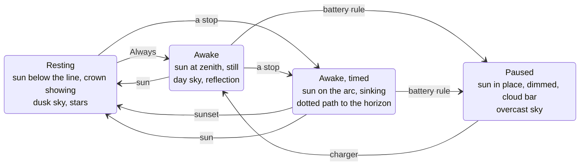

# Design

The app has one job and one state. The interface is built so that the state is
legible from across the room and nothing on screen is decoration.

## The horizon

The face of the app is a landscape: a sky, a line, the ground. A sun sits
above the line while the machine is kept awake and below it while it rests. A
timed session is a sunset: the sun starts at its zenith and travels a quarter
circle to the horizon, arriving exactly when the session ends. A dotted arc
shows the path still to go.

This is not a metaphor laid over a dashboard; it is the status display.

The sun is also the toggle. Its hit target is a real `<button>` positioned
over it, so keyboard users and screen readers get a button named "Keep awake"
or "Let it sleep" rather than an SVG.

## Palette

Two palettes, **Paper** and **Night**, both built from warm neutrals. There is
one accent, the sun, and nothing else in the UI is coloured. Switches, active
stops and the primary button are ink on paper, not accent on white; that is
what keeps the sun the brightest thing on screen.

| Token          | Paper     | Night     | Used for                             |
| -------------- | --------- | --------- | ------------------------------------ |
| `--paper`      | `#f4f0e7` | `#0f1216` | window background                    |
| `--paper-2`    | `#ebe6da` | `#161b21` | code chips, secondary surfaces       |
| `--ink`        | `#1c1b18` | `#ebe4d6` | text, the horizon line, active state |
| `--ink-2`      | `#5f5b52` | `#a79f91` | secondary text                       |
| `--ink-3`      | `#9a948a` | `#6d685f` | tertiary text, inactive stops        |
| `--sun`        | `#dca544` | `#e3b458` | the sun, afterglow, lit stars        |
| `--sky-on`     | `#dfe8ea` | `#1f2a38` | sky while awake                      |
| `--sky-off`    | `#cfd5d8` | `#131920` | sky while resting                    |
| `--sky-paused` | `#d5d3cd` | `#1b1e23` | sky while paused                     |

No gradients. Depth comes from three stepped bands of afterglow above the
line (the sun's colour at 10–16% opacity, like a risograph) and a static
film-grain overlay (`feTurbulence`, 8% multiply on Paper, 5% screen on Night)
that is rendered once and composited.

Theme follows Windows by default; Settings offers Paper and Night by name.

## Type

| Face                | Where                                   | Why                                                    |
| ------------------- | --------------------------------------- | ------------------------------------------------------ |
| Fraunces (variable) | the status word, the wordmark, whispers | one voice with character, used in exactly three places |
| Segoe UI Variable   | everything else                         | native to Windows 11, perfect at 12–13 px              |

Fraunces is bundled (latin subset, upright and italic, 150 KB together) and
set at `opsz 72`, `SOFT 50`. Tabular numerals wherever a number can change.
No icon font: the few icons are 1.3 px stroked SVG paths drawn to a 16 px grid.

## Layout

380 × 600 by default, frameless, custom 40 px title bar. Top to bottom:

1. **Title bar**: wordmark in italic Fraunces; settings, minimise, close. The
   close button is red only on hover, the one concession to platform habit.
2. **Scene**: 380 × 240, scales with width, capped at 440.
3. **Status**: the word (Resting / Awake / Paused) and one line of detail.
   Whispers (tips, easter eggs) briefly replace the detail in italic.
4. **Rule**: durations as stops on a hairline. The active stop has a filled
   dot and a doubled tick. "Until…" opens an inline time field.
5. **Rows**: the two switches people flip daily.

Everything else is behind the gear, in a pane that slides in from the right
and uses the same Row primitive with switches, a two-arrow stepper for lists
and a segmented control for three-way choices. No dropdowns, no modals.

Spacing is a 4 px grid with 24 px side margins. Hairlines are 1 px at 14% ink.
Radii: 6 px for controls, 10 px for surfaces.

## Motion

| Thing              | Duration | Easing                     |
| ------------------ | -------- | -------------------------- |
| sun travel, sky    | 720 ms   | `cubic-bezier(.4,0,.2,1)`  |
| pane slide         | 320 ms   | `cubic-bezier(.2,.7,.2,1)` |
| hover, switch knob | 140 ms   | standard                   |

The sun moves on `transform` only. `prefers-reduced-motion` zeroes all three.

## Copy

Short, lower-case where Windows is, no exclamation marks. States are named for
what the laptop is doing ("Resting", "Awake"), not what the app is doing. Hints
explain consequences, never restate the label. All copy that is more than a
label lives in `src/lib/copy.ts` and is tested for length and tone.

## Hidden things

They exist so the app rewards curiosity without cluttering the surface. Each
is harmless, discoverable by touching the scene, and never required.

| Touch                  | Happens                                                        |
| ---------------------- | -------------------------------------------------------------- |
| the horizon line       | a tip, nine in rotation                                        |
| a star (resting)       | it lights in sun colour; the seventh draws the constellation   |
| the reflection (awake) | the water ripples                                              |
| the wordmark           | a credit line                                                  |
| 00:00–05:00            | the awake line gains "It is late. The sun will hold the line." |

## Decided against

| Idea                     | Why not                                                           |
| ------------------------ | ----------------------------------------------------------------- |
| Mica / acrylic window    | the scene paints its own sky; translucency fights it              |
| a big primary button     | the sun is the button; a second one would make the sun decorative |
| chips for durations      | a rule reads as an instrument and uses a quarter of the height    |
| accent-coloured controls | one accent, used once                                             |
| toasts in 0.1            | a sunset you can see is enough; on the roadmap behind a setting   |

---

_Keep me awake · [Akshay Bajpai](https://akshaybajpai.com)_
