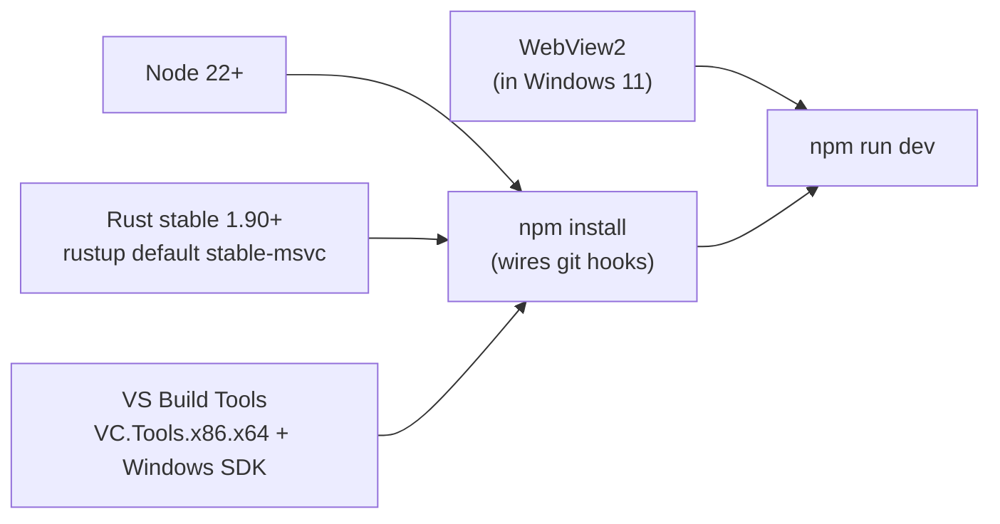
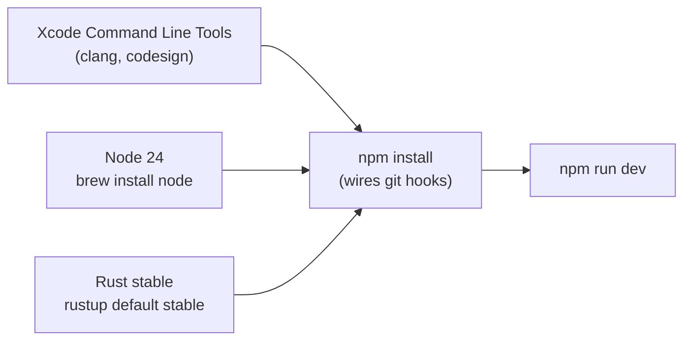
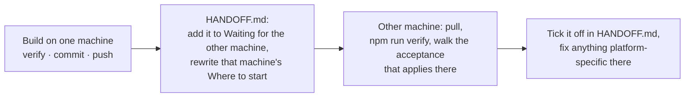
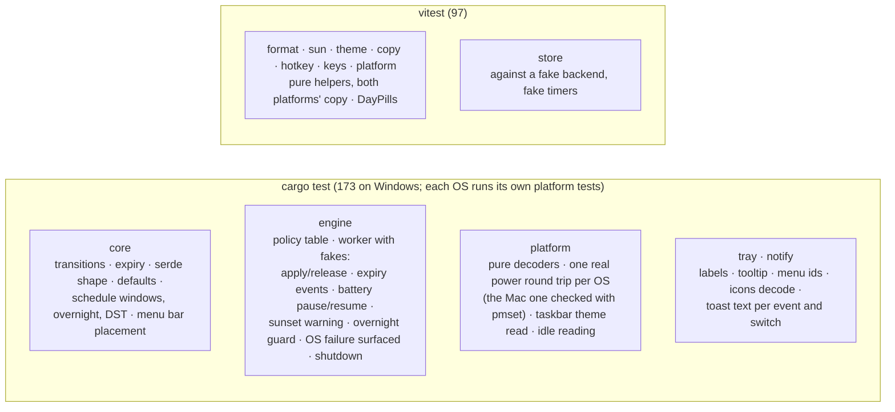

# Development

How this repository is worked on: setup, the daily loop, the house style and
how things are tested. If something here drifts from reality, fixing the doc
is part of the change.

## Setup (Windows)



```powershell
winget install OpenJS.NodeJS.LTS
winget install Rustlang.Rustup ; rustup default stable-msvc
winget install Microsoft.VisualStudio.2022.BuildTools --override "--quiet --wait --add Microsoft.VisualStudio.Component.VC.Tools.x86.x64 --add Microsoft.VisualStudio.Component.Windows11SDK.26100"
npm install
npm run dev     # first Rust build takes a few minutes
```

Editor: VS Code with the extensions in `.vscode/extensions.json`.

## Setup (macOS)



```sh
xcode-select --install
brew install node rustup
# Homebrew's rustup is keg-only: put its shims on PATH (and in ~/.zshrc),
# or cargo is missing from npm scripts and the git hooks.
export PATH="/opt/homebrew/opt/rustup/bin:$PATH"
rustup default stable
npm install
npm run dev     # first Rust build takes a few minutes
```

For screenshots and for driving the menu bar from a script, give your
terminal **Screen Recording** and **Accessibility** in System Settings →
Privacy & Security; without them `screencapture` fails with "could not
create image from display" and System Events cannot click the menu bar.
`brew install librsvg` provides `rsvg-convert`, used to export the template
icons and the DMG background from `design/`.

Platform code lives in `src-tauri/src/platform/macos.rs` (see
[`specs/macos.md`](specs/macos.md)). Everything else is shared, so a change to
`core`, `engine` or the UI must still pass `npm run verify` on both machines.

| Task                  | Windows                                                              | macOS                                                                                |
| --------------------- | -------------------------------------------------------------------- | ------------------------------------------------------------------------------------ |
| Prove the app holds   | `powercfg /requests` (elevated)                                      | `pmset -g assertions`                                                                |
| Kill a stray build    | `taskkill /IM keepmeawake.exe /F`                                    | `pkill -x KeepMeAwake`                                                               |
| Screenshot the window | CDP: `Page.captureScreenshot`                                        | `screencapture -o -l<id> shot.png`, `<id>` from the snippet below (Screen Recording) |
| Inspect the webview   | `WEBVIEW2_ADDITIONAL_BROWSER_ARGUMENTS=--remote-debugging-port=9222` | right-click → Inspect Element (debug builds)                                         |
| Settings file         | `%APPDATA%\dev.bajpai.keepmeawake\`                                  | `~/Library/Application Support/dev.bajpai.keepmeawake/`                              |
| Log                   | `%LOCALAPPDATA%\dev.bajpai.keepmeawake\logs\`                        | `~/Library/Logs/dev.bajpai.keepmeawake/`                                             |

The window id for `screencapture` comes from CoreGraphics; the app is not
scriptable, so AppleScript cannot give it:

```sh
swift -e 'import CoreGraphics; let l = CGWindowListCopyWindowInfo(.optionOnScreenOnly, kCGNullWindowID) as! [[String: Any]]; print(l.first { ($0["kCGWindowOwnerName"] as? String)?.lowercased() == "keepmeawake" && ($0["kCGWindowLayer"] as? Int) == 0 }?["kCGWindowNumber"] ?? "")'
```

## Two machines, one `main`

Development happens on both a Windows PC and a Mac, each pushing small
commits to `main`. Most of the code is shared, so a change made on one
machine reaches both platforms, and each platform has to see it working.



| Rule                              | In practice                                                                                                                    |
| --------------------------------- | ------------------------------------------------------------------------------------------------------------------------------ |
| Pull before you start             | `git pull`, then read [`HANDOFF.md`](HANDOFF.md)                                                                               |
| Built here is not done everywhere | a feature built on the Mac is checked on Windows before it ships, and the other way round                                      |
| Docs move with the code           | guide, architecture, roadmap, changelog and specs change in the same series of commits as the behaviour                        |
| The handoff is the baton          | at the end of every session, update **Waiting for the other machine** and **Where to start** for both machines, then push      |
| Platform work stays in its lane   | `platform/` and `cfg` blocks; shared files (`core`, `engine`, `copy.ts`, the docs) are where conflicts appear, so commit small |

## Daily commands

| Command             | Does                                                                   |
| ------------------- | ---------------------------------------------------------------------- |
| `npm run dev`       | Vite dev server + `tauri dev`. UI hot-reloads; Rust rebuilds on save.  |
| `npm run verify`    | What CI runs: lint, type-check, UI tests, clippy, Rust tests.          |
| `npm run lint`      | ESLint (0 warnings) and Prettier check. `npm run format` to fix.       |
| `npm run check`     | `svelte-check` with the strict tsconfig.                               |
| `npm test`          | Vitest once; `npm run test:watch` for watch mode.                      |
| `npm run lint:rust` | `cargo clippy --all-targets -D warnings` and `cargo fmt --check`.      |
| `npm run test:rust` | `cargo test`.                                                          |
| `npm run build`     | Release build plus NSIS and MSI installers (`.app` and `.dmg` on Mac). |

Rust-only loops are faster from `src-tauri`: `cargo test`, `cargo clippy`.

## Layout

| Path                      | Holds                                                              |
| ------------------------- | ------------------------------------------------------------------ |
| `.githooks/`              | pre-commit (prettier, eslint, rustfmt on staged files), commit-msg |
| `.github/`                | CI, release workflow, templates, Dependabot                        |
| `design/`                 | SVG sources for icons; regenerate with `tauri icon`                |
| `docs/`                   | this folder; `adr/` for decisions                                  |
| `legacy/`                 | the original script, kept as a souvenir                            |
| `src/`                    | Svelte UI                                                          |
| `src/lib/api.ts`          | the only file that calls `invoke()`                                |
| `src/lib/types.ts`        | mirrors of the Rust core types; keep in sync                       |
| `src/lib/*.ts`            | pure helpers, each with a `.test.ts` beside it                     |
| `src/lib/copy.ts`         | every piece of UI text that is more than a label                   |
| `src/lib/components/`     | one component per file, styles scoped inside                       |
| `src/styles/`             | `tokens.css` (palette, type, motion), `base.css` (reset)           |
| `src-tauri/src/core/`     | pure domain, no I/O                                                |
| `src-tauri/src/platform/` | OS traits; `windows.rs` and `macos.rs` hold the only `unsafe`      |
| `src-tauri/src/engine/`   | worker thread and policy                                           |
| `src-tauri/src/app/`      | Tauri shell: commands, tray, window                                |
| `src-tauri/capabilities/` | IPC permissions; keep minimal                                      |
| `src-tauri/icons/`        | generated; do not hand-edit                                        |

## Style

### Rust

- Edition 2024, `rustfmt` per `rustfmt.toml`. Clippy `pedantic` is on and CI
  treats warnings as errors; an `#[allow]` needs a comment saying why.
- `unsafe` only in `platform/windows.rs` and `platform/macos.rs`, every block
  with a `SAFETY:` comment.
- Public items are documented. Doc comments say what and why, not how.
- `thiserror` enums at the platform boundary; `Result<_, String>` only at the
  Tauri command boundary.
- No `unwrap` / `expect` outside tests. Prefer `let … else`.
- `log`: `info` for state changes, `warn` for degraded-but-recovered,
  `error` for things the user will notice.

### TypeScript and Svelte

- Svelte 5 runes only; no `svelte/store`.
- `strict`, `noUncheckedIndexedAccess`, `exactOptionalPropertyTypes`.
- One component per file; styles scoped; tokens from `tokens.css`, never raw
  colours in components.
- Pure logic lives in `src/lib/*.ts`, not in components, so it is testable
  without a DOM.
- Field names that cross IPC stay `snake_case`.

### Commits

[Conventional Commits](https://www.conventionalcommits.org), checked by the
`commit-msg` hook. Subject ≤ 72 characters.

```
feat(engine): pause below the battery threshold
fix(tray): rebuild menu after settings change
docs(design): explain why there are no gradients
```

Scopes: `core`, `platform`, `engine`, `app`, `tray`, `ui`, `brand`, `docs`,
`ci`, `build`, `deps`. Small commits, each buildable, each about one thing.
Linear history on `main`.

### Changes that touch settings

Fields must default, so adding one needs no migration. If a field changes
meaning, bump `SETTINGS_VERSION` and migrate in `persistence.rs`.

## Testing



Rules: a bug fix comes with the test that would have caught it. Tests with
fakes never sleep for fixed times; they wait on a condition with a bounded
timeout (`wait_for_guard` in `engine/mod.rs`).

## Debugging

| Need                  | Do                                                                                                                                   |
| --------------------- | ------------------------------------------------------------------------------------------------------------------------------------ |
| see the log           | dev builds log at `debug` to stdout and the file; release at `info`                                                                  |
| prove the request     | `powercfg /requests` (elevated) lists "KeepMeAwake is keeping this PC awake"; on a Mac `pmset -g assertions` lists "…this Mac awake" |
| inspect the UI        | right click → Inspect in dev builds                                                                                                  |
| reset settings        | delete the JSON file                                                                                                                 |
| screenshot the window | see `docs/assets/`; captured with a PowerShell `CopyFromScreen` helper                                                               |

## Working with an AI assistant

`CLAUDE.md` at the root gives Claude Code these conventions in a form it reads
automatically. Keep the two in step.

---

_Keep me awake · [Akshay Bajpai](https://akshaybajpai.com)_
