# Field guide

Everything the app can do, including the parts that are not labelled.

## The window

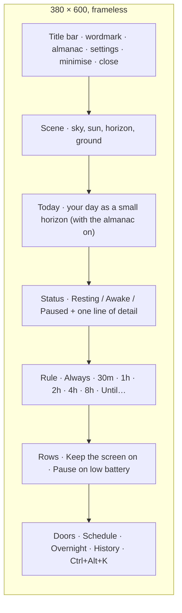

### Scene

| Element      | Click                     | Means                                                                      |
| ------------ | ------------------------- | -------------------------------------------------------------------------- |
| Sun          | toggles awake / resting   | above the line: awake; below it: resting; dimmed with a bar across: paused |
|              | during a schedule window  | skips the rest of the window; click again to come back to it               |
| Horizon line | shows a tip               | there are ten; they cycle                                                  |
| Stars        | lights one (resting only) | find all seven                                                             |
| Reflection   | ripples (awake only)      |                                                                            |
| Dotted arc   |                           | the path the sun still has to travel in a timed session                    |

### Status

The word is what the laptop is doing: **Resting**, **Awake**, **Paused**. The
line under it says until when, or why it is paused. Between midnight and five
in the morning the awake line adds a second sentence.

| State                     | Word    | Line                                                          |
| ------------------------- | ------- | ------------------------------------------------------------- |
| resting                   | Resting | `Your laptop sleeps as usual.`                                |
| resting, schedule waiting | Resting | `Your laptop sleeps as usual. Awake again at 9:00 am.`        |
| always                    | Awake   | `Until you say otherwise, or 6h untouched.`                   |
| always, guard off or kept | Awake   | `Until you say otherwise.`                                    |
| always, nobody around     | Awake   | `Nobody here for 6 hours. Resting at 3:12 am.` **Keep it up** |
| timed                     | Awake   | `Until 5:30 pm · 1h 30m left`                                 |
| timed, sunset near        | Awake   | `The sun sets in 5 minutes.` **Give it another 30m**          |
| schedule window           | Awake   | `Until 6:00 pm · on schedule`                                 |
| window skipped            | Resting | `Skipping today's schedule until 6:00 pm.`                    |
| paused                    | Paused  | `Holding off while battery is low.`                           |
| always, quiet at night    | Awake   | `Away for the night. Sleeping at 3:12 am.` **Keep it up**     |
| set with the night        | Resting | `Asleep for the night. Always resumes when you return.`       |

When the next window is further off than tomorrow the line names the day:
`Awake again at 9:00 am on Monday.`

**Sunset warning.** A few minutes before a timed session ends (5 by default,
Settings → Waking → **Warn before sunset**: Off · 2m · 5m · 10m), the line
turns to `The sun sets in 5 minutes.` and ends with a link, **Give it another
30m**, which moves the end 30 minutes later; the warning comes again before
the new end. The tray (the menu bar on a Mac) has the same item, and a toast
says it if the window is closed. Only timed sessions, only when the timer
is longer than the warning (a 2-minute timer never warns), and not while a
schedule window that lasts longer than the timer is open, since the sun
stays up when the timer ends.

**Overnight guard.** Always is the easiest session to forget, so its line
says how it can end: `Until you say otherwise, or 6h untouched.` When an
Always session has had no keyboard, mouse or trackpad input for 6 hours
(Settings → Waking → **Overnight guard**: Off · 4h · 6h · 8h), the sun asks
once: the line turns to `Nobody here for 6 hours. Resting at 3:12 am.` with
a link, **Keep it up**; the tray (the menu bar on a Mac) gains the same item
and a toast says it if the window is closed. Then, within ten minutes:

| Happens                         | Result                                                                           |
| ------------------------------- | -------------------------------------------------------------------------------- |
| any input                       | the question goes away quietly; the 6 hours start again                          |
| **Keep it up** (window or tray) | `Kept up. It will not ask again this time.`; the line drops the 6h until it ends |
| nothing                         | the session ends, the laptop sleeps as usual, history: `idle`                    |

The guard only reads how long since the last input; it never sends any.
Timers and schedule windows end on their own and are never asked about. A
paused Always session is guarded too, since it would resume on the charger.
A machine that cannot say how long it has been idle is never stopped.

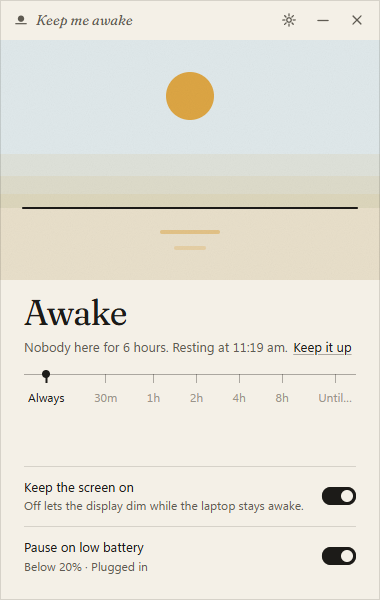 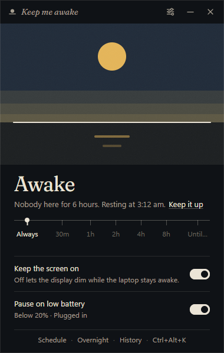

### Schedule

One window of time on chosen days, set in Settings → Schedule. While it is
open the sun rises on its own and sets as the window closes, exactly like a
timed session; outside it the laptop sleeps as usual. Overnight windows
(10:00 pm until 6:00 am) belong to the day they start on.

| You do                         | Happens                                                      |
| ------------------------------ | ------------------------------------------------------------ |
| nothing                        | awake inside the window, resting outside it                  |
| click the sun inside a window  | `Skipped until 6:00 pm.` Resting until the window closes     |
| click it again                 | `Back on schedule.`                                          |
| pick a stop or Always          | that session wins, and is not cut short when the window ends |
| a session ends inside a window | the schedule takes over without letting go                   |
| launch inside a window         | starts awake                                                 |

 

### Rule

Stops are durations measured from now. **Always** has no end. **Until…** opens
a time field; the time is today if still ahead, otherwise tomorrow. The active
stop carries a dot; while a custom time is set the last stop reads
"Until 5:30 pm".

### Rows

| Row                  | On                                           | Off                                 |
| -------------------- | -------------------------------------------- | ----------------------------------- |
| Keep the screen on   | display and system are both held             | display may dim; system stays awake |
| Pause on low battery | below 20% the sun pauses; resumes on charger | battery level is ignored            |

The hint under the battery row shows the live reading ("Plugged in · 100%").

### Doors

The line at the foot, `Schedule · Overnight · History · Ctrl+Alt+K`, opens
Settings at that section: the schedule, the overnight guard (in Waking),
the log of when the sun was up, and the hotkey, which shows the combination
it is set to (`Hotkey` when it is off; `⌥⌘K` on a Mac). Hover one for what
is behind it. When an update is ready the line leads with it,
`Update 0.3.1`, opening About, and the hotkey door makes room. The settings
button in the title bar (the sliders) opens Settings where you left it. The
line hides when the window is shorter than 560 px.

### Today

With the almanac on, Home shows your day beside the laptop's: under the
scene, today as a small horizon (the same strip the Almanac draws), and
beside the status word today's hours, `4h 58m`, or `Leave`. Either opens the
Almanac. Both stay current while the sun is up and whenever the window comes
back into view. The first time a day reaches the length of your working
hours, Home whispers it once: `A full day: 9h 02m.` The strip gives way
when the window is shorter than 560 px.

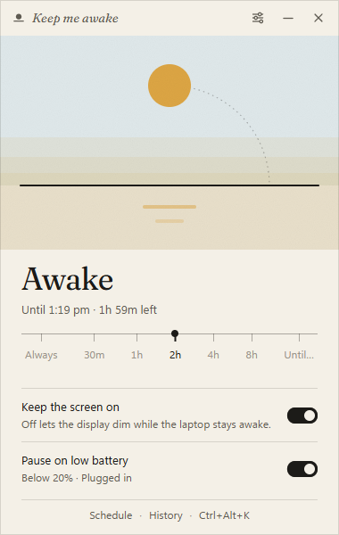 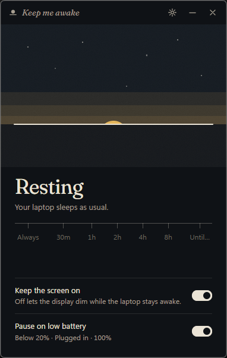

## Almanac

The open book in the title bar. A book of your days at this machine: how
long you worked, which days you took off, and when the keys went quiet at
night. It is on by default and reads one thing, once a minute: how long
since the last keyboard, mouse or trackpad input. Nothing is typed, nothing
is sent anywhere, and it works the same with the sun up or down.

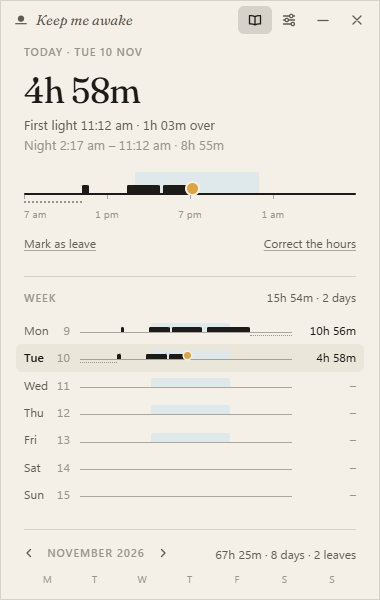 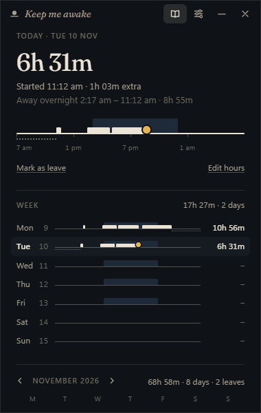

| Part      | Shows                                                                                                   |
| --------- | ------------------------------------------------------------------------------------------------------- |
| The day   | `4h 29m`, or a word: `Leave`, `Rest`, `Nothing`, `Ahead`                                                |
| Detail    | `Started 11:39 am · ended 2:17 am · 2h 47m extra`; then `Night 2:17 am – 11:12 am · 8h 55m`             |
| The strip | the day as a small horizon; see below                                                                   |
| The week  | seven smaller strips, Monday first, with each day's total; click one to read it                         |
| The month | a calendar: a bar under a day worked (longer for a longer day), a ring for leave, the sun on today      |
| The tally | the year's leaves and days worked; `Usual night` once three nights are known                            |
| The foot  | **Working days and hours…** opens Settings → Almanac; **Clear the almanac** empties it, no confirmation |

Reading a strip:

| Mark                      | Means                                                      |
| ------------------------- | ---------------------------------------------------------- |
| the band of sky           | your working hours (working days only)                     |
| ink on the line           | you were here; a break under ten minutes does not split it |
| ink outside the band      | time over: before hours, after hours, or on a day off      |
| the dotted run underneath | the night, at whichever end of the day it falls            |
| the sun                   | now, on today                                              |

The **night** is read backwards: it is the quiet between the last touch of
one day and the first touch of the next, so nothing is asked and nothing is
guessed as it happens. That is why it is found with the sun on **Always**
(the laptop never slept, but the keys did go quiet) exactly as it is with
the laptop asleep. On the first open after a night, Home whispers it once:
`A quiet night: 2:17 am to 11:12 am.`

| A quiet is a night when                           | So                                          |
| ------------------------------------------------- | ------------------------------------------- |
| it lasts 3 to 16 hours                            | an afternoon out, or a weekend away, is not |
| at least 2 hours of it fall in your resting hours | the 10 hours opposite your working hours    |
| a touch under 2 minutes inside it is looked past  | a nudged mouse at 3 am is not a morning     |

It says "night" and "quiet", never that you slept: it knows when the keys
went quiet, not what you did.

A **day** does not end at midnight. It turns over opposite the middle of
your working hours (1 am for 9 to 6, 7 am for 3 pm to midnight), so work
that runs late stays on the day it began.

**Leave**: the link under the strip marks the day being read, **Mark as
leave** or **Not a leave**. Days still to come can be marked, and show as a
ring ahead. A past working day with nothing in it reads as leave on its own
(switch that off on a machine you rarely use), and a day with under five
minutes in it is not a day's work.

What never counts as leave:

| Day                                   | Reads as  | Why                                                                                             |
| ------------------------------------- | --------- | ----------------------------------------------------------------------------------------------- |
| not one of your **Working days**      | `Day off` | your weekend, however long: set the days in Settings → Almanac                                  |
| a working day you never actually work | `Day off` | empty on that weekday in three or more of the weeks around it, in weeks you did work other days |
| before the almanac's first day        | nothing   | it was not keeping count yet                                                                    |
| a day you marked **Not a leave**      | nothing   | you said so                                                                                     |

The second row is for a week that does not match the setting: if Working
days says Monday to Friday and you have not worked a Friday in weeks, Fridays
stop counting as leave without your changing anything. A whole week away
still reads as leave, and so does one missed Friday among worked ones.

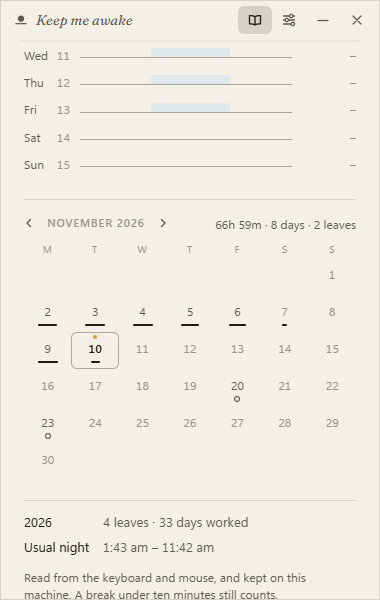 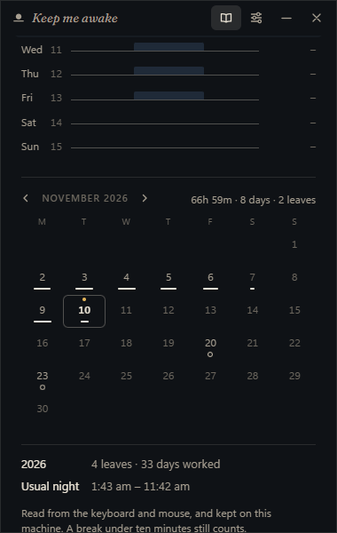

**Putting a day right.** What is read from the keys can be wrong: a day
worked on another machine, a meeting with the laptop shut, an evening that
was not work. Everything can be set by hand, on any day, past or to come:

| Link, under the day's strip | Does                                                                       |
| --------------------------- | -------------------------------------------------------------------------- |
| **Mark as leave**           | the day is leave, whatever was typed on it                                 |
| **Not a leave**             | the day is not leave, though it is an empty working day                    |
| **Edit hours**              | two time fields, From and Until; **Save** sets the day to that one stretch |
| **Nobody here**             | in the editor: nobody was at the machine that day                          |
| **Undo my edit**            | in the editor, on a day set by hand: back to what the keys said            |

A day set by hand says so (`Set by you: 3:00 pm – 12:30 am`), and its night
follows it. Nothing that was read is thrown away: a correction stands in
front of it and can be taken off again.

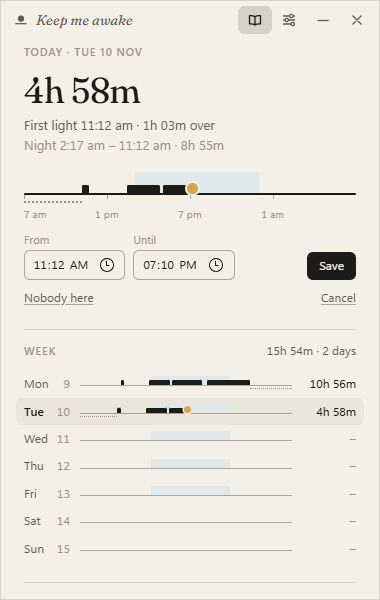 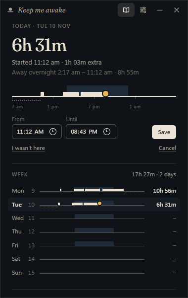

**Sleep when I'm away** (Settings → Almanac; off unless you ask): lets an **Always**
session follow your night. Once the keys have been quiet for the time you
choose, inside your resting hours, the sun asks as the overnight guard asks
(`Away for the night. Sleeping at 3:12 am.`, with **Keep it up**), and ten
minutes later it sets, so the laptop can sleep. At your next touch it rises
again, back on Always, without being asked. Turning the sun on or off by
hand cancels that, and so does a day with nobody back.

Every automatic thing here has a switch: keeping the almanac at all, an
empty working day reading as leave, the morning whisper, and Sleep when I'm away.

**Copy month as CSV**, at the foot, puts the open month on the clipboard, a
row a day: date, what the day read as, minutes worked and over, first and
last touch, the night, and whether it was set by hand.

It lives in `almanac.json` beside the settings, keeps 400 days, and is
written as a stretch begins, two minutes after the keys go quiet, every
quarter hour while you work, and on quit. What it cannot know: whether what
you did at the keyboard was work, and a meeting taken without touching the
laptop for more than ten minutes reads as a break.

## AI

Off until you turn it on, locked until you give it a key, and built to cost
next to nothing. Four things in the app are easier said than set, and a
language model does those four, only when asked. Which model is yours to
choose: Claude, OpenAI, or any other service.

| Feature                 | Where                             | You click      | It sends                               | You get                                       |
| ----------------------- | --------------------------------- | -------------- | -------------------------------------- | --------------------------------------------- |
| **The day, in a line**  | Almanac, under the month          | Read this day  | the one day being read                 | one sentence on it                            |
| **This week, in words** | Almanac, under the month          | Read this week | that week, one line a day              | two or three sentences                        |
| **Ask the almanac**     | Almanac, under the month          | Ask            | your question and the month in view    | an answer in a sentence or two                |
| **Tell the sun**        | Home, with **Until…** on the rule | Ask            | the sentence you typed, and local time | `Awake for 2 hours`, then **Start** or **No** |

They are always there, under a small `AI` chip that says where things
stand, and each has its own switch beside its name:

| The chip says                       | Means                                    | To change it                        |
| ----------------------------------- | ---------------------------------------- | ----------------------------------- |
| a lock, `Locked: needs an API key.` | no key has been added                    | **Add a key** opens Settings → AI   |
| `AI is switched off.`               | there is a key; the master switch is off | **Switch it on**, right there       |
| nothing more                        | ready; each feature shows what it sends  | a feature's own switch turns it off |

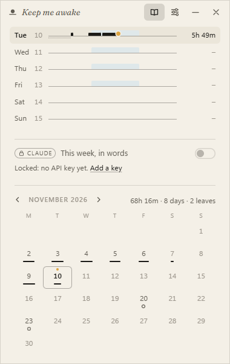 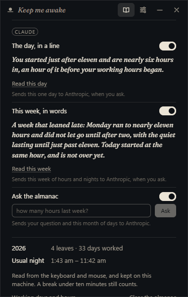

**Which service.** Settings → **AI** → **Service**:

| Service    | Asked through                         | Model when none is named | Key from                |
| ---------- | ------------------------------------- | ------------------------ | ----------------------- |
| **Claude** | Anthropic's Messages API              | `claude-haiku-5-5`       | `console.anthropic.com` |
| **OpenAI** | Chat Completions                      | `gpt-5.4-nano`           | `platform.openai.com`   |
| **Other**  | the same chat format, at your address | none: you name it        | the service you chose   |

**Other** is any service that speaks the OpenAI chat format: OpenRouter,
Gemini's compatible endpoint, Groq, Mistral, or a model on this machine
(Ollama at `http://localhost:11434/v1`, where any text will do for the key).
The address must be `https`, or plain `http` only to this machine, so a key
is never sent in the clear. Each service keeps its own key; choosing another
never sends it the first one's.

**What it costs.** Every request asks the service's smallest model unless
you name another, and is capped: a line, or a few sentences, never more.
With Claude, thinking is switched off as well, so nothing is paid for but
the answer. The largest thing the app can ask, a question about a whole
month, comes to about a thirtieth of a cent with Claude Haiku at the list
price when this was written. Asking the same thing twice in a session is
answered from memory and costs nothing. Nothing is ever asked on the app's
own initiative. A model you name yourself costs what that model costs: one
that reasons before it answers may spend the cap on reasoning and return
nothing, so pick a small, direct one.

Settings → **AI** also has the master switch (**Use AI**), the model, the
key, and every feature's switch again. The key is your own and asking is
billed to it. It is typed once and kept in Windows Credential Manager or the
macOS Keychain: not in the settings file, and never shown again, only
**Remove it**.

**Hide AI**, at the foot of that section, takes every one of these out of
sight, on Home and in the Almanac. What is left is one row in Settings →
Claude with one button, **Enable AI**. It is off by default.

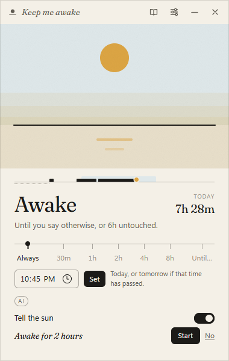 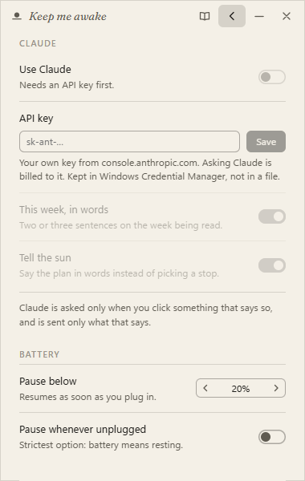

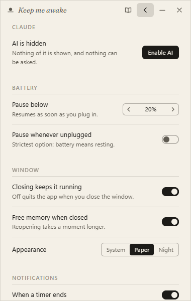

## Keyboard

| Windows    | macOS    | Does                                                                      |
| ---------- | -------- | ------------------------------------------------------------------------- |
| Space      | Space    | toggle awake / resting                                                    |
| Ctrl+Alt+K | ⌥⌘K      | toggle from any app, window open or not (recordable in Settings → Hotkey) |
| Esc        | Esc      | back from settings or the almanac, else close to the tray or menu bar     |
|            | ⌘W       | close to the menu bar                                                     |
|            | ⌘M       | minimise                                                                  |
|            | ⌘Q       | quit                                                                      |
| Ctrl+,     | ⌘,       | settings                                                                  |
| Tab / ←→   | Tab / ←→ | move between stops and controls                                           |

## Tray and menu bar

On Windows the sun lives in the tray. On a Mac it lives in the menu bar, and
the app has no Dock icon and no place in Cmd-Tab: it is a menu bar app.

| Action                        | Does                                                                      |
| ----------------------------- | ------------------------------------------------------------------------- |
| click (left click on Windows) | open the window; on a Mac it drops down centred beneath the menu bar icon |
| right click                   | status line · Keep awake / Let it sleep · Keep awake for ▸ · Open · Quit  |
|                               | while a schedule window is open: Skip today's schedule / Back on schedule |
|                               | near the end of a timer: Give it another 30m                              |
|                               | while the overnight guard asks: Keep it up                                |
|                               | when an update is ready: `Update ready: 0.3.1` under the status line      |
| hover                         | tooltip with the same status line as the menu                             |

Icon states: sun above the line (awake), sun set (resting), bar across the sun
(paused). On Windows the icons follow the taskbar theme: white on a dark
taskbar, ink on a light one, switching within a second when Windows changes
mode. On a Mac they are template images, which macOS tints for a light or
dark menu bar itself. Nothing to set.

## Settings

| Section       | Setting                            | Notes                                                                               |
| ------------- | ---------------------------------- | ----------------------------------------------------------------------------------- |
| Startup       | Launch at sign-in                  | registers under the current user; starts hidden                                     |
|               | Open the window at launch          | only applies when you start it yourself                                             |
|               | Begin as                           | Resting · Awake · Default length                                                    |
| Waking        | Default length                     | what the sun, tray toggle and Space use. Always, or a stop                          |
|               | Warn before sunset                 | Off · 2m · 5m · 10m before a timer ends; 5m by default                              |
|               | Overnight guard                    | Off · 4h · 6h · 8h without input before Always asks, then rests; 6h                 |
|               | Keep the screen on                 | same switch as on the home pane                                                     |
| Schedule      | Keep a schedule                    | awake during these hours, resting outside them. Off by default                      |
|               | Days                               | Monday first; weekdays by default                                                   |
|               | From / Until                       | 9:00 am until 6:00 pm by default; overnight is fine; the same time twice is all day |
| Almanac       | Keep an almanac                    | days, hours and nights, from your input. On by default; see Almanac above           |
|               | Working days                       | Monday first; weekdays by default                                                   |
|               | Working hours                      | 9:00 am until 6:00 pm by default; past midnight is fine                             |
|               | Count missed working days as leave | on by default; off on a machine you rarely use. Weekends and days off never count   |
|               | Morning whisper                    | the morning's whisper; on by default                                                |
|               | Break reminder                     | Off · 1h · 90m · 2h at the machine without five minutes away; off by default        |
|               | Sleep when I'm away                | Off · 30m · 1h · 2h of quiet at night before Always sets; off by default            |
| AI            | Use AI                             | the master switch; off by default, and locked without a key                         |
|               | Service                            | Claude · OpenAI · Other (any service in the OpenAI chat format)                     |
|               | Model                              | empty for the service's smallest; or name one                                       |
|               | Address                            | for Other: `https://…/v1`, or `http://localhost…`                                   |
|               | API key                            | your own; kept in the OS credential store, never shown again                        |
|               | This week, in words                | its own switch, also beside the feature in the Almanac                              |
|               | Tell the sun                       | its own switch, also beside the feature on Home                                     |
|               | The day, in a line                 | its own switch, also beside the feature in the Almanac                              |
|               | Ask the almanac                    | its own switch, also beside the feature in the Almanac                              |
|               | Hide AI                            | off by default; on, only an Enable AI button is left                                |
| Battery       | Pause below                        | Off, or 10–50%                                                                      |
|               | Pause whenever unplugged           | strictest: on battery means resting                                                 |
| Window        | Closing keeps it running           | off quits on close                                                                  |
|               | Free memory when closed            | destroys the UI on close (default); off hides it for an instant reopen              |
| Theme         |                                    | System, Paper, Night and twenty-four more; see Themes below                         |
| Notifications | When a timer ends                  | a toast when a timed session sets on its own. On by default                         |
|               | Battery pauses and resumes         | when the battery rule pauses the sun, and when the charger brings it back           |
|               | Schedule starts and ends           | when a schedule window opens or closes                                              |
| Hotkey        | Hotkey                             | `Ctrl+Alt+K` by default. Change records a new one; Off removes it                   |
| History       |                                    | the last 30 times the sun was up; see below                                         |
| Tips          |                                    | the keyboard and tray table                                                         |
| About         | Check for updates automatically    | once a day, from GitHub; on by default. See Updates below                           |
|               |                                    | version, how it works, author, Source, Quit                                         |

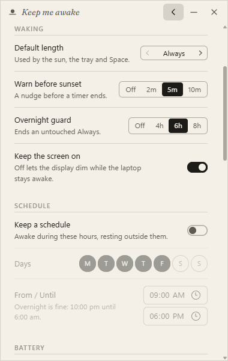 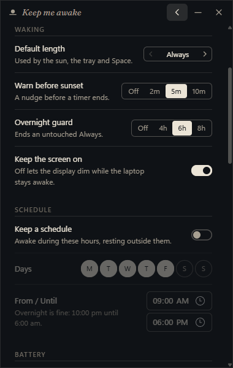

 

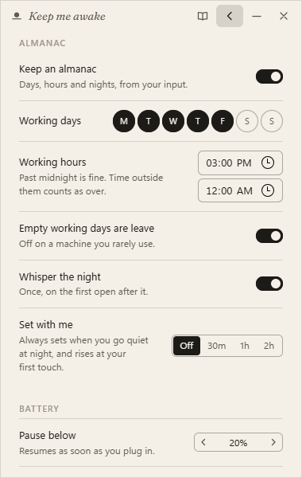 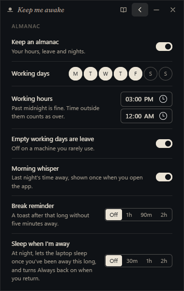

## Themes

Settings → Theme. Each swatch is a small horizon in that theme's colours;
click one to wear it, or walk them with the arrow keys. **Back to System** returns to Paper by day and Night
by night. A theme changes colours only.

| Shelf    | Themes                                                                                    |
| -------- | ----------------------------------------------------------------------------------------- |
| Its own  | System (follows Windows or macOS), Paper, Night                                           |
| Borrowed | Solarized Light, Solarized Dark, Gruvbox, Nord, Dracula, Catppuccin, Tokyo Night, Monokai |
| Play     | Terminal, Blueprint, Pocket, Newsprint, Risograph, Dial-up, Mars, Deep Sea                |
| Loud     | Vaporwave, Thermal, Negative, Miami, Bubblegum, Highlighter, Grape Soda, Hi-Vis           |

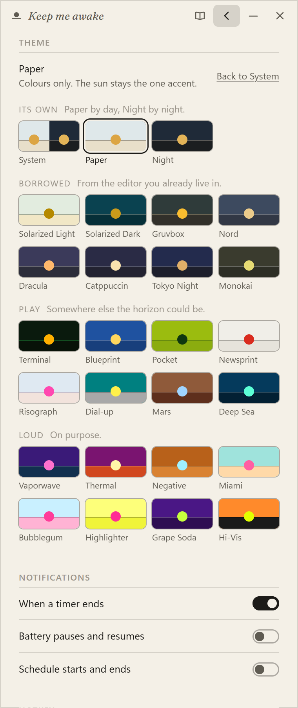

## History

Settings → History answers "did it actually stay up?". Each row is one
stretch with the sun up, newest first, at most 30 shown (200 are kept):

| Column | Shows                                                            |
| ------ | ---------------------------------------------------------------- |
| day    | `Today`, `Yesterday`, else `Tue 3 Nov`                           |
| span   | when it rose and set, in local time; `–` for an end it never had |
| length | `2h 28m`, `9h`, `5m`                                             |
| ended  | how it ended, or `now` while it runs                             |

| Ended      | Means                                                                             |
| ---------- | --------------------------------------------------------------------------------- |
| `you`      | you set the sun: the sun, the rule, the tray or menu bar, the hotkey, or quitting |
| `timer`    | a timed session ran out                                                           |
| `schedule` | the schedule window it belonged to closed                                         |
| `battery`  | it was paused for the battery and never resumed before it ended                   |
| `idle`     | the overnight guard let it go: hours without input, and nobody answered           |
| `sleep`    | it never ended cleanly: the machine slept or shut down, or the app was killed     |

Pauses show as a thin inset line under their row:
`paused 12:10 pm – 12:40 pm · battery`. Changing the plan mid-stretch (from
Always to 2h, say) is the same row. **Clear history** empties it at once, with
no confirmation: it is a log, not data. It lives in `history.json` beside the
settings and is read only when Settings opens.

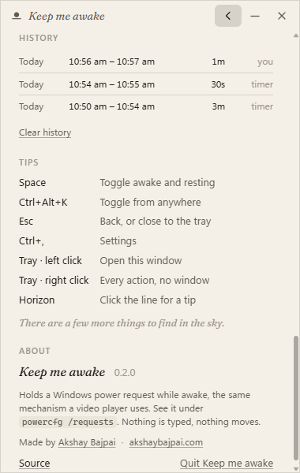 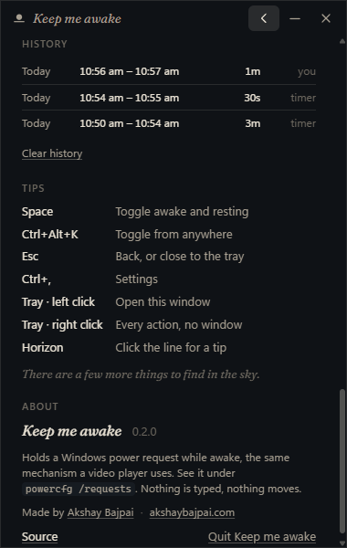

The app does not yet notice the machine sleeping (0.4 on the roadmap). A
timer or window that ran out while the lid was shut is logged as ending when
it was due, but a machine that sleeps and wakes inside the next window shows
one row across both days.

## Notifications

Quiet Windows toasts for the moments that matter while the window is closed,
each behind its own switch in Settings → Notifications. Nothing is shown
while the window is open and focused; the status line already says it.

| Moment           | Title                    | Body                                                                                   | Default                   |
| ---------------- | ------------------------ | -------------------------------------------------------------------------------------- | ------------------------- |
| timer ended      | `The sun has set`        | `Resting now. 2h 00m, as asked.`                                                       | on                        |
| sunset near      | `The sun sets soon`      | `In 5 minutes. Give it another 30m from the tray or the window.`                       | on, with the timer switch |
| nobody around    | `Nobody around`          | `No input for 6 hours. Resting at 3:12 am unless you're back.`                         | on, with the guard        |
| a long stretch   | `Time for a break`       | `90 minutes without a break.`                                                          | off; Settings → Almanac   |
| quiet at night   | `Away for the night`     | `The laptop will sleep at 3:12 am unless you're back. Always resumes when you return.` | with Sleep when I'm away  |
| battery paused   | `Paused for the battery` | `Holding off at 18%. Plug in to resume.`                                               | off                       |
| battery resumed  | `Back up`                | `Charger connected. The sun is up again.`                                              | off                       |
| schedule started | `On schedule`            | `Awake until 6:00 pm.`                                                                 | off                       |
| schedule ended   | `Off schedule`           | `Resting until 9:00 am.`                                                               | off                       |

A toast is skipped when it would no longer be true: no "Resting now" if a
schedule window took over, no schedule toasts while your own session hides
the change.

 

## Hotkey

`Ctrl+Alt+K` (on a Mac, `⌥⌘K`) does what the sun does, from any app, with the
window open or closed: the tray or menu bar icon changes and nothing opens.
Settings → Hotkey shows the combination with **Change** and **Off**. Change
listens for the next keys you press with at least one of Ctrl, Alt or Win (on
a Mac ⌘, ⌃ or ⌥) (`Press keys…`), shows them as you hold them and saves when
you let go; Esc cancels. A Mac shows the combination in glyphs, in the order
its menus use. If another app or the system already owns the combination
(`⌘Space`, say), the old one stays and the window says
`That combination is already taken.`

The hotkey is registered with the OS (`RegisterHotKey` on Windows, a Carbon
hot key on macOS), which only listens. Nothing is ever typed into other
applications.

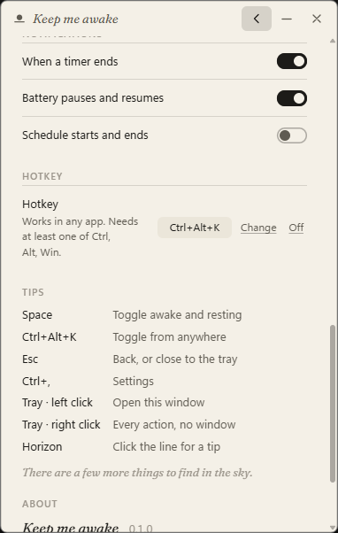 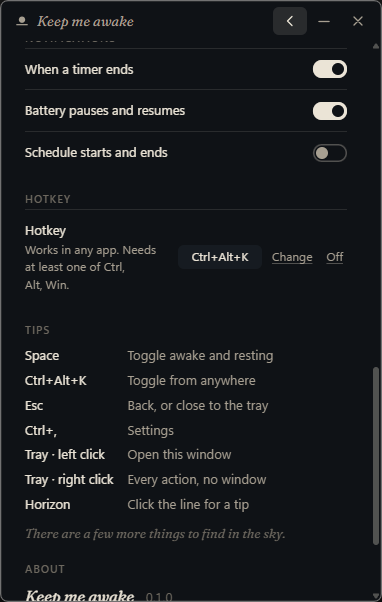

## Updates

The app looks for a newer release on GitHub about half a minute after
launch, then once a day, and whenever you open the window if it has not
looked in the last hour (Settings → About → **Check for updates
automatically**, on by default; off, it never looks on its own).
**Check for updates** in Settings → About looks right now, whatever the
switch says, and answers `You're up to date.` when there is nothing newer.

A release cannot announce itself to the app the instant it is published:
that would need a server pushing to it, and the app has none. Looking when
the window opens is what makes a new release show up the next time you
look. Checking never installs anything: an update that is found stays
shown as available, in all the places below, until you choose to install
it.

| When                         | Where                                                                      |
| ---------------------------- | -------------------------------------------------------------------------- |
| a newer release is found     | Home's line leads with `Update 0.3.1`; the tray adds `Update ready: 0.3.1` |
| the next time a window opens | once per version, a whisper: `A new version is up: 0.3.1.`                 |
| Settings → About             | `Update available: 0.3.1 · Install and restart`                            |
| you click it                 | `Downloading… 42%` over a hairline, then it installs and opens the new one |

Every update is signed; one whose signature does not match the key built
into the app is refused. On Windows the installer runs on its own, without
questions, and the app comes back by itself. Only full releases are offered:
pre-releases are never pushed to anyone. 0.3.0 is the first release that
updates itself; a copy older than that is updated by installing once by hand. An offline check
is not an error and says nothing; it tries again the next day.

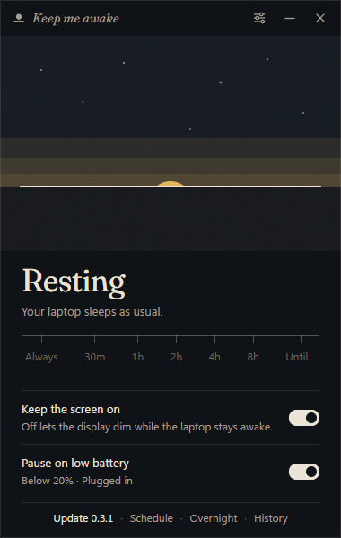 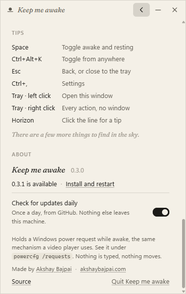

## Where things are

| What      | Windows                                                      | macOS                                                                |
| --------- | ------------------------------------------------------------ | -------------------------------------------------------------------- |
| Settings  | `%APPDATA%\dev.bajpai.keepmeawake\settings.json`             | `~/Library/Application Support/dev.bajpai.keepmeawake/settings.json` |
| Log       | `%LOCALAPPDATA%\dev.bajpai.keepmeawake\logs\keepmeawake.log` | `~/Library/Logs/dev.bajpai.keepmeawake/keepmeawake.log`              |
| Autostart | `HKCU\Software\Microsoft\Windows\CurrentVersion\Run`         | a LaunchAgent in `~/Library/LaunchAgents/`                           |
| Proof     | `powercfg /requests` (elevated) while awake                  | `pmset -g assertions` while awake                                    |

## When it will not hold

- Lid closed, power button, Start → Sleep: Windows releases every request on
  purpose. That is correct.
- Modern Standby laptop on battery: Windows terminates system requests five
  minutes after the sleep timeout. Plug in, or accept it.
- Always, with nobody at the keyboard for the overnight guard's hours: the
  sun asks, and ten minutes later lets the machine sleep. Keep it up, or
  turn the guard off in Settings → Waking, for an unattended all-nighter.
- "Paused: Windows refused the request": something blocked
  `PowerCreateRequest`; check the log.
- Mac lid closed with no external display: macOS sleeps regardless of any
  assertion, by design. With a display, power and a keyboard attached
  (clamshell mode) it stays up.
- "Paused: macOS refused the request": IOKit turned the assertion down;
  check the log for the `IOReturn` code.

## Installing on a Mac

The Mac build is signed ad hoc but not notarized yet, so macOS asks once
before the first open. Drag the sun to Applications from the disk image and
open it; macOS says it cannot check the app for malicious software. Then:

| macOS         | Do, once                                                                                     |
| ------------- | -------------------------------------------------------------------------------------------- |
| 15 and later  | System Settings → Privacy & Security, scroll to **KeepMeAwake was blocked**, **Open Anyway** |
| 12 to 14      | right-click **KeepMeAwake** in Applications → **Open** → **Open**                            |
| any, Terminal | `xattr -d com.apple.quarantine /Applications/KeepMeAwake.app`                                |

It runs on macOS 12 or later on Apple Silicon. An Intel Mac needs a universal build
(`npm run build -- --target universal-apple-darwin`); the releases do not
include one yet.

---

_Keep me awake · [Akshay Bajpai](https://akshaybajpai.com)_
