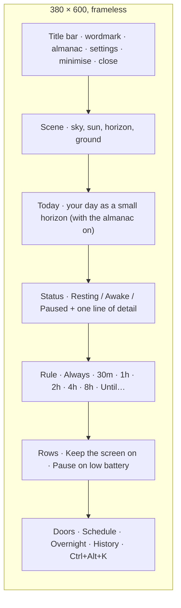
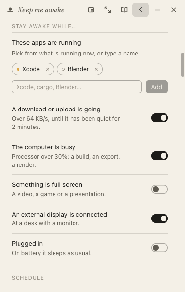
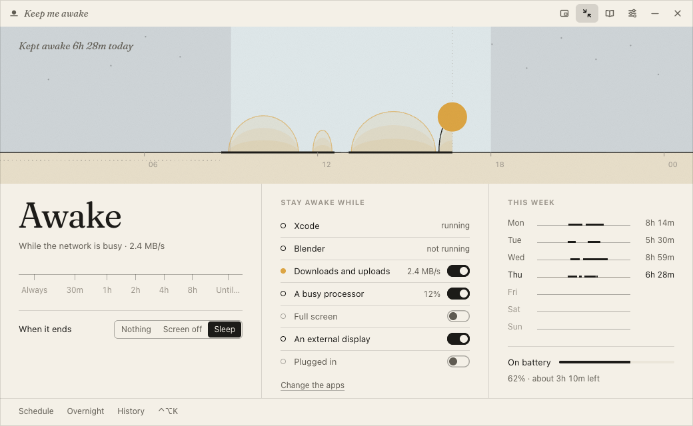
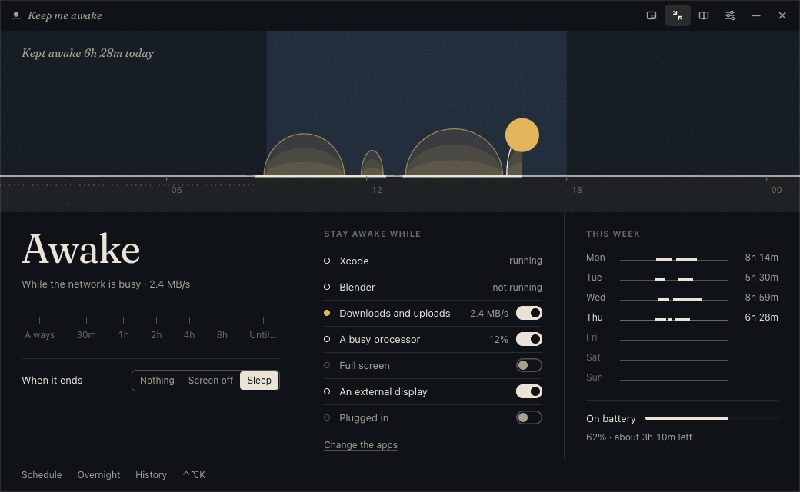
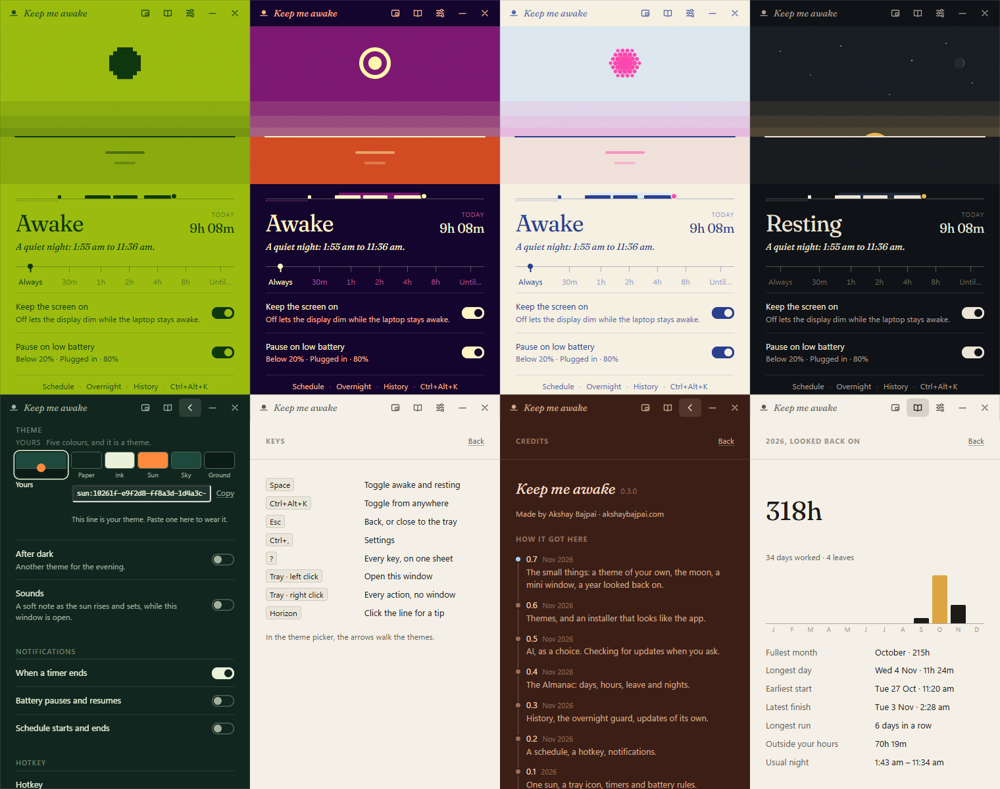
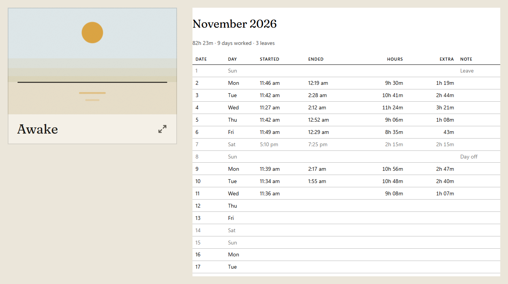

# Field guide

Everything the app can do, including the parts that are not labelled.

## The window

### Scene

| Element      | Click                         | Means                                                                                                     |
| ------------ | ----------------------------- | --------------------------------------------------------------------------------------------------------- |
| Sun          | turns staying awake on or off | above the line: awake; below it: resting, so the laptop sleeps as usual; dimmed with a bar across: paused |
|              | during scheduled hours        | skips the rest of today's schedule; click again to go back to it                                          |
| Horizon line | shows a tip                   | there are ten, one per click                                                                              |
| Stars        | lights one (resting only)     | find all seven                                                                                            |
| Reflection   | ripples (awake only)          |                                                                                                           |
| Dotted arc   |                               | on a timer: the path the sun still has to travel, so how much time is left                                |

### Status

The word under the sun says what the laptop is doing:

| Word        | Means                                                                             |
| ----------- | --------------------------------------------------------------------------------- |
| **Awake**   | the app is keeping your laptop awake                                              |
| **Resting** | the app is doing nothing; your laptop sleeps as its own settings say              |
| **Paused**  | it would be keeping the laptop awake, but is holding off, usually for the battery |

The line under the word says until when, or why it is paused. Between
midnight and 5 am the awake line adds
`It is late. Your laptop will stay awake.`

| State                                   | Word    | Line                                                                 |
| --------------------------------------- | ------- | -------------------------------------------------------------------- |
| resting                                 | Resting | `Your laptop sleeps as usual.`                                       |
| resting, with a schedule set            | Resting | `Your laptop sleeps as usual. Awake again at 9:00 am.`               |
| Always                                  | Awake   | `Until you turn it off, or 6h with no input.`                        |
| Always, overnight guard off or answered | Awake   | `Until you turn it off.`                                             |
| Always, no input for hours              | Awake   | `No input for 6h. Sleeps at 3:12 am.` **I'm here**                   |
| on a timer                              | Awake   | `Until 5:30 pm · 1h 30m left`                                        |
| on a timer, near the end                | Awake   | `Ends in 5 minutes.` **Add 30 minutes**                              |
| during scheduled hours                  | Awake   | `Until 6:00 pm · on schedule`                                        |
| today's schedule skipped                | Resting | `Skipping today's schedule until 6:00 pm.`                           |
| paused                                  | Paused  | `Not keeping awake while battery is low.`                            |
| Always, away at night                   | Awake   | `Away for the night? Sleeps at 3:12 am.` **I'm here**                |
| asleep while you are away               | Resting | `Sleeping while you are away. Always comes back on when you return.` |

When the next scheduled start is later than tomorrow, the line names the day:
`Awake again at 9:00 am on Monday.`

**A warning before a timer ends.** A few minutes before a timer runs out (5
by default; Settings → Staying awake → **Timer warning**: Off · 2m · 5m ·
10m), the line changes to `Ends in 5 minutes.` with a link,
**Add 30 minutes**, which pushes the end back by half an hour; you are warned
again before the new end. The tray (the menu bar on a Mac) shows the same
item, and a notification says it if the window is closed. It only warns for
timers, only when the timer is longer than the warning (a 2-minute timer
never warns), and not when a schedule will keep the laptop awake past the
timer's end anyway.

**Overnight guard.** Always is the easiest setting to forget, so its line
says how it can end: `Until you turn it off, or 6h with no input.` If an
Always session sees no keyboard, mouse or trackpad input for 6 hours
(Settings → Staying awake → **Overnight guard**: Off · 4h · 6h · 8h), it
asks once whether you are still there. The line changes to
`No input for 6h. Sleeps at 3:12 am.` with a link, **I'm here**; the tray
(the menu bar on a Mac) gains an item, **I'm here, stay awake**, and a
notification, `Still there?`, asks if the window is closed. Then, within ten
minutes:

| Happens                       | Result                                                                                         |
| ----------------------------- | ---------------------------------------------------------------------------------------------- |
| any input                     | the question goes away quietly, and the 6 hours start again                                    |
| **I'm here** (window or tray) | `Staying awake. It will not ask again this time.`; the line drops the 6h until you turn it off |
| nothing                       | Always turns off, the laptop sleeps as usual, and History records `idle`                       |

The guard only checks how long it has been since your last input; it never
creates any. Timers and schedules end on their own, so it never asks about
them. A paused Always session is watched too, since plugging in would start
it again. If the system cannot say how long it has been idle, the guard
never turns anything off.

 

### Schedule

Set hours on chosen days, in Settings → Schedule. During those hours the
laptop is kept awake without your clicking anything, and the sun goes down
when they end, just as it does for a timer; outside them the laptop sleeps
as usual. Hours that run past midnight (10:00 pm until 6:00 am) belong to
the day they start on.

| You do                               | Happens                                                             |
| ------------------------------------ | ------------------------------------------------------------------- |
| nothing                              | awake during the scheduled hours, resting outside them              |
| click the sun during scheduled hours | `Skipped until 6:00 pm.` Resting until those hours end              |
| click it again                       | `Back on schedule.`                                                 |
| pick a length or Always              | your choice wins, and is not cut short when the scheduled hours end |
| a timer ends during scheduled hours  | the schedule carries on with no gap                                 |
| launch during scheduled hours        | starts awake                                                        |

 

### Rule

The row of lengths under the status: **Always**, 30m, 1h, 2h, 4h, 8h and
**Until…**. Each length counts from the moment you pick it. **Always** stays
awake until you turn it off. **Until…** opens a time field: a time still
ahead today means today, one already gone means tomorrow. The length in use
has a dot under it; with a time set, the last one reads "Until 5:30 pm".

### Rows

| Row                  | On                                               | Off                                                     |
| -------------------- | ------------------------------------------------ | ------------------------------------------------------- |
| Keep the screen on   | the screen stays on, as well as the laptop       | the screen may dim and turn off; the laptop stays awake |
| Pause on low battery | below 20% it pauses; plugging in starts it again | the battery level is ignored                            |

The hint under the battery row shows the live reading ("Plugged in · 100%");
on battery it says how long the charge will last, as the OS estimates it
(`Below 20% · 62% · about 3h 10m left`).

A Mac mini, an iMac or a desktop PC has no battery, so it is offered no
battery rules at all: no battery row here, no Battery section or battery
notifications in Settings, and no battery tip.

### Doors

Each link in the row at the bottom,
`Schedule · Overnight · History · Ctrl+Alt+K`, opens Settings at that section: the schedule, the overnight
guard (under Staying awake), the history of when the laptop was kept awake,
and the hotkey, shown as the keys it is set to (`Hotkey` when it is off;
`⌥⌘K` on a Mac). Hover over one to see where it goes. When an update is
ready the row starts with `Update 0.3.1`, which opens About, and the hotkey
link makes room. The settings button in the title bar (the sliders icon)
opens Settings where you left it. The row hides when the window is shorter
than 560 px.

### Today

With the Almanac on (see below), Home also shows your own day: under the
sun, a strip of today's hours (the same strip the Almanac draws), and next to
the status word, today's total, `4h 58m`, or `Leave`. Click either to open
the Almanac. Both update while the laptop is kept awake and whenever the
window comes back into view. The first time in a day that your hours reach
the length of your working hours, the status line briefly says so, once:
`A full day: 9h 02m.` The strip hides when the window is shorter than 560 px.

 

## Almanac

The Almanac is a diary of your working days that the app keeps for you. Open
it with the open-book button in the title bar. It shows how long you worked
each day, which days you took off, and when you were away overnight. It is on
by default and checks one thing, once a minute: how long since your last
keyboard, mouse or trackpad input. Nothing is typed, nothing is sent
anywhere, and it works whether or not the app is keeping the laptop awake.

 

| Part      | Shows                                                                                                                                   |
| --------- | --------------------------------------------------------------------------------------------------------------------------------------- |
| The day   | `4h 29m`, or a word: `Leave`, `Day off`, `No activity`, `Upcoming`                                                                      |
| Detail    | `Started 11:39 am · ended 2:17 am · 2h 47m extra`; then `Away overnight 2:17 am – 11:12 am · 8h 55m`                                    |
| The strip | the day drawn as a small horizon; see below                                                                                             |
| The week  | seven smaller strips, Monday first, with each day's total; click one to see that day                                                    |
| The month | a calendar: a bar under each day worked (longer for a longer day), a ring for leave, the sun on today                                   |
| The tally | the year's leave and days worked, with **Year in review**; `Usually away` (your usual hours away overnight) once three nights are known |
| The foot  | **Working days and hours…** opens Settings → Almanac; **Clear the almanac** empties it at once, without asking                          |

Reading a strip:

| Mark                      | Means                                                               |
| ------------------------- | ------------------------------------------------------------------- |
| the band of sky           | your working hours (working days only)                              |
| ink on the line           | you were at the laptop; a break under ten minutes does not split it |
| ink outside the band      | extra time: before hours, after hours, or on a day off              |
| the dotted run underneath | the night away, at whichever end of the day it falls                |
| the sun                   | now, on today                                                       |

**Nights** are worked out afterwards: a night is the gap between your last
input one day and your first input the next. Nothing is asked and nothing is
guessed while it happens. So a night is found just the same when the laptop
was kept awake on **Always** (it never slept, but you stopped typing) as when
it was asleep. The first time you open the app after a night, the status line
briefly shows it, once: `Last night you were away from 2:17 am to 11:12 am.`
This is the **Morning whisper**, and Settings → Almanac can switch it off.

| A gap counts as a night when                      | So                                                  |
| ------------------------------------------------- | --------------------------------------------------- |
| it lasts 3 to 16 hours                            | an afternoon out, or a weekend away, is not a night |
| at least 2 hours of it fall in your resting hours | the 10 hours opposite your working hours            |
| input under 2 minutes inside it is ignored        | a nudged mouse at 3 am does not end the night       |

It says "away", never that you slept: it knows when you stopped using the
keyboard and mouse, not what you did.

A **day** does not end at midnight. It ends halfway round the clock from the
middle of your working hours (1 am for 9 to 6, 7 am for 3 pm to midnight), so
work that runs late stays on the day it began.

**Leave**: the link under the strip marks the day you are looking at, **Mark
as leave**, or, on a day that reads as leave, **Not leave**. Future days can
be marked too, and show as a ring. A past working day with no activity counts
as leave on its own (switch that off on a laptop you rarely use), and a day
with under five minutes of activity does not count as a day's work.

What never counts as leave:

| Day                                   | Reads as  | Why                                                                                                 |
| ------------------------------------- | --------- | --------------------------------------------------------------------------------------------------- |
| not one of your **Working days**      | `Day off` | your weekend, however long: set the days in Settings → Almanac                                      |
| a working day you never actually work | `Day off` | no activity on that weekday in three or more of the weeks around it, in weeks you worked other days |
| before the almanac's first day        | nothing   | it was not keeping count yet                                                                        |
| a day you marked **Not leave**        | nothing   | you said so                                                                                         |

The second row covers a week that does not match the setting: if Working
days says Monday to Friday but you have not worked a Friday in weeks, Fridays
stop counting as leave without your changing anything. A whole week away
still counts as leave, and so does one missed Friday among worked ones.

 

**Correcting a day.** What is worked out from your input can be wrong: a day
worked on another machine, a meeting with the laptop shut, an evening that
was not work. You can set any day by hand, past or future:

| Link, under the day's strip | Does                                                                       |
| --------------------------- | -------------------------------------------------------------------------- |
| **Mark as leave**           | the day is leave, whatever activity it had                                 |
| **Not leave**               | the day is not leave, even though it is an empty working day               |
| **Edit hours**              | two time fields, From and Until; **Save** sets the day to that one stretch |
| **I wasn't here**           | in the editor: you were not at the laptop that day                         |
| **Undo my edit**            | in the editor, on a day set by hand: back to what was recorded             |

A day set by hand says so (`Set by you: 3:00 pm – 12:30 am`), and its night
moves to match. Nothing recorded is thrown away: your correction sits on top
of it, and **Undo my edit** takes it off again.

 

**Sleep when I'm away** (Settings → Almanac; off unless you turn it on) lets
your laptop sleep while you are away at night, even on **Always**. Once there
has been no input for the time you choose, during your resting hours, it asks
the way the overnight guard does (`Away for the night? Sleeps at 3:12 am.`,
with **I'm here**). If nobody answers, ten minutes later it stops keeping the
laptop awake, so it can sleep. When you come back and touch the keyboard or
mouse, Always turns back on by itself. It waits up to a day for you; turning
it on or off yourself in the meantime cancels the wait.

Every automatic part of the Almanac has a switch: keeping the almanac at all,
counting empty working days as leave, the Morning whisper, and Sleep when I'm
away.

**Copy month as CSV**, at the foot, copies the month on screen to the
clipboard, one row a day: date, what the day counts as, minutes worked and
extra, first and last input, the night away, and whether you set it by hand.

It is saved in `almanac.json` beside the settings and keeps 400 days. It is
written when you start working, two minutes after your input stops, every
quarter hour while you work, and when you quit. What it cannot know: whether
what you did at the keyboard was work. A meeting where you do not touch the
laptop for more than ten minutes counts as a break.

## AI

Four optional features use an AI language model, and only when you click
them. **The day, in a line** and **This week, in words** describe a day or a
week from your Almanac in a few plain sentences. **Ask the almanac** answers a
question about your month (`how many hours last week?`). **Tell the sun**
lets you type how long to stay awake (`for 2 hours, or until 6:30 pm`)
instead of picking a length. They are off until you turn them on, locked
until you add a key, and built to cost next to nothing. You choose the
service: Claude, OpenAI, or another.

| Feature                 | Where                           | You click      | It sends                                    | You get                                       |
| ----------------------- | ------------------------------- | -------------- | ------------------------------------------- | --------------------------------------------- |
| **The day, in a line**  | Almanac, under the month        | Read this day  | the day you are looking at                  | one sentence about it                         |
| **This week, in words** | Almanac, under the month        | Read this week | that week, one line a day                   | two or three sentences                        |
| **Ask the almanac**     | Almanac, under the month        | Ask            | your question and the month in view         | an answer in a sentence or two                |
| **Tell the sun**        | Home, after you pick **Until…** | Ask            | the sentence you typed, and your local time | `Awake for 2 hours`, then **Start** or **No** |

They are always shown, under a small `AI` label that says whether they are
ready, and each has its own switch beside its name:

| The label says                      | Means                                      | To change it                        |
| ----------------------------------- | ------------------------------------------ | ----------------------------------- |
| a lock, `Locked: needs an API key.` | no key has been added                      | **Add a key** opens Settings → AI   |
| `AI is switched off.`               | there is a key, but the main switch is off | **Switch it on**, right there       |
| nothing more                        | ready; each feature shows what it sends    | a feature's own switch turns it off |

 

**Which service.** Settings → **AI** → **Service**:

| Service    | Asked through                         | Model when none is named | Key from                |
| ---------- | ------------------------------------- | ------------------------ | ----------------------- |
| **Claude** | Anthropic's Messages API              | `claude-haiku-5-5`       | `console.anthropic.com` |
| **OpenAI** | Chat Completions                      | `gpt-5.4-nano`           | `platform.openai.com`   |
| **Other**  | the same chat format, at your address | none: you name it        | the service you chose   |

**Other** is any service that speaks the OpenAI chat format: OpenRouter,
Gemini's compatible endpoint, Groq, Mistral, or a model on this machine
(Ollama at `http://localhost:11434/v1`, where any text will do for the key).
The address must be `https`, or plain `http` only to this machine, so a key
is never sent in the clear. Each service keeps its own key; choosing another
never sends it the first one's.

**What it costs.** Every request asks the service's smallest model unless
you name another, and is capped: a line, or a few sentences, never more.
With Claude, extended thinking is switched off too, so you pay only for the
answer. The largest thing the app can ask, a question about a whole
month, comes to about a thirtieth of a cent with Claude Haiku at the list
price when this was written. Asking the same thing twice in a session reuses
the first answer and costs nothing. The app never asks anything on its own. A model you name yourself costs what that model costs: one
that reasons before it answers may spend the cap on reasoning and return
nothing, so pick a small, direct one.

Settings → **AI** also has the main switch (**Use AI**), the model, the
key, and every feature's switch again. The key is your own, and each request
is billed to it. It is typed once and kept in Windows Credential Manager or the
macOS Keychain: not in the settings file, and never shown again, only
**Remove it**.

**Hide AI**, at the bottom of that section, hides every AI feature, on Home
and in the Almanac. All that is left is one row in Settings → AI with one
button, **Enable AI**, which brings them back. Hide AI is off by default.

 

## Stay awake while…

Settings → **Stay awake while…** keeps the laptop awake on its own while
something is going on, so there is nothing to remember to switch on.
Everything here is off until you turn it on.

| Row                              | Keeps it awake while                                                    |
| -------------------------------- | ----------------------------------------------------------------------- |
| These apps are running           | any app on the list runs. Pick from what is running, or type a name     |
| A download or upload is going    | more than 64 KB/s moves, and for 2 minutes after it goes quiet          |
| The computer is busy             | the processor is over 30% (a build, an export), and for 2 minutes after |
| Something is full screen         | a video, a game or a presentation fills a screen                        |
| An external display is connected | a monitor is plugged in (laptops only)                                  |
| Plugged in                       | the laptop is on mains power (laptops only)                             |

A dot beside an app is in the sun's colour while it is running. Home says
which condition is keeping it awake: `While Xcode runs`, `While the network
is busy · 2.4 MB/s`. A stop on the rule, Always, or the schedule's hours
come first; a condition takes over when they end.

Clicking the sun while a condition holds lets the laptop sleep until that
condition clears (`Skipping until Xcode quits.`); click again to undo.
History lists each stretch, ending as `condition`.

It looks every 30 seconds, and only at what is switched on; with nothing
on, it looks at nothing.

## When it ends

Settings → Staying awake → **When it ends** decides what happens after a
timer, the schedule's hours or a condition ends on its own:

| Choice     | Windows                           | Mac                                                   |
| ---------- | --------------------------------- | ----------------------------------------------------- |
| Nothing    | the laptop sleeps in its own time | the same                                              |
| Lock       | locks the screen                  | not offered: macOS has no public way to lock          |
| Screen off | turns the screen off              | turns the screen off; locks it if a password is asked |
| Sleep      | puts the laptop to sleep          | puts the Mac to sleep                                 |

It only acts if nobody has touched the keyboard, mouse or trackpad for a
minute, so someone working when the schedule ends at six is left alone. It
never acts when you end it yourself, or when the battery or the overnight
guard ended it. The timer warning says what is coming:
`5 minutes left. Add 30 minutes from the tray or the window. Then it will sleep.`

## The wide window

The title bar's two-corners button (or Ctrl+E, ⌘E on a Mac) opens the
window wide: 1040 × 640, down to 860 × 560. It reopens wide until you go
back with the same button, the shortcut, or Esc.

| Part               | Shows                                                                                                                                                                           |
| ------------------ | ------------------------------------------------------------------------------------------------------------------------------------------------------------------------------- |
| The day            | today across the window. Each time it was kept awake rises from the line as a dome of light, as tall as it was long; the one running now climbs to the sun, which stands at now |
| The sky            | the working hours lit, the rest the resting sky with its stars                                                                                                                  |
| The line           | ink where you were at the machine, the night dotted under it (from the almanac)                                                                                                 |
| Pointing at a dome | when it was, how long, and why it ended                                                                                                                                         |
| Now                | the status, the lengths, and When it ends                                                                                                                                       |
| Stay awake while   | each condition with a dot (off, on, or in the sun's colour when it is the reason), its live reading and its switch                                                              |
| This week          | Monday to Sunday, each a small line with the time kept awake as ink, and its total; the battery and time left                                                                   |

Click the sun in the day to turn staying awake on or off, as on Home.
Settings and the Almanac open as a column under the same sky.

## Command line

The app can be driven from a terminal or a script:

| Command                       | Does                                                                 |
| ----------------------------- | -------------------------------------------------------------------- |
| `keepmeawake --for 2h`        | keep awake for a length: `30m`, `90m`, `1h30m`, or minutes           |
| `keepmeawake --until 18:30`   | until a time today, or tomorrow if it has passed; `6:30pm` works too |
| `keepmeawake --always`        | until turned off                                                     |
| `keepmeawake --off`           | let it sleep                                                         |
| `keepmeawake --toggle`        | what clicking the sun does                                           |
| `keepmeawake --status`        | print what it is doing, or that it is not running                    |
| `keepmeawake --run CMD ARGS…` | keep awake while the command runs; exits with its exit code          |
| `keepmeawake --help`          | the list above                                                       |

A command starts the app (hidden) if it is not running, and never opens
the window. A mistake prints the list and exits with 2.

| Where   | The program                                                                                                                                                                         |
| ------- | ----------------------------------------------------------------------------------------------------------------------------------------------------------------------------------- |
| Mac     | `/Applications/KeepMeAwake.app/Contents/MacOS/keepmeawake`. To type just `keepmeawake`: `ln -s /Applications/KeepMeAwake.app/Contents/MacOS/keepmeawake /usr/local/bin/keepmeawake` |
| Windows | `keepmeawake.exe`, in the folder the setup installed it to (under `%LOCALAPPDATA%`); add that folder to PATH to type just `keepmeawake`                                             |

On Windows the program is a windowed app, so Command Prompt does not wait
for `--run` to finish; in PowerShell, `keepmeawake --run … | Out-Null` waits.

## Keyboard

| Windows    | macOS    | Does                                                                                |
| ---------- | -------- | ----------------------------------------------------------------------------------- |
| Space      | Space    | turn staying awake on or off                                                        |
| Ctrl+Alt+K | ⌥⌘K      | turn it on or off from any app, window open or not (change it in Settings → Hotkey) |
| Esc        | Esc      | back from settings or the almanac, else close to the tray or menu bar               |
|            | ⌘W       | close to the menu bar                                                               |
|            | ⌘M       | minimise                                                                            |
|            | ⌘Q       | quit                                                                                |
| Ctrl+,     | ⌘,       | settings                                                                            |
| Ctrl+E     | ⌘E       | the wide window, and back                                                           |
| ?          | ?        | all keyboard shortcuts, on one sheet                                                |
| Tab / ←→   | Tab / ←→ | move between lengths and controls                                                   |

## Tray and menu bar

On Windows the sun lives in the tray. On a Mac it lives in the menu bar, and
the app has no Dock icon and no place in Cmd-Tab: it is a menu bar app.

| Action                        | Does                                                                                                             |
| ----------------------------- | ---------------------------------------------------------------------------------------------------------------- |
| click (left click on Windows) | opens the window; on a Mac it drops down centred beneath the menu bar icon                                       |
| right click                   | a menu: status line · Keep awake / Let it sleep · Keep awake for ▸ (30m … 8h, Until I turn it off) · Open · Quit |
|                               | during scheduled hours: Skip today's schedule / Back on schedule                                                 |
|                               | near the end of a timer: Add 30 minutes                                                                          |
|                               | while the overnight guard asks: I'm here, stay awake                                                             |
|                               | when an update is ready: `Update ready: 0.3.1` under the status line                                             |
| hover                         | a tooltip with the same status line as the menu                                                                  |

The icon shows the state: the sun above the line (awake), below it
(resting), or with a bar across (paused). On Windows the icons follow the
taskbar: white on a dark taskbar, ink on a light one, switching within a
second when Windows changes mode. On a Mac, macOS tints them to suit a light
or dark menu bar. There is nothing to set.

## Settings

| Section       | Setting                            | Notes                                                                                                           |
| ------------- | ---------------------------------- | --------------------------------------------------------------------------------------------------------------- |
| Startup       | Launch at sign-in                  | registers under the current user; starts in the background, without opening the window                          |
|               | Open the window at launch          | only when you start it yourself, not at sign-in                                                                 |
|               | At launch                          | what to do when the app starts: Resting · Awake · Default length                                                |
| Staying awake | Default length                     | how long a click on the sun, the tray item or Space keeps it awake: Always, or a length                         |
|               | Timer warning                      | Off · 2m · 5m · 10m before a timer ends, so you can add 30 minutes; 5m by default                               |
|               | Overnight guard                    | Off · 4h · 6h · 8h with no input before Always asks if you are there, then lets the laptop sleep; 6h by default |
|               | Keep the screen on                 | the same switch as on Home                                                                                      |
| Schedule      | Keep a schedule                    | stays awake during these hours, on the days you pick; the laptop sleeps as usual outside them. Off by default   |
|               | Days                               | Monday first; weekdays by default                                                                               |
|               | From / Until                       | 9:00 am until 6:00 pm by default; can run past midnight; the same start and end means all day                   |
| Almanac       | Keep an almanac                    | logs your hours from keyboard and mouse. On by default; see Almanac above                                       |
|               | Working days                       | Monday first; weekdays by default                                                                               |
|               | Working hours                      | 9:00 am until 6:00 pm by default; can run past midnight; time outside them counts as extra                      |
|               | Count missed working days as leave | on by default; turn it off on a laptop you rarely use. Weekends and days off never count                        |
|               | Morning whisper                    | when you were away last night, shown once in the morning; on by default                                         |
|               | Break reminder                     | Off · 1h · 90m · 2h at the laptop without a 5-minute break, then a notification; off by default                 |
|               | Sleep when I'm away                | Off · 30m · 1h · 2h with no input at night before Always lets the laptop sleep; off by default                  |
| AI            | Use AI                             | the main switch; off by default, and locked until you add a key                                                 |
|               | Service                            | Claude · OpenAI · Other (any service in the OpenAI chat format)                                                 |
|               | Model                              | leave empty for the service's smallest, or name one                                                             |
|               | Address                            | for Other: `https://…/v1`, or `http://localhost…`                                                               |
|               | API key                            | your own; kept in the OS credential store, never shown again                                                    |
|               | This week, in words                | its own switch, also beside the feature in the Almanac                                                          |
|               | Tell the sun                       | its own switch, also beside the feature on Home                                                                 |
|               | The day, in a line                 | its own switch, also beside the feature in the Almanac                                                          |
|               | Ask the almanac                    | its own switch, also beside the feature in the Almanac                                                          |
|               | Hide AI                            | off by default; on, it hides every AI feature and leaves only an Enable AI button                               |
| Battery       | Pause below                        | Off, or 10–50%                                                                                                  |
|               | Pause whenever unplugged           | the strictest option: on battery, the laptop sleeps as usual                                                    |
| Window        | Closing keeps it running           | off, closing the window quits the app                                                                           |
|               | Free memory when closed            | frees the window's memory when you close it (default); off, it stays hidden for an instant reopen               |
| Theme         |                                    | System, Paper, Night and twenty-four more, an evening theme and sounds; see Themes below                        |
| Notifications | When a timer ends                  | a notification when a timer runs out. On by default                                                             |
|               | Battery pauses and resumes         | when the battery rule pauses it, and when plugging in starts it again                                           |
|               | Schedule starts and ends           | when your scheduled hours begin or end                                                                          |
| Hotkey        | Hotkey                             | `Ctrl+Alt+K` by default. **Change** records a new one; **Off** removes it                                       |
| History       |                                    | the last 30 times it kept the laptop awake; see below                                                           |
| Tips          |                                    | the keyboard and tray shortcuts                                                                                 |
| About         | Check for updates automatically    | once a day, from GitHub; on by default. See Updates below                                                       |
|               |                                    | version, how it works, author, Source, Quit                                                                     |

 

 

 

## Themes

Settings → Theme. Each swatch is a small horizon in that theme's colours:
click one to use it, or move through them with the arrow keys. **Use the
system theme** goes back to System, which shows Paper in light mode and Night
in dark mode. A theme changes the colours and nothing else.

| Shelf    | Themes                                                                                    |
| -------- | ----------------------------------------------------------------------------------------- |
| Standard | System (follows your light or dark mode), Paper, Night                                    |
| Editors  | Solarized Light, Solarized Dark, Gruvbox, Nord, Dracula, Catppuccin, Tokyo Night, Monokai |
| Places   | Terminal, Blueprint, Pocket, Newsprint, Risograph, Dial-up, Mars, Deep Sea                |
| Loud     | Vaporwave, Thermal, Negative, Miami, Bubblegum, Highlighter, Grape Soda, Hi-Vis           |
| Yours    | five colours you pick; see A theme of your own below                                      |

In the same section, **After dark** switches to a different theme in the
evening: pick the **Evening theme** and the **Evening hours**.

## Small things

Extras you never need, but might enjoy.

| Thing                     | Where to find it                                                                                                       |
| ------------------------- | ---------------------------------------------------------------------------------------------------------------------- |
| A sun shaped by its theme | use Pocket (pixels), Thermal (a ring) or Risograph (a halftone dot)                                                    |
| Tonight's moon            | Night, while resting: top right of the sky. Click it for its phase                                                     |
| A shooting star           | a resting sky, about once in thirty openings                                                                           |
| Try before you choose     | point at any swatch in Settings → Theme; the window shows that theme until you move away                               |
| A theme of your own       | Settings → Theme → **Yours**: pick five colours, and copy the one line of text that shares it, or paste someone else's |
| An evening theme          | Settings → Theme → **After dark**: a different theme for the evening, with its hours                                   |
| All keyboard shortcuts    | press **?**                                                                                                            |
| Year in review            | Almanac → the year's row → **Year in review**                                                                          |
| Print month               | Almanac → **Print month**, beside Copy month as CSV                                                                    |
| Sounds                    | Settings → Theme → **Sounds**: a soft note when it turns on and off, while the window is open. Off by default          |
| Mini window               | the first button in the title bar: just the sun, above other windows. **Esc** brings the whole window back             |
| Credits                   | Settings → About → **Credits and history**: who made it, and the version history                                       |

## History

Settings → History answers "did it actually stay awake?". Each row is one
stretch of keeping the laptop awake, newest first, at most 30 shown (200 are
kept):

| Column | Shows                                                                       |
| ------ | --------------------------------------------------------------------------- |
| day    | `Today`, `Yesterday`, else `Tue 3 Nov`                                      |
| span   | when it started and stopped, in local time; `–` if it never stopped cleanly |
| length | `2h 28m`, `9h`, `5m`                                                        |
| ended  | why it stopped, or `now` while it runs                                      |

| Ended       | Means                                                                                  |
| ----------- | -------------------------------------------------------------------------------------- |
| `you`       | you turned it off: the sun, a length, the tray or menu bar, the hotkey, or quitting    |
| `timer`     | a timer ran out                                                                        |
| `schedule`  | the scheduled hours it belonged to ended                                               |
| `battery`   | it was paused for the battery and never started again before it ended                  |
| `idle`      | the overnight guard turned it off: hours with no input, and nobody answered            |
| `sleep`     | the machine went to sleep anyway (a closed lid), or it shut down or the app was killed |
| `condition` | what it stayed awake for went away: the app quit, the download finished                |

Pauses show as a thin, indented line under their row:
`paused 12:10 pm – 12:40 pm · battery`. Changing the length partway through
(from Always to 2h, say) stays in the same row. **Clear history** empties it
at once, without asking: it is only a log. It is kept in `history.json`
beside the settings and read only when Settings opens.

 

The app notices the machine going to sleep anyway (a closed lid, the power
button) and waking. A stretch that was up when it slept ends as `sleep` at
that moment, and if anything still wants it awake on waking (Always, the
schedule's hours, a condition), a new row starts then. A timer or
scheduled hours that ran out while it slept end as `timer` or `schedule`,
when they were due, and the window is right the moment the lid opens.

## Notifications

Quiet notifications for the moments that matter while the window is closed,
each behind its own switch in Settings → Notifications. Nothing is shown
while the window is open and in front; the status line already says it.

| Moment                  | Title                    | Body                                                                                         | Default                      |
| ----------------------- | ------------------------ | -------------------------------------------------------------------------------------------- | ---------------------------- |
| a timer ran out         | `Timer done`             | `Kept awake for 2h 00m, as asked. Your laptop sleeps as usual now.`                          | on                           |
| a timer is about to end | `Timer ends soon`        | `5 minutes left. Add 30 minutes from the tray or the window.`                                | on, with the timer switch    |
| no input for hours      | `Still there?`           | `No input for 6 hours. Your laptop can sleep at 3:12 am unless you're back.`                 | on, with the overnight guard |
| a long stretch          | `Time for a break`       | `90 minutes without a break.`                                                                | off; Settings → Almanac      |
| away at night           | `Away for the night`     | `Your laptop can sleep at 3:12 am unless you're back. Always comes back on when you return.` | with Sleep when I'm away     |
| battery paused          | `Paused for the battery` | `Battery at 18%. Plug in to keep it awake.`                                                  | off                          |
| plugged in again        | `Awake again`            | `Charger connected. Keeping your laptop awake again.`                                        | off                          |
| schedule started        | `Schedule started`       | `Awake until 6:00 pm.`                                                                       | off                          |
| schedule ended          | `Schedule ended`         | `Your laptop sleeps as usual until 9:00 am.`                                                 | off                          |

A notification is skipped when it would no longer be true: no `Timer done`
if the schedule took over, and no schedule notifications while your own
choice (a timer or Always) means nothing changed.

 

## Hotkey

`Ctrl+Alt+K` (on a Mac, `⌥⌘K`) does what clicking the sun does, from any
app, with the window open or closed: the tray or menu bar icon changes and
nothing opens. Settings → Hotkey shows the keys with **Change** and **Off**.
Click **Change** (it says `Press keys…`), then press the keys you want,
including at least one of Ctrl, Alt or Win (on a Mac ⌘, ⌃ or ⌥); they show as
you hold them and are saved when you let go. Esc cancels. A Mac shows the combination in glyphs, in the order
its menus use. If another app or the system already uses the keys
(`⌘Space`, say), your old hotkey stays and the window says
`That combination is already taken.`

The hotkey is registered with the OS (`RegisterHotKey` on Windows, a Carbon
hot key on macOS), which only listens for it. Nothing is ever typed into other
applications.

 

## Updates

The app looks for a newer release on GitHub about half a minute after
launch, then once a day, and whenever you open the window if it has not
looked in the last hour (Settings → About → **Check for updates
automatically**, on by default; off, it never looks on its own).
**Check for updates** in Settings → About looks right now, whatever the
switch says, and answers `You're up to date.` when there is nothing newer.

The app cannot hear about a release the moment it is published: that would
need a server to tell it, and there is none. Checking when the window opens
means a new release shows up the next time you look. Checking never installs
anything: an update that is found stays listed as available, in all the
places below, until you choose to install it.

| When                           | Where                                                                                    |
| ------------------------------ | ---------------------------------------------------------------------------------------- |
| a newer release is found       | the row of links on Home starts with `Update 0.3.1`; the tray adds `Update ready: 0.3.1` |
| the next time the window opens | once per version, the status line briefly says `A new version is up: 0.3.1.`             |
| Settings → About               | `Update available: 0.3.1 · Install and restart`                                          |
| you click it                   | `Downloading… 42%` over a thin progress line, then it installs and opens the new version |

Every update is signed; one whose signature does not match the key built
into the app is refused. On Windows the installer runs on its own, without
questions, and the app comes back by itself. Only full releases are offered:
pre-releases are never pushed to anyone. 0.3.0 is the first release that
updates itself; to update a copy older than that, install once by hand. A
check that fails because you are offline is not an error and says nothing;
it tries again the next day.

 

## Where things are

| What      | Windows                                                      | macOS                                                                |
| --------- | ------------------------------------------------------------ | -------------------------------------------------------------------- |
| Settings  | `%APPDATA%\dev.bajpai.keepmeawake\settings.json`             | `~/Library/Application Support/dev.bajpai.keepmeawake/settings.json` |
| Log       | `%LOCALAPPDATA%\dev.bajpai.keepmeawake\logs\keepmeawake.log` | `~/Library/Logs/dev.bajpai.keepmeawake/keepmeawake.log`              |
| Autostart | `HKCU\Software\Microsoft\Windows\CurrentVersion\Run`         | a LaunchAgent in `~/Library/LaunchAgents/`                           |
| Proof     | `powercfg /requests` (elevated) while awake                  | `pmset -g assertions` while awake                                    |

## When it will not hold

| Situation                                                              | What happens                                                                                                                                                                 |
| ---------------------------------------------------------------------- | ---------------------------------------------------------------------------------------------------------------------------------------------------------------------------- |
| Windows: lid closed, power button, or Start → Sleep                    | Windows lets go of every request on purpose, so the laptop sleeps. That is correct.                                                                                          |
| Windows: a Modern Standby laptop on battery                            | Windows ends the request five minutes after the sleep timeout. Plug in, or accept it.                                                                                        |
| Always, with no input for the overnight guard's hours                  | it asks if you are there, and ten minutes later lets the laptop sleep. Click **I'm here**, or turn the guard off in Settings → Staying awake, for an unattended all-nighter. |
| **Paused** with `Not keeping awake while Windows refused the request.` | something blocked `PowerCreateRequest`; check the log                                                                                                                        |
| Mac: lid closed with no external display                               | macOS sleeps whatever the app asks, by design. With a display, power and a keyboard attached (clamshell mode) it stays awake.                                                |
| **Paused** with `Not keeping awake while macOS refused the request.`   | IOKit turned the request down; check the log for the `IOReturn` code                                                                                                         |

## Installing on a Mac

The Mac build is signed ad hoc but not notarized yet, so macOS asks once
before the first open. Drag the sun to Applications from the disk image and
open it; macOS says it cannot check the app for malicious software. Then:

| macOS         | Do, once                                                                                     |
| ------------- | -------------------------------------------------------------------------------------------- |
| 15 and later  | System Settings → Privacy & Security, scroll to **KeepMeAwake was blocked**, **Open Anyway** |
| 12 to 14      | right-click **KeepMeAwake** in Applications → **Open** → **Open**                            |
| any, Terminal | `xattr -d com.apple.quarantine /Applications/KeepMeAwake.app`                                |

It runs on macOS 12 or later on Apple Silicon. An Intel Mac needs a universal build
(`npm run build -- --target universal-apple-darwin`); the releases do not
include one yet.

---

_Keep me awake · [Akshay Bajpai](https://akshaybajpai.com)_
