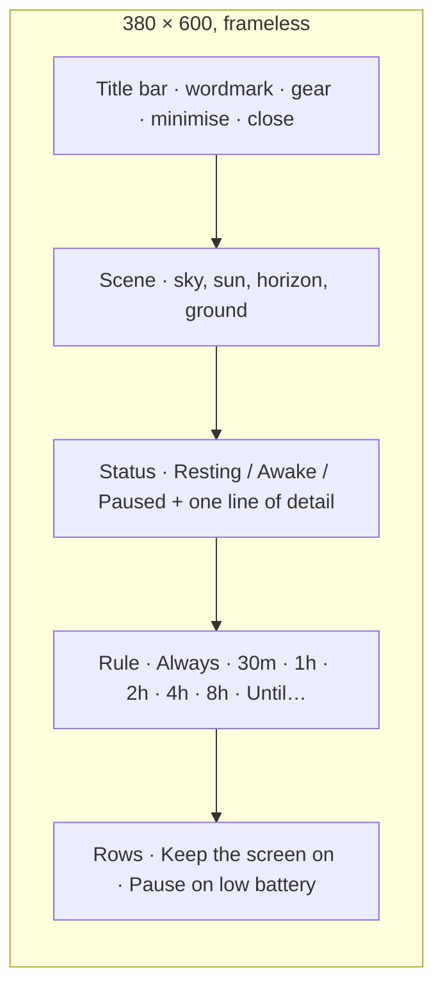
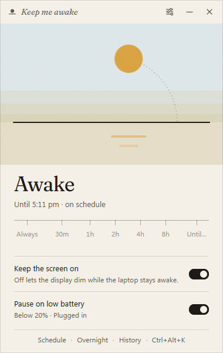
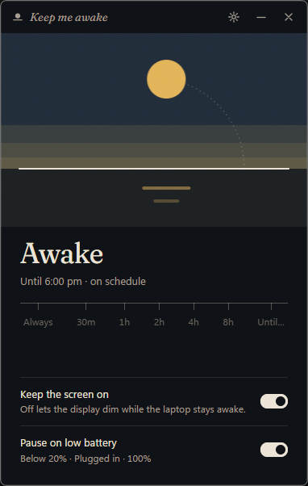
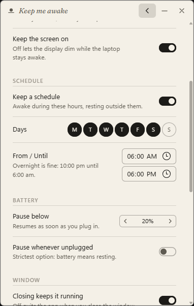
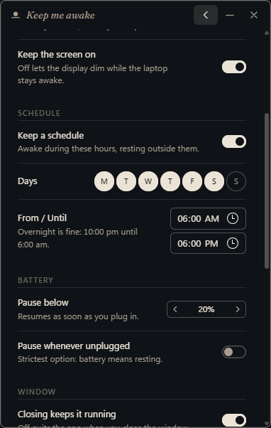
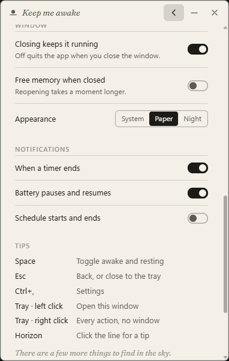
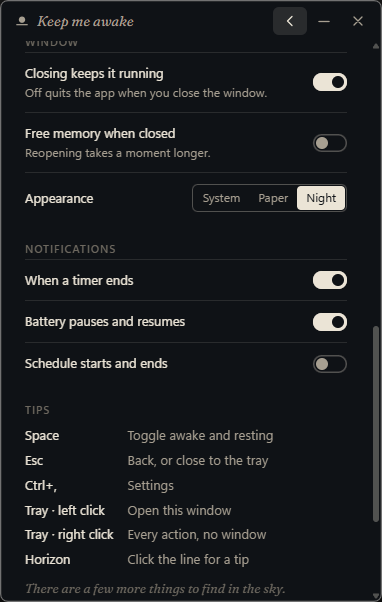

# Field guide

Everything the app can do, including the parts that are not labelled.

## The window

### Scene

| Element      | Click                     | Means                                                                      |
| ------------ | ------------------------- | -------------------------------------------------------------------------- |
| Sun          | toggles awake / resting   | above the line: awake; below it: resting; dimmed with a bar across: paused |
|              | during a schedule window  | skips the rest of the window; click again to come back to it               |
| Horizon line | shows a tip               | there are ten; they cycle                                                  |
| Stars        | lights one (resting only) | find all seven                                                             |
| Reflection   | ripples (awake only)      |                                                                            |
| Dotted arc   |                           | the path the sun still has to travel in a timed session                    |

### Status

The word is what the laptop is doing: **Resting**, **Awake**, **Paused**. The
line under it says until when, or why it is paused. Between midnight and five
in the morning the awake line adds a second sentence.

| State                     | Word    | Line                                                   |
| ------------------------- | ------- | ------------------------------------------------------ |
| resting                   | Resting | `Your laptop sleeps as usual.`                         |
| resting, schedule waiting | Resting | `Your laptop sleeps as usual. Awake again at 9:00 am.` |
| always                    | Awake   | `Until you say otherwise.`                             |
| timed                     | Awake   | `Until 5:30 pm · 1h 30m left`                          |
| schedule window           | Awake   | `Until 6:00 pm · on schedule`                          |
| window skipped            | Resting | `Skipping today's schedule until 6:00 pm.`             |
| paused                    | Paused  | `Holding off while battery is low.`                    |

When the next window is further off than tomorrow the line names the day:
`Awake again at 9:00 am on Monday.`

### Schedule

One window of time on chosen days, set in Settings → Schedule. While it is
open the sun rises on its own and sets as the window closes, exactly like a
timed session; outside it the laptop sleeps as usual. Overnight windows
(10:00 pm until 6:00 am) belong to the day they start on.

| You do                         | Happens                                                      |
| ------------------------------ | ------------------------------------------------------------ |
| nothing                        | awake inside the window, resting outside it                  |
| click the sun inside a window  | `Skipped until 6:00 pm.` Resting until the window closes     |
| click it again                 | `Back on schedule.`                                          |
| pick a stop or Always          | that session wins, and is not cut short when the window ends |
| a session ends inside a window | the schedule takes over without letting go                   |
| launch inside a window         | starts awake                                                 |

 

### Rule

Stops are durations measured from now. **Always** has no end. **Until…** opens
a time field; the time is today if still ahead, otherwise tomorrow. The active
stop carries a dot; while a custom time is set the last stop reads
"Until 5:30 pm".

### Rows

| Row                  | On                                           | Off                                 |
| -------------------- | -------------------------------------------- | ----------------------------------- |
| Keep the screen on   | display and system are both held             | display may dim; system stays awake |
| Pause on low battery | below 20% the sun pauses; resumes on charger | battery level is ignored            |

The hint under the battery row shows the live reading ("Plugged in · 100%").

## Keyboard

| Keys     | Does                                   |
| -------- | -------------------------------------- |
| Space    | toggle awake / resting                 |
| Esc      | back from settings, else close to tray |
| Ctrl+,   | settings                               |
| Tab / ←→ | move between stops and controls        |

## Tray

| Action      | Does                                                                      |
| ----------- | ------------------------------------------------------------------------- |
| left click  | open the window                                                           |
| right click | status line · Keep awake / Let it sleep · Keep awake for ▸ · Open · Quit  |
|             | while a schedule window is open: Skip today's schedule / Back on schedule |
| hover       | tooltip with the same status line as the menu                             |

Icon states: sun above the line (awake), sun set (resting), bar across the sun
(paused).

## Settings

| Section       | Setting                    | Notes                                                                     |
| ------------- | -------------------------- | ------------------------------------------------------------------------- |
| Startup       | Launch at sign-in          | registers under the current user; starts hidden                           |
|               | Open the window at launch  | only applies when you start it yourself                                   |
|               | Begin as                   | Resting · Awake · Default length                                          |
| Waking        | Default length             | what the sun, tray toggle and Space use. Always, or a stop                |
|               | Keep the screen on         | same switch as on the home pane                                           |
| Schedule      | Keep a schedule            | awake during these hours, resting outside them. Off by default            |
|               | Days                       | Monday first; weekdays by default                                         |
|               | From / Until               | 9:00 am until 6:00 pm by default; overnight is fine                       |
| Battery       | Pause below                | Off, or 10–50%                                                            |
|               | Pause whenever unplugged   | strictest: on battery means resting                                       |
| Window        | Closing keeps it running   | off quits on close                                                        |
|               | Free memory when closed    | destroys the UI on close (default); off hides it for an instant reopen    |
|               | Appearance                 | System · Paper · Night                                                    |
| Notifications | When a timer ends          | a toast when a timed session sets on its own. On by default               |
|               | Battery pauses and resumes | when the battery rule pauses the sun, and when the charger brings it back |
|               | Schedule starts and ends   | when a schedule window opens or closes                                    |
| Tips          |                            | the keyboard and tray table                                               |
| About         |                            | version, how it works, author, Source, Quit                               |

 

## Notifications

Quiet Windows toasts for the moments that matter while the window is closed,
each behind its own switch in Settings → Notifications. Nothing is shown
while the window is open and focused; the status line already says it.

| Moment           | Title                    | Body                                      | Default |
| ---------------- | ------------------------ | ----------------------------------------- | ------- |
| timer ended      | `The sun has set`        | `Resting now. 2h 00m, as asked.`          | on      |
| battery paused   | `Paused for the battery` | `Holding off at 18%. Plug in to resume.`  | off     |
| battery resumed  | `Back up`                | `Charger connected. The sun is up again.` | off     |
| schedule started | `On schedule`            | `Awake until 6:00 pm.`                    | off     |
| schedule ended   | `Off schedule`           | `Resting until 9:00 am.`                  | off     |

A toast is skipped when it would no longer be true: no "Resting now" if a
schedule window took over, no schedule toasts while your own session hides
the change.

 

## Where things are

| What      | Where                                                        |
| --------- | ------------------------------------------------------------ |
| Settings  | `%APPDATA%\dev.bajpai.keepmeawake\settings.json`             |
| Log       | `%LOCALAPPDATA%\dev.bajpai.keepmeawake\logs\keepmeawake.log` |
| Autostart | `HKCU\Software\Microsoft\Windows\CurrentVersion\Run`         |
| Proof     | `powercfg /requests` (elevated) while awake                  |

## When it will not hold

- Lid closed, power button, Start → Sleep: Windows releases every request on
  purpose. That is correct.
- Modern Standby laptop on battery: Windows terminates system requests five
  minutes after the sleep timeout. Plug in, or accept it.
- "Paused: Windows refused the request": something blocked
  `PowerCreateRequest`; check the log.

---

_Keep me awake · [Akshay Bajpai](https://akshaybajpai.com)_
