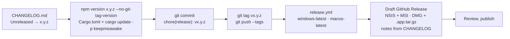

# Releasing

## Versioning

Semantic versioning. The source of truth is `package.json`;
`src-tauri/tauri.conf.json` reads it and `src-tauri/Cargo.toml` is bumped to
match.

| Bump    | When                                                                                |
| ------- | ----------------------------------------------------------------------------------- |
| `patch` | fixes, copy, performance                                                            |
| `minor` | features, new settings (with defaults)                                              |
| `major` | a settings migration that cannot default, or a behaviour change that breaks a habit |

## Flow

## Signing

Installers are unsigned until a certificate is in place, on both platforms.
On macOS the bundle is signed ad hoc (`signingIdentity: "-"`), so the
signature verifies but Gatekeeper still asks once (Privacy & Security → Open
Anyway; see the guide);
notarization needs an Apple Developer account and the `APPLE_*` secrets listed
in [`specs/macos.md`](specs/macos.md). When one is, add
`TAURI_SIGNING_PRIVATE_KEY` and `TAURI_SIGNING_PRIVATE_KEY_PASSWORD` as
repository secrets and set `bundle.windows.certificateThumbprint`. The updater
(roadmap) requires it.

## Channels

| Channel         | Status  |
| --------------- | ------- |
| GitHub Releases | now     |
| Winget          | roadmap |
| Scoop           | roadmap |

---

_Keep me awake · [Akshay Bajpai](https://akshaybajpai.com)_
