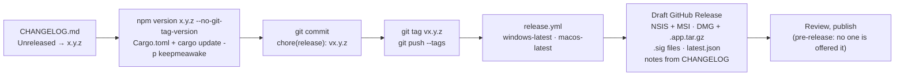

# Releasing

## Versioning

Semantic versioning. The source of truth is `package.json`;
`src-tauri/tauri.conf.json` reads it and `src-tauri/Cargo.toml` is bumped to
match.

| Bump    | When                                                                                |
| ------- | ----------------------------------------------------------------------------------- |
| `patch` | fixes, copy, performance                                                            |
| `minor` | features, new settings (with defaults)                                              |
| `major` | a settings migration that cannot default, or a behaviour change that breaks a habit |

## Flow

## Updates

Installs update themselves from `latest.json` on the newest **full**
release (`releases/latest/download/latest.json`); a pre-release is never
offered. Each update is signed with the updater key and verified against
the public key in `src-tauri/tauri.conf.json` before it runs.

| Piece                 | Where                                                                                              |
| --------------------- | -------------------------------------------------------------------------------------------------- |
| public key            | `plugins.updater.pubkey` in `tauri.conf.json`, committed                                           |
| private key, password | repository secrets `TAURI_SIGNING_PRIVATE_KEY`, `_PASSWORD`; the files live outside the repo       |
| signed artifacts      | `tauri.updater.conf.json` (`createUpdaterArtifacts`), passed by `release.yml` with `--config`      |
| `latest.json`         | written by `tauri-action` (`includeUpdaterJson`), both platforms merged, NSIS preferred on Windows |

The release job fails early if either secret is missing. The overlay keeps
local `npm run build` working without the key; to build signed artifacts
locally, set both variables and run
`npm run build -- --config src-tauri/tauri.updater.conf.json`.

The key pair was made once with `npx tauri signer generate`, written to a
path outside the repository. The private key, its password and where they
are kept never go in the repo, its docs or commit messages. Losing the
private key means no install can verify a new update: the owner keeps it
backed up, privately.
Rotating it means shipping the new public key in a release signed with the
old one first.

## Signing installers

Installers are unsigned until a certificate is in place, on both platforms.
On macOS the bundle is signed ad hoc (`signingIdentity: "-"`), so the
signature verifies but Gatekeeper still asks once (Privacy & Security → Open
Anyway; see the guide);
notarization needs an Apple Developer account and the `APPLE_*` secrets listed
in [`specs/macos.md`](specs/macos.md). A Windows certificate goes in
`bundle.windows.certificateThumbprint`. Neither is needed for updates, which
carry their own signature.

## Channels

| Channel         | Status  |
| --------------- | ------- |
| GitHub Releases | now     |
| Winget          | roadmap |
| Scoop           | roadmap |

---

_Keep me awake · [Akshay Bajpai](https://akshaybajpai.com)_
