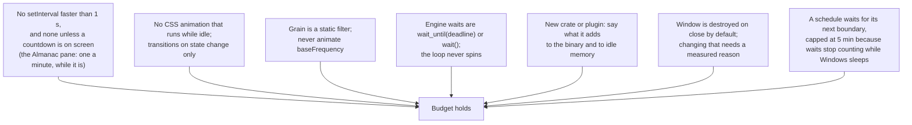

# Resource budget

"Tiny" is a feature, so it has numbers and a way to check them.

## Budget

| Metric                         | Budget              | Windows (0.2, release)                                       | macOS (release)                                  | Why                                                                         |
| ------------------------------ | ------------------- | ------------------------------------------------------------ | ------------------------------------------------ | --------------------------------------------------------------------------- |
| Private memory, tray only      | ≤ 12 MB             | 4.5 MB after an update check (0.2: 5.7 MB)                   | **16 MB resting, 17 MB awake** (over)            | one native process, no webview                                              |
| Private memory, window open    | ≤ 90 MB             | 5.4 MB app + WebView2                                        | 26 MB app + 30 MB WebContent                     | the system webview is the floor; the page is small                          |
| CPU while resting              | 0 wake-ups          | 0 ms CPU in 60 s (almanac off)                               | 0 ms CPU in 60 s (almanac off)                   | the engine (and, on Windows, theme) threads block in the kernel             |
| CPU while resting, almanac on  | 1 wake-up / min     | by design; to be measured                                    | by design; to be measured                        | one idle reading a minute, nothing else                                     |
| CPU while awake                | 1 wake-up / 30 s    | 1 / 30 s                                                     | 20 ms CPU in 60 s (two polls)                    | battery poll only                                                           |
| CPU while resting, schedule on | ≤ 1 wake-up / 5 min | by design                                                    | by design                                        | the next window start, re-checked so sleep cannot make it late              |
| Threads at rest                | no polling threads  | 30 (Tauri, WebView2 loader, plugins)                         | 14 resting, 18 awake                             | `keepmeawake-engine` (and `keepmeawake-theme`) sleep until woken            |
| CPU, window open, idle         | ≤ 0.1%              | idle                                                         | 10 ms CPU in 30 s                                | no animation loops; 1 Hz clock only in a timed session                      |
| Binary                         | ≤ 12 MB             | 5.6 MB exe · 2.2 MB NSIS · 3.0 MB MSI (0.2: 4.2 · 1.5 · 2.1) | 4.1 MB binary · 4.0 MB `.app` · 2.0 MB DMG (0.2) | `opt-level = "s"`, LTO, stripped; the updater's TLS is most of 0.3's growth |
| UI bundle (JS + CSS, gzip)     | ≤ 60 KB             | 30 KB + 3.7 KB (0.1: 28 KB + 3.5 KB)                         | 32 KB + 3.8 KB (both, from the next build)       | Svelte compiles away; no framework runtime                                  |
| Fonts                          | ≤ 160 KB            | 149 KB                                                       | 149 KB                                           | one family, two files, latin subset                                         |
| Cold open of the window        | ≤ 400 ms            | under 1 s                                                    | 0.86 s from a cold launch                        | webview spin-up + first paint                                               |

The almanac is the first thing that wakes the app at rest, and it is behind
a switch (Settings → Almanac → Keep an almanac, on by default). One thread,
`keepmeawake-almanac`, waits on a condvar: with the almanac on it wakes
once a minute to read the idle time (`GetLastInputInfo` or
`CGEventSourceSecondsSinceLastEventType`, one call of microseconds) and
note it; with it off it waits with no timeout and never wakes. A minute is
enough because the OS stamps the last input itself: the moment someone left
is known to the second from a look taken later. `almanac.json` (one line,
400 days at most, a few tens of KB after a year) is written as a span
opens, two minutes after the keys go quiet, every 15 minutes while a span
grows, and on exit. In the window, the Almanac pane asks for it once a
minute while it is on screen and the window is visible, and never
otherwise; the strips are positioned boxes with no animation. The numbers
for a resting minute with the almanac on are still to be measured on both
machines.

The sunset warning adds one engine wake per timed session, at the warning
moment, and nothing in the window: the status line uses the 1 Hz clock a
timed session already runs.

Auto-update adds one thread, `keepmeawake-update`, asleep between checks:
it wakes about 30 s after launch, then at most every 6 h to compare
wall-clock times (a laptop's sleep stops the clock a thread sleeps on), and
makes one HTTPS request a day, none with the switch off. The window adds
nothing: the update arrives as an event, and progress is sent once per
percent, not per chunk. The updater pulls in an HTTP client and TLS; this is
the one feature allowed to cost that. Measured on Windows (release,
2026-11-07): the exe grows from 4.2 MB to 5.6 MB and the NSIS installer is
2.2 MB, MSI 3.0 MB; in the tray after its first check the app is 4.5 MB
private with 13 threads and 0 ms CPU in an idle minute. The check runs on a
current-thread runtime of its own: Tauri's shared runtime would have started
a worker per CPU core for it (45 threads, 6.4 MB on the test machine).

The overnight guard adds no timer and no thread. While an Always session
runs it reads the idle time once per battery poll (`GetLastInputInfo` on
Windows, `CGEventSourceSecondsSinceLastEventType` on macOS, each a single
call of microseconds); at rest, during timers and with the guard off it
reads nothing. A question adds one engine wake, at the end of its ten-minute
grace.

0.3's session history adds one small file write as each stretch starts and
ends (`history.json`, at most 200 entries, a few tens of KB) and nothing at
idle: it is written from the engine's existing events, and read only when
Settings opens.

0.2 adds `chrono` (schedule arithmetic), `tauri-plugin-notification` and
`tauri-plugin-global-shortcut`: together +0.4 MB on the exe and nothing at
idle. The taskbar watch is one thread blocked in `RegNotifyChangeKeyValue`
(about 64 KB of stack, no CPU), and the tray carries three more 64 px PNGs
(under 1 KB each).

macOS adds no thread and no timer: there is no taskbar theme to watch (the
menu bar icon is a template image), and the battery is read with the same
30 s poll while awake rather than an IOKit run-loop notification, which would
remove that poll and is noted under Later. The UI bundle grew by about 2 KB
gzipped when the build target gained `safari15` for WKWebView on macOS 12.

The macOS memory figures are `phys_footprint` from `footprint <pid>`, which
counts AppKit's and WebKit's dirty and compressed pages for the process; the
Windows figures are private bytes. They are not the same measure, but the
menu-bar-only footprint is over the 12 MB budget either way: AppKit itself is
most of it. Whether the budget gets a macOS line of its own is an open
question.

Windows measured on a Windows 11 laptop, 2026-11-07. macOS measured on an
Apple Silicon Mac, macOS 27, 2026-11-07. WebView2 processes are
shared with other apps on the machine and cannot be attributed cleanly from Task
Manager; the app process itself stays at ~5 MB whether the window is open or not.

## Measure

```sh
# macOS: memory, threads and CPU time for the app process
P=$(pgrep -x keepmeawake)
footprint $P | grep phys_footprint
ps -M $P | tail -n +2 | wc -l
ps -o time= -p $P; sleep 60; ps -o time= -p $P
```

```powershell
# Memory for the app process
Get-Process keepmeawake | Select-Object Id, @{n='PrivateMB';e={[math]::Round($_.PrivateMemorySize64/1MB,1)}}, Handles, Threads

# Wake-ups: Resource Monitor → CPU → keepmeawake.exe, or
# Windows Performance Recorder, CPU usage profile, one idle minute.

# UI bundle
npm run ui:build   # Vite prints gzip sizes per chunk
```

## Rules that protect it



---

_Keep me awake · [Akshay Bajpai](https://akshaybajpai.com)_
