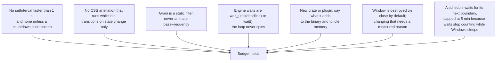

# Resource budget

"Tiny" is a feature, so it has numbers and a way to check them.

## Budget

| Metric                         | Budget              | Measured (0.1, release)               | Why                                                            |
| ------------------------------ | ------------------- | ------------------------------------- | -------------------------------------------------------------- |
| Private memory, tray only      | ≤ 12 MB             | 5.3 MB                                | one native process, no WebView                                 |
| Private memory, window open    | ≤ 90 MB             | 5.4 MB app + WebView2                 | WebView2 is the floor; the page is small                       |
| CPU while resting              | 0 wake-ups          | 0                                     | the engine thread blocks on a condvar                          |
| CPU while awake                | 1 wake-up / 30 s    | 1 / 30 s                              | battery poll only                                              |
| CPU while resting, schedule on | ≤ 1 wake-up / 5 min | by design                             | the next window start, re-checked so sleep cannot make it late |
| CPU, window open, idle         | ≤ 0.1%              | idle                                  | no animation loops; 1 Hz clock only in a timed session         |
| Binary                         | ≤ 12 MB             | 3.8 MB exe · 1.5 MB NSIS · 2.1 MB MSI | `opt-level = "s"`, LTO, stripped                               |
| UI bundle (JS + CSS, gzip)     | ≤ 60 KB             | 28 KB + 3.5 KB                        | Svelte compiles away; no framework runtime                     |
| Fonts                          | ≤ 160 KB            | 149 KB                                | one family, two files, latin subset                            |
| Cold open of the window        | ≤ 400 ms            | under 1 s                             | WebView2 spin-up + first paint                                 |

Measured on a Core Ultra 5 laptop, Windows 11, 2026-11-07. WebView2 processes are
shared with other apps on the machine and cannot be attributed cleanly from Task
Manager; the app process itself stays at ~5 MB whether the window is open or not.

## Measure

```powershell
# Memory for the app process
Get-Process keepmeawake | Select-Object Id, @{n='PrivateMB';e={[math]::Round($_.PrivateMemorySize64/1MB,1)}}, Handles, Threads

# Wake-ups: Resource Monitor → CPU → keepmeawake.exe, or
# Windows Performance Recorder, CPU usage profile, one idle minute.

# UI bundle
npm run ui:build   # Vite prints gzip sizes per chunk
```

## Rules that protect it



---

_Keep me awake · [Akshay Bajpai](https://akshaybajpai.com)_
