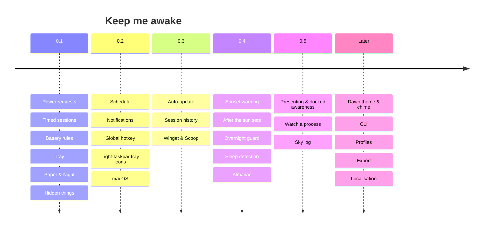

# Roadmap

What is built, what is next, and what has been considered and set aside. Each
item names the layers it touches so the size is honest. Ordered by how much it
helps a working day. Items under _Next_ have full implementation specs in
[`docs/specs/`](specs/README.md).

## Shipped in 0.1

| Feature                                                              | Layers           |
| -------------------------------------------------------------------- | ---------------- |
| Wake guard via Windows power requests, system and display separately | platform, engine |
| Off / Always / 30m–8h / until a time                                 | core, UI, tray   |
| Pause below a threshold or when unplugged; auto-resume               | engine           |
| Tray icon with state, tooltip, full menu                             | app              |
| On-demand window, WebView2 destroyed on close                        | app              |
| Launch at sign-in, state at launch, default length                   | app, UI          |
| Paper and Night, following Windows                                   | UI               |
| Settings persisted atomically, rotating log                          | persistence      |
| Tips, stars, ripple, credit, late-night line                         | UI               |

## Shipped in 0.2 (pre-release)

| Feature                                                       | Spec                                                             | Layers                      |
| ------------------------------------------------------------- | ---------------------------------------------------------------- | --------------------------- |
| Schedule: awake during chosen hours on chosen days, skippable | [schedule.md](specs/schedule.md)                                 | core, engine, app, tray, ui |
| Notifications: toasts for timer end, battery, schedule        | [notifications.md](specs/notifications.md)                       | app, ui                     |
| Global hotkey: `Ctrl+Alt+K`, recordable                       | [global-hotkey.md](specs/global-hotkey.md)                       | app, ui                     |
| Tray icons that follow the taskbar theme                      | [tray-icons-light-taskbar.md](specs/tray-icons-light-taskbar.md) | platform, app, brand        |
| macOS: menu bar app on IOKit assertions (acceptance pending)  | [macos.md](specs/macos.md)                                       | platform, app, ui, ci       |

## Shipped in 0.3

| Feature                                                          | Spec                                           | Layers                    |
| ---------------------------------------------------------------- | ---------------------------------------------- | ------------------------- |
| Auto-update, signed, once a day, opt-out                         | [auto-update.md](specs/auto-update.md)         | app, ui, ci               |
| Session history with how each session ended                      | [session-history.md](specs/session-history.md) | core, engine, app, ui     |
| Sunset warning (from 0.4)                                        | [sunset-warning.md](specs/sunset-warning.md)   | engine, app, ui           |
| Overnight guard (from 0.4)                                       | [overnight-guard.md](specs/overnight-guard.md) | platform, engine, app, ui |
| Home's doors into Settings, settings sliders, a pass over the UI |                                                | ui                        |

## Next

| Feature          | Spec                                     | Layers   |
| ---------------- | ---------------------------------------- | -------- |
| Winget and Scoop | [winget-scoop.md](specs/winget-scoop.md) | ci, docs |

macOS shipped in 0.2.0 as a pre-release, built on a Mac. The
by-hand acceptance items that need a person at the Mac (menu bar click and
legibility, ⌘W/⌘Q in the real app, toasts, launch at sign-in, unplugging) are
listed in [`HANDOFF.md`](HANDOFF.md); it stays marked pending until they pass.

## Built for 0.4, not yet released

| Feature                                                                                                                                                                                         | Spec                           | Layers                |
| ----------------------------------------------------------------------------------------------------------------------------------------------------------------------------------------------- | ------------------------------ | --------------------- |
| Almanac: days and hours worked, time over, leave, and the night read from the last and first touch; any day put right by hand; today on Home; Always can set with the night and rise at a touch | [almanac.md](specs/almanac.md) | core, engine, app, ui |

Built on Windows; waits for the Mac (see [`HANDOFF.md`](HANDOFF.md)).

## After 0.3

Scoped enough to size; each gets a full spec when it is next in line.

### 0.4: the sun looks after you

| Feature                                                              | What                                                                                                                                                                                                                                          | Layers                 | Size |
| -------------------------------------------------------------------- | --------------------------------------------------------------------------------------------------------------------------------------------------------------------------------------------------------------------------------------------- | ---------------------- | ---- |
| Sunset warning ([spec](specs/sunset-warning.md), shipped in 0.3.0)   | Five minutes before a timed session ends: a toast `The sun sets in 5 minutes` and, in the window, the status line turns to it. One tray item and one whisper action: **Give it another 30m**. Setting: off / 2 / 5 / 10 min.                  | engine, app, ui        | S    |
| After the sun sets                                                   | What happens when a timed or scheduled session ends: nothing (today), **lock**, **sleep**, **hibernate**. Uses `LockWorkStation` / `SetSuspendState`. A 30-second whisper countdown with **Not now** cancels it. Default: nothing.            | platform, engine, ui   | M    |
| Overnight guard ([spec](specs/overnight-guard.md), shipped in 0.3.0) | If the session is Always and there has been no keyboard or mouse input for N hours (read-only `GetLastInputInfo`), ask once via toast and the window, then let it sleep. Default 6 hours; off available. Prevents the accidental all-nighter. | platform, engine, ui   | M    |
| Sleep detection                                                      | Register for `PowerRegisterSuspendResumeNotification`; when Windows sleeps despite a held request (Modern Standby on battery, lid), record it in history as `sleep` with the real time, and show `Windows slept at 2:14 am` on the next open. | platform, app, history | S    |

### 0.5: it notices where it is

| Feature              | What                                                                                                                                                                                                                                                                       | Layers               | Size |
| -------------------- | -------------------------------------------------------------------------------------------------------------------------------------------------------------------------------------------------------------------------------------------------------------------------- | -------------------- | ---- |
| Presenting awareness | `SHQueryUserNotificationState` reports presentation mode and full-screen apps. Option: **stay awake while presenting or full-screen** (keeps the display on during a talk or a film, lets go after). Polled only while the option is on, every 30 s alongside the battery. | platform, engine, ui | S    |
| Docked awareness     | External display present (`EnumDisplayMonitors`, `WM_DISPLAYCHANGE` via a message-only window) → option **stay awake while docked**. Works with the schedule: docked overrides battery rules because docks power the laptop.                                               | platform, engine, ui | M    |
| Watch a process      | **Stay awake while this runs**: pick a process name (`cargo.exe`, `rsync`, a game); the sun stays up while it exists and sets a minute after it exits. Enumerate with `CreateToolhelp32Snapshot` every 15 s only while a watch is set.                                     | platform, engine, ui | M    |
| Sky log              | History drawn, not listed: one row per day, each session a small arc from its start to its end on a 24-hour horizon, pauses as gaps, sleep as a broken arc. The Almanac's strips already draw each day that way for presence; this lays the sun's sessions over them.      | ui                   | S    |

### Later

| Idea                   | Note                                                                                                                                                                                                                                              |
| ---------------------- | ------------------------------------------------------------------------------------------------------------------------------------------------------------------------------------------------------------------------------------------------- |
| Dawn theme and chime   | A third palette (first light: rose paper, pale gold) and an optional soft chime at sunset. Both off by default; the chime is a 2-second bundled OGG.                                                                                              |
| Energy estimate        | While awake on battery, show the drain rate (`BatteryDischargeRate` from `CallNtPowerInformation`) as `about 3h 10m of battery at this rate` under the battery row.                                                                               |
| CLI                    | `keepmeawake --for 2h`, `--until 18:00`, `--off`, `--status`; speaks to the running app over the single-instance channel; exits immediately.                                                                                                      |
| Profiles               | Named bundles of settings: **Presenting** (display on, no battery pause), **Downloading** (display off), **Overnight** (display off, guard on). Tray submenu to switch.                                                                           |
| Export and portable    | Export/import settings and history as one JSON; a portable build that keeps them beside the exe.                                                                                                                                                  |
| Away mode              | `PowerRequestAwayModeRequired` for S3 machines: media keeps playing, screen off. Only shown when the machine reports S3.                                                                                                                          |
| Localisation           | Strings are centralised in `copy.ts` and `tray.rs`; add a locale layer when there is a second language.                                                                                                                                           |
| Linux                  | The non-Windows fallbacks already compile; a D-Bus `org.freedesktop.ScreenSaver` inhibitor and a StatusNotifier icon would make it real. After macOS.                                                                                             |
| macOS battery events   | Replace the 30 s battery poll on macOS with `IOPSNotificationCreateRunLoopSource`, so an awake Mac wakes only when the power source changes.                                                                                                      |
| Homebrew cask          | Joins Winget and Scoop once the macOS build is signed.                                                                                                                                                                                            |
| Presence for chat apps | Power requests do not reset the idle timer chat apps read; keeping one "active" needs synthetic input, which this app does not send. Only ever as an explicit, labelled opt-in, and only if it can avoid injecting input into other applications. |

## Decided against

| Option                            | Why                                                            |
| --------------------------------- | -------------------------------------------------------------- |
| Electron, .NET WPF                | ~150 MB and ~60 MB idle against ~5 MB                          |
| Mica / acrylic                    | see [design.md](design.md)                                     |
| Keystroke injection to stay awake | replaced by power requests; the reason this exists             |
| Polling the battery while off     | nothing can change the decision while off                      |
| Calendar integration              | needs OAuth and a network; the schedule covers the common case |

---

_Keep me awake · [Akshay Bajpai](https://akshaybajpai.com)_
