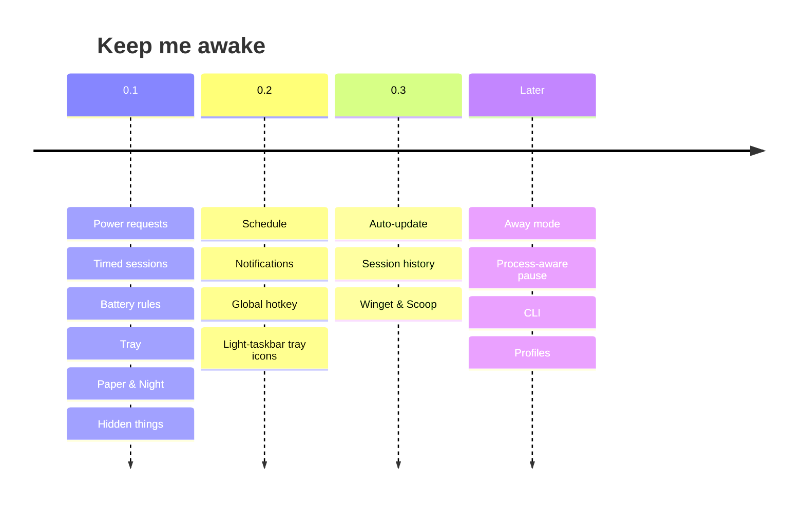

# Roadmap

What is built, what is next, and what has been considered and set aside. Each
item names the layers it touches so the size is honest. Ordered by how much it
helps a working day.

## Shipped in 0.1

| Feature                                                              | Layers           |
| -------------------------------------------------------------------- | ---------------- |
| Wake guard via Windows power requests, system and display separately | platform, engine |
| Off / Always / 30m–8h / until a time                                 | core, UI, tray   |
| Pause below a threshold or when unplugged; auto-resume               | engine           |
| Tray icon with state, tooltip, full menu                             | app              |
| On-demand window, WebView2 destroyed on close                        | app              |
| Launch at sign-in, state at launch, default length                   | app, UI          |
| Paper and Night, following Windows                                   | UI               |
| Settings persisted atomically, rotating log                          | persistence      |
| Tips, stars, ripple, credit, late-night line                         | UI               |

## Next

### Schedule

_engine, core, UI._ Work hours per weekday: "awake 9:00–18:00 Mon–Fri". A second
deadline source in the engine; the scene shows the day's window on the arc.
Adds "Begin as: Scheduled".

### Notifications

_app, UI._ A toast when a timed session ends, when the battery rule pauses and
when it resumes. One setting; on for timer end, off for pause/resume by
default. `tauri-plugin-notification`.

### Global hotkey

_app._ Toggle from anywhere, default `Ctrl+Alt+K`, editable.
`tauri-plugin-global-shortcut`.

### Tray icons for light taskbars

_app._ Read `SystemUsesLightTheme`, swap to an ink icon set so the mark never
disappears on a light taskbar.

### Auto-update

_app, release._ Tauri updater with signed releases. Needs a signing key in CI;
see [releasing.md](releasing.md).

### Session history

_core, UI._ A quiet list of past sessions (start, end, how it ended) in
Settings. Answers "did it actually stay up overnight?".

### Winget and Scoop

_release._ Manifests generated from the release asset URL and SHA256.

## Later

| Idea                   | Note                                                                                                                                                                                                                                             |
| ---------------------- | ------------------------------------------------------------------------------------------------------------------------------------------------------------------------------------------------------------------------------------------------ |
| Away mode              | `PowerRequestAwayModeRequired`, S3 machines only                                                                                                                                                                                                 |
| Process-aware pause    | stay awake while a build or download runs, then let it sleep                                                                                                                                                                                     |
| Lid-close surfacing    | Windows already releases requests; show it rather than change it                                                                                                                                                                                 |
| Localisation           | strings are already centralised in `copy.ts` and `tray.rs`                                                                                                                                                                                       |
| Portable build         | single `.exe`, settings beside it                                                                                                                                                                                                                |
| CLI                    | `keepmeawake --for 2h`, `--off`, `--status`, via the single-instance channel                                                                                                                                                                     |
| Profiles               | "Presenting" (display on, no battery pause) vs "Downloading" (display off)                                                                                                                                                                       |
| Presence for chat apps | power requests do not reset the idle timer chat apps read. Keeping one "active" needs synthetic input, which this app does not send. Only ever as an explicit, labelled opt-in, and only if it can avoid injecting input into other applications |

## Decided against

| Option                            | Why                                                |
| --------------------------------- | -------------------------------------------------- |
| Electron, .NET WPF                | ~150 MB and ~60 MB idle against ~5 MB              |
| Mica / acrylic                    | see [design.md](design.md)                         |
| Keystroke injection to stay awake | replaced by power requests; the reason this exists |
| Polling the battery while off     | nothing can change the decision while off          |

---

_Keep me awake · [Akshay Bajpai](https://akshaybajpai.com)_
