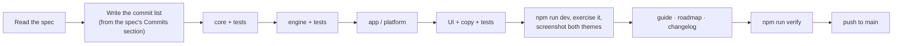

# Handoff brief

You are building the next releases of **Keep me awake**, a personal project by
Akshay Bajpai ([akshaybajpai.com](https://akshaybajpai.com)). This brief is
the contract. The specs in this folder are the work.

## Read first, in this order

0. `docs/HANDOFF.md`: where the previous session stopped. Update it when you stop.
1. `CLAUDE.md` at the repo root (two minutes).
2. `docs/architecture.md`: layers, engine loop, IPC, window lifecycle.
3. `docs/design.md`: the horizon, palette, type, copy rules, what was decided against.
4. `docs/development.md`: setup, commands, style, testing, commit rules.
5. The spec you are about to build.

## Non-negotiables

| Rule                                                                              | Where it is enforced                       |
| --------------------------------------------------------------------------------- | ------------------------------------------ |
| `npm run verify` is green before any claim of done                                | CI runs the same                           |
| Small Conventional Commits, subject ≤ 72 chars, each one buildable                | `.githooks/commit-msg`                     |
| `core` performs no I/O; dependencies point down only                              | review                                     |
| `unsafe` only in `platform/windows.rs` and `platform/macos.rs`, with `SAFETY:`    | clippy `undocumented_unsafe_blocks = deny` |
| `src/lib/types.ts` mirrors `core` field for field, `snake_case`                   | serde tests on both sides                  |
| New settings fields default; a change of meaning bumps `SETTINGS_VERSION`         | `persistence.rs`                           |
| No timers, polling or animation loops without a note in `docs/resource-budget.md` | review                                     |
| UI: tokens only, no gradients, one accent (the sun), nothing generic              | `docs/design.md`                           |
| Copy that is more than a label lives in `src/lib/copy.ts`                         | tests pin tone and length                  |
| Every doc ends with the author footer; diagrams are Mermaid                       | `docs/`                                    |
| **No synthetic input to other applications, ever**                                | ADR 0002, roadmap                          |

## Definition of done, per spec

- All items under **Acceptance** in the spec pass, by hand, on the real app.
- Tests listed under **Tests** exist and pass; `cargo test` and `vitest` counts
  go up, never down.
- `docs/guide.md`, `docs/architecture.md` (if the shape changed),
  `docs/roadmap.md` (move the item to Shipped) and `CHANGELOG.md` (Unreleased)
  are updated in the same series of commits.
- Screenshots in both themes for any visible change, captured from the real
  window at 380 × 600, saved under `docs/assets/` and referenced from the guide.
- The resource budget still holds; new numbers recorded if anything measurable
  changed.

## How to work

- Build bottom-up: domain first, so the engine tests drive the behaviour
  before any UI exists.
- Run the app and look at it. The window is 380 × 600; the design has to hold
  at 340 × 520 too.
- When a spec and the code disagree, the code's existing conventions win for
  style and the spec wins for behaviour; note the conflict in the commit body.
- When something is genuinely ambiguous, pick the option that costs fewer
  resources and less UI, and say so in the commit body.
- Do not refactor beyond the spec. Do not add dependencies the spec does not
  name without a sentence on what they cost.

## Versions

| Version | Specs                                                            | Tag when           |
| ------- | ---------------------------------------------------------------- | ------------------ |
| 0.2.0   | schedule, notifications, global-hotkey, tray-icons-light-taskbar | all four accepted  |
| 0.3.0   | auto-update, session-history, winget-scoop                       | all three accepted |
| track   | macos (built on a Mac, ships with the next release)              | accepted on a Mac  |

Release steps are in `docs/releasing.md`.

---

_Keep me awake · [Akshay Bajpai](https://akshaybajpai.com)_
