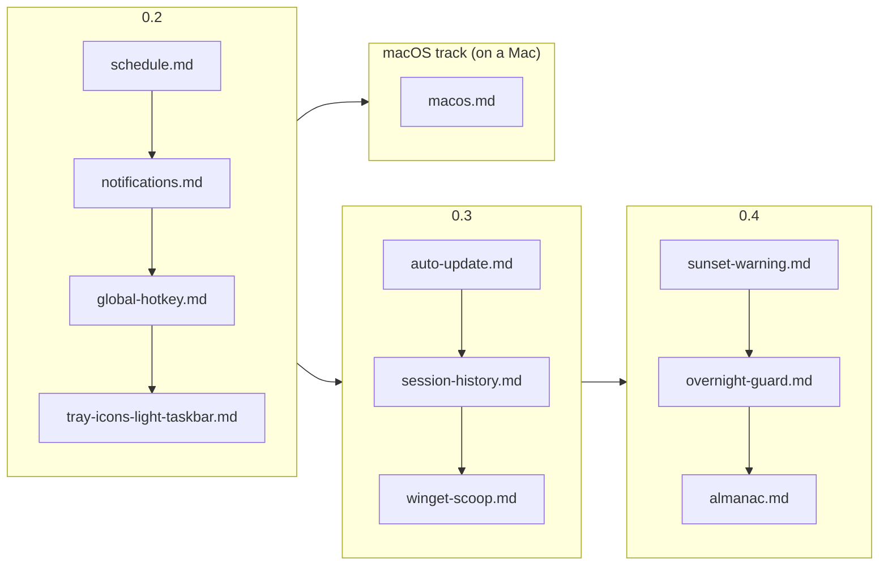

# Specs

Implementation specs for the features on the [roadmap](../roadmap.md), written
so that another engineer (or model) can build each one without re-deriving the
design. Read [BRIEF.md](BRIEF.md) first; it is the handoff.

| Spec                                                         | Version | Touches                            | Size |
| ------------------------------------------------------------ | ------- | ---------------------------------- | ---- |
| [Schedule](schedule.md)                                      | 0.2     | core, engine, app, tray, ui        | L    |
| [Notifications](notifications.md)                            | 0.2     | app, ui                            | S    |
| [Global hotkey](global-hotkey.md)                            | 0.2     | app, ui                            | S    |
| [Tray icons for light taskbars](tray-icons-light-taskbar.md) | 0.2     | platform, app, brand               | S    |
| [Auto-update](auto-update.md)                                | 0.3     | app, ui, ci                        | M    |
| [Session history](session-history.md)                        | 0.3     | core, engine, app, ui              | M    |
| [Winget and Scoop](winget-scoop.md)                          | 0.3     | ci, docs                           | S    |
| [Sunset warning](sunset-warning.md)                          | 0.4     | core, engine, app, tray, ui        | S    |
| [Overnight guard](overnight-guard.md)                        | 0.4     | platform, core, engine, app, ui    | M    |
| [Almanac](almanac.md)                                        | 0.4     | core, app, ui                      | L    |
| [Claude](claude.md)                                          | 0.5     | core, app, ui                      | M    |
| [macOS](macos.md)                                            | track   | build, platform, app, tray, ui, ci | L    |

Each spec has the same sections: **Why**, **Experience** (exact copy and
placement), **Settings**, **Rust**, **UI**, **IPC**, **Tests**, **Docs**,
**Resource impact**, **Acceptance**, **Commits**, **Out of scope**. Build them
in the order above; later specs assume earlier ones exist. The macOS spec is a
parallel track built on a different machine; it only assumes 0.2.

Features for after 0.3 are sketched in the roadmap under _After 0.3_ and get a
spec here when they are next in line.

---

_Keep me awake · [Akshay Bajpai](https://akshaybajpai.com)_
