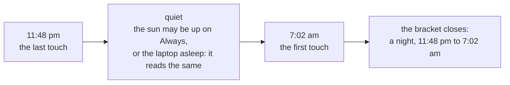

# Almanac

Version 0.4 · Size L · Touches core, app, ui

## Why

The app knows when the laptop was held awake, and nothing about the person
holding it. Three questions it could not answer: how long did I work today,
which days did I take off, and when did I actually stop last night. The last
one matters most with the sun on **Always**: the laptop never sleeps, so its
sleep says nothing about yours.

An almanac is a book of days: when the light came, when it went. This one is
yours.

## The idea: the night is read backwards

Nobody tells an app they are going to bed, and nobody is watching a window
while they sleep. So the almanac never asks and never guesses in the moment.
It keeps one thing, read-only: the moments someone was at the keyboard, mouse
or trackpad (the same idle reading the overnight guard uses, ADR 0002).



The first touch of the morning closes the bracket, and the quiet between the
two touches is the night. Both ends are exact, because the OS stamps the last
input itself: the app only has to look once a minute to know to the second
when you left. Nothing depends on the laptop sleeping, so **Always** changes
nothing, and a laptop that did sleep reads the same way (no looks, no input).

| Rule                                                                | Why                                                               |
| ------------------------------------------------------------------- | ----------------------------------------------------------------- |
| A quiet of 3 to 16 hours, at least 2 of them between 10 pm and 8 am | an afternoon out is not a night; a weekend away is not one either |
| A stir under 2 minutes inside it does not end it                    | a nudged mouse at 3 am is not a morning                           |
| The night belongs to the day it ends on; the longest wins           | one night per morning                                             |
| A break under 10 minutes is still work                              | reading and thinking leave no input                               |
| Worked time stops at the last touch, not when the quiet was noticed | hours are never padded by the wait                                |

It says "night" and "quiet", never "you slept": it knows when the keys went
quiet, not what you did.

## Experience

A new pane, **Almanac**, opened from a button in the title bar (left of
settings), beside Home and Settings. Top to bottom:

| Part      | Shows                                                                                                                                |
| --------- | ------------------------------------------------------------------------------------------------------------------------------------ |
| The day   | eyebrow `Today` (or `Tue 10 Nov`); the figure in Fraunces, `6h 42m` (or the word `Leave`, `Rest`, `Nothing`); one line of detail     |
| Detail    | `First light 9:02 am · last 6:40 pm`, then `Night 11:48 pm – 7:02 am · 7h 14m` when there was one                                    |
| The strip | the day as a 24-hour horizon: ink where you were here, a dotted run under the line for the night, the sun on the line at now (today) |
| The week  | seven smaller strips, Monday first, each with its total; click one to read that day                                                  |
| The month | a calendar: a bar under each worked day (longer for longer days), a ring for leave, the sun on today; arrows step months             |
| The tally | `This week`, the month, the year's leaves, and `Usual night` once three nights are known                                             |
| The foot  | what it reads and that it stays here; **Working days…** (opens Settings → Almanac); **Clear the almanac**                            |

Under the detail line, one quiet link marks the selected day: **Mark as
leave**, or **Not a leave** on a day that reads as one. Future days can be
marked too: planned leave shows as a ring ahead.

What a day reads as:

| Day                                                   | Reads as                                                                            |
| ----------------------------------------------------- | ----------------------------------------------------------------------------------- |
| marked as leave                                       | `Leave`                                                                             |
| any time worked (and not marked)                      | its hours                                                                           |
| a past working day with nothing in it, since it began | `Leave` (unless **Empty working days are leave** is off, or marked **Not a leave**) |
| a non-working day with nothing in it                  | `Rest`                                                                              |
| anything else with nothing in it                      | `Nothing`                                                                           |

On the first open after a night, Home whispers it once:
`A quiet night: 11:48 pm to 7:02 am.`

With the almanac off, the pane says so and offers the switch.

## Settings

Settings → new section **Almanac**, after **Schedule**.

| Field                          | Type        | Default       | UI                                                                   |
| ------------------------------ | ----------- | ------------- | -------------------------------------------------------------------- |
| `almanac.enabled`              | `bool`      | `true`        | **Keep an almanac**: `Days, hours and nights, from your input.`      |
| `almanac.work_days`            | `[bool; 7]` | Monday–Friday | **Working days**: the schedule's day pills                           |
| `almanac.empty_days_are_leave` | `bool`      | `true`        | **Empty working days are leave**: `Off on a machine you rarely use.` |

New fields with defaults, so `SETTINGS_VERSION` stays.

## Rust

### core/almanac.rs (new, pure)

```rust
pub const AWAY_MS: u64 = 10 * 60 * 1000;        // a longer quiet starts a new span
pub const KEEP_MS: u64 = 400 * 24 * 60 * 60 * 1000;
pub struct Span { pub from_unix_ms: u64, pub to_unix_ms: u64 }
pub enum Mark { Leave, Clear }                   // Clear: "not a leave"
pub struct Almanac {
    pub version: u32,
    pub spans: Vec<Span>,                        // oldest first
    pub marks: BTreeMap<String, Mark>,           // by local day, `2026-11-10`
}
pub enum Noted { Nothing, Extended, Opened }
impl Almanac {
    /// One look: the last input was `idle` before `now`.
    pub fn note(&mut self, now_unix_ms: u64, idle: Duration, last_look_unix_ms: Option<u64>) -> Noted;
    pub fn mark(&mut self, day: &str, mark: Option<Mark>) -> bool;   // false for a day that is not a date
    pub fn trim(&mut self, now_unix_ms: u64);
}
```

`note`: no input since the newest span's end, nothing; input within
`AWAY_MS` of it, the span grows to that input; otherwise a new span opens at
the input. Its start is not known exactly (only the latest input is), so it
is taken as up to one look earlier, never before the previous look. Days are
not cut here: spans are instants, and the window buckets them in local time.

`Settings::almanac: AlmanacSettings`, defaulted.

### app/almanac.rs (new)

- `Keeper`: the almanac behind a mutex, its path, whether it is on, and a
  condvar. `look()` reads the idle time once and notes it; `start()` spawns
  `keepmeawake-almanac`, which looks every `LOOK_EVERY` (60 s) while on and
  blocks with no timeout while off.
- Saved when a span opens, when the keys have been quiet for two minutes,
  every 15 minutes while someone is here, and on exit. Never more.
- The engine is not touched: presence is not a power decision.

### persistence.rs

`almanac_path`, `load_almanac`, `save_almanac` (compact JSON: it is data, not
a file people read; the same atomic write).

## UI

- `types.ts`: `Span`, `Mark`, `Almanac`, `AlmanacSettings`.
- `almanac.ts` (new, pure, tested): local-day bucketing across midnight and
  DST, nights, what each day reads as, week and month grids, tallies, the
  usual night.
- `DayStrip.svelte`, `MonthGrid.svelte`, `Almanac.svelte` (new); the title
  bar button; a third pane in `App.svelte`; Settings → Almanac.
- `copy.ts`: every sentence above.
- Store: `almanac`, `loadAlmanac`, `markDay`, `clearAlmanac`, and the
  morning whisper, once per night (remembered in `localStorage`).

## IPC

| Command         | Args                                | Returns                                             |
| --------------- | ----------------------------------- | --------------------------------------------------- |
| `get_almanac`   |                                     | `Almanac`, after one fresh look                     |
| `mark_day`      | `day: string`, `mark: Mark \| null` | `Almanac`, or an error for a day that is not a date |
| `clear_almanac` |                                     | `Almanac` (empty), also written to disk             |

## Tests

Core: a first look opens a span; looks while typing grow it; a quiet under
ten minutes is bridged and a longer one opens a new span; the new span starts
no earlier than the previous look; a clock that went backwards changes
nothing; marks set, replace and clear, and refuse a non-date; trim by age and
mark count; serde shape and defaults; the settings' defaults.
App: `look` with `FakeIdle` and `ManualClock` notes and says when to save; an
unknown idle reading notes nothing; off, it does not look.
Persistence: round trip, missing and corrupt files.
UI: bucketing across midnight and a DST day; a night found, a nap and a
weekend not; a stir ignored; each kind of day; marks win; tallies; the usual
night across midnight; grids; the copy's length and tone; the store loads,
marks, clears and whispers once.

## Docs

Guide (the Almanac, Settings table), architecture (core table, the keeper,
IPC, on disk, security posture), design (layout, type, what was decided
against), resource budget, changelog, roadmap, handoff.

## Resource impact

One thread, `keepmeawake-almanac`, blocked on a condvar: it wakes once a
minute while the almanac is on (one idle reading, microseconds) and never
while it is off. One small file write when a span opens, when the keys go
quiet, and every 15 minutes while someone is here. In the window: one
`get_almanac` a minute while the Almanac pane is on screen, nothing
otherwise. This is the first wake-up at rest the app has; it is the
feature's whole cost and it is behind a switch.

## Acceptance

- [ ] Use the laptop, leave it 15 minutes, come back: today's strip shows two
      runs of ink with a gap, and the figure did not grow during the gap.
- [ ] Leave the sun on Always overnight: the next morning the whisper names
      the night, and the strip shows it dotted under the line.
- [ ] The same with the sun down and the laptop asleep.
- [ ] Mark a day as leave, then not: the month, the tally and the figure follow.
- [ ] Switch the almanac off: the thread stops waking; the pane says it is closed.
- [ ] Clear the almanac empties the pane and the file.
- [ ] Paper and Night, at 380 × 600 and 340 × 520.

## Commits

1. `docs(specs): the almanac`
2. `feat(core): the almanac of presence and marked days`
3. `feat(core): almanac settings`
4. `feat(app): keep the almanac from the idle reading`
5. `feat(ui): read the almanac into days, nights and tallies`
6. `feat(ui): the Almanac pane`
7. `docs: the almanac in the guide, architecture and changelog`

## Out of scope

A leave allowance and balance, half days, public holidays, telling work from
anything else done at the keyboard, presence by camera or microphone, a toast
in the morning, the day's total in the tray, export, sync between machines.

---

_Keep me awake · [Akshay Bajpai](https://akshaybajpai.com)_
