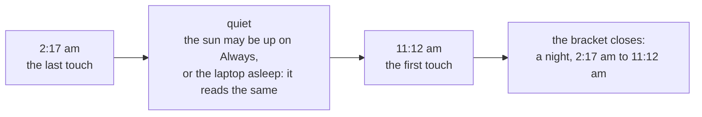

# Almanac

Version 0.4 · Size L · Touches core, engine, app, ui

## Why

The app knows when the laptop was held awake, and nothing about the person
holding it. Three questions it could not answer: how long did I work today,
which days did I take off, and when did I actually stop last night. The last
one matters most with the sun on **Always**: the laptop never sleeps, so its
sleep says nothing about yours.

An almanac is a book of days: when the light came, when it went. This one is
yours.

## The idea: the night is read backwards

Nobody tells an app they are going to bed, and nobody is watching a window
while they sleep. So the almanac never asks and never guesses in the moment.
It keeps one thing, read-only: the moments someone was at the keyboard, mouse
or trackpad (the same idle reading the overnight guard uses, ADR 0002).



The first touch of the morning closes the bracket, and the quiet between the
two touches is the night. Both ends are exact, because the OS stamps the last
input itself: the app only has to look once a minute to know to the second
when you left. Nothing depends on the laptop sleeping, so **Always** changes
nothing, and a laptop that did sleep reads the same way (no looks, no input).

| Rule                                                                  | Why                                                               |
| --------------------------------------------------------------------- | ----------------------------------------------------------------- |
| A quiet of 3 to 16 hours, at least 2 of them in the resting hours     | an afternoon out is not a night; a weekend away is not one either |
| The resting hours are the 10 hours centred opposite the working hours | someone on 3 pm to midnight sleeps at 3 am, not at 11 pm          |
| A stir under 2 minutes inside it does not end it                      | a nudged mouse at 3 am is not a morning                           |
| The night belongs to the day it leads into; the longest wins          | one night per morning                                             |
| A break under 10 minutes is still work                                | reading and thinking leave no input                               |
| Worked time stops at the last touch, not when the quiet was noticed   | hours are never padded by the wait                                |
| "No input since the last look" is judged on the monotonic clock       | a laptop that wakes itself in the night has not been touched      |

It says "night" and "quiet", never "you slept": it knows when the keys went
quiet, not what you did.

## Working hours, and where a day ends

Working hours are a setting (9 am to 6 pm by default; 3 pm to midnight is as
good, and so is anything that runs past midnight). They are when work is
meant to happen, not when it may: time outside them still counts, and is
shown as **over**.

A day does not end at midnight. It turns over opposite the middle of the
working hours, on the hour, so work that runs late stays on the day it began.

| Working hours      | The day turns at | The resting hours |
| ------------------ | ---------------- | ----------------- |
| 9:00 am – 6:00 pm  | 1 am             | 8 pm – 6 am       |
| 3:00 pm – 12:00 am | 7 am             | 2 am – 12 pm      |
| 10:00 pm – 6:00 am | 2 pm             | 9 am – 7 pm       |

## Experience

A new pane, **Almanac**, opened from an open book in the title bar (left of
settings), beside Home and Settings. Top to bottom:

| Part      | Shows                                                                                                                                                    |
| --------- | -------------------------------------------------------------------------------------------------------------------------------------------------------- |
| The day   | eyebrow `Today · Tue 10 Nov`; the figure in Fraunces, `4h 29m` (or the word `Leave`, `Rest`, `Nothing`, `Ahead`); one line of detail                     |
| Detail    | `Started 11:39 am · ended 2:17 am · 2h 47m extra`, then `Night 2:17 am – 11:12 am · 8h 55m` when there was one                                           |
| The strip | the day as a small horizon, turn to turn: a band of sky over the working hours, ink where you were here, the night dotted under the line, the sun at now |
| The week  | seven smaller strips, Monday first, each with its total; click one to read that day                                                                      |
| The month | a calendar: a bar under each worked day (longer for longer days), a ring for leave, the sun on today; arrows step months                                 |
| The tally | the year's leaves and days worked, and `Usual night` once three nights are known                                                                         |
| The foot  | what it reads and that it stays here; **Working days and hours…** (opens Settings → Almanac); **Clear the almanac**                                      |

Under the strip, one quiet link marks the day being read: **Mark as leave**,
or **Not a leave** on a day that reads as one. Days still to come can be
marked too: planned leave shows as a ring ahead.

What a day reads as:

| Day                                                   | Reads as                                                                            |
| ----------------------------------------------------- | ----------------------------------------------------------------------------------- |
| marked as leave                                       | `Leave`                                                                             |
| five minutes or more worked (and not marked)          | its hours                                                                           |
| still to come                                         | `Ahead`                                                                             |
| a past working day with nothing in it, since it began | `Leave` (unless **Empty working days are leave** is off, or marked **Not a leave**) |
| a past day that is not a working day, nothing in it   | `Rest`                                                                              |
| a past working day, empty, on a weekday not worked    | `Rest`: see below                                                                   |
| anything else with nothing in it                      | `Nothing` (today shows `0m`)                                                        |

On the first open after a night, Home whispers it once:
`A quiet night: 2:17 am to 11:12 am.`

With the almanac off, the pane says so and offers the switch.

## Added after the first build

### A weekday nobody works

The working days are a setting, and a setting can be wrong for a week: the
default is Monday to Friday, and someone who works four days would get a
leave every week. So an empty past working day reads as `Rest`
(`Day.usual_off`) when the same weekday was empty in at least three
(`OFF_FROM`) of the four weeks either side (`OFF_WEEKS`), counting only
weeks in which some other day was worked, and in none of them was it worked
or marked as leave; and the day's own week was worked. A week with nothing
in it says nothing either way, so a holiday stays leave. Its detail line:
`A day you do not usually work: a day off, not leave.` The switch is now
labelled **Count missed working days as leave**, with the hint `Weekends
and days off never count.`

Asked for once the first build was in use, and built the same day.

### Today on Home

Under the scene, today as a row-sized strip; at the right of the status
word, today's figure in Fraunces under the eyebrow `Today`. Both open the
Almanac. Shown only with the almanac on; the strip hides below 560 px of
height. Kept fresh with no timer: asked for again when the engine reports
and when the window comes back into view, at most once in 55 s. The first
time a day reaches the length of its working hours, Home whispers once:
`A full day: 9h 02m.`

### Putting a day right

| Link              | Does                                                                        |
| ----------------- | --------------------------------------------------------------------------- |
| **Mark as leave** | `marks[day] = leave`                                                        |
| **Not a leave**   | `marks[day] = clear` on an empty past working day, else the mark is removed |
| **Edit hours**    | opens From / Until; **Save** sets `fixes[day]` to that one stretch          |
| **Nobody here**   | `fixes[day]` of no length: nobody was at the machine                        |
| **Undo my edit**  | removes `fixes[day]`                                                        |

`Almanac::fixes: BTreeMap<String, Span>`, `Almanac::fix(day, Option<Span>)`
(refuses a non-date, a stretch that ends before it starts, or one over 36
hours). Corrections are kept beside the spans, not over them. The window
applies them first (`almanac.ts::corrected`): on a day set by hand, what was
read inside that day is cut out and the stretch put in, so hours, first and
last touch, time over and the night all follow. A day set by hand reads
`Set by you: 3:00 pm – 12:30 am`.

### Sleep when I'm away

`almanac.rest_after_mins: Option<u16>`, default `None`; Settings → Almanac →
**Sleep when I'm away**: Off · 30m · 1h · 2h. While it is on, the almanac is on and
it is night by the almanac's hours (`AlmanacSettings::is_resting`), the
overnight guard's wait for an Always session is those minutes instead of
its hours. The question, the ten minutes, **Keep it up** and the `idle`
ending are the guard's own; the status line and toast say
`Away for the night. Sleeping at 3:12 am.` A session that set this way rises
again at the next touch (`State::rise`, looked for every 30 s; a touch is
the idle time shrinking against the monotonic clock). A command that starts
or ends a session cancels it, and so does a day with nobody back.

`almanac.whisper_night: bool`, default `true`: the morning whisper's switch.

## Settings

Settings → new section **Almanac**, after **Schedule**.

| Field                          | Type        | Default       | UI                                                                                             |
| ------------------------------ | ----------- | ------------- | ---------------------------------------------------------------------------------------------- |
| `almanac.enabled`              | `bool`      | `true`        | **Keep an almanac**: `Your hours, leave and nights.`                                           |
| `almanac.work_days`            | `[bool; 7]` | Monday–Friday | **Working days**: the schedule's day pills                                                     |
| `almanac.start_minutes`        | `u16`       | `540`         | **Working hours**, two time fields: `Past midnight is fine. Time outside them counts as over.` |
| `almanac.end_minutes`          | `u16`       | `1080`        |                                                                                                |
| `almanac.empty_days_are_leave` | `bool`      | `true`        | **Count missed working days as leave**: `Weekends and days off never count.`                   |

New fields with defaults, so `SETTINGS_VERSION` stays. An end at or before
the start runs past midnight; equal ends mean the whole day.

## Rust

### core/almanac.rs (new, pure)

```rust
pub const AWAY_MS: u64 = 10 * 60 * 1000;        // a longer quiet starts a new span
pub const KEEP_MS: u64 = 400 * 24 * 60 * 60 * 1000;
pub struct Span { pub from_unix_ms: u64, pub to_unix_ms: u64 }
pub enum Mark { Leave, Clear }                   // Clear: "not a leave"
pub struct Look { pub at_unix_ms: u64, pub at: Instant, pub idle: Duration }
pub struct Almanac {
    pub version: u32,
    pub spans: Vec<Span>,                        // oldest first
    pub marks: BTreeMap<String, Mark>,           // by local day, `2026-11-10`
}
pub enum Noted { Nothing, Extended, Opened }
impl Almanac {
    pub fn note(&mut self, look: Look, last: Option<Look>) -> Noted;
    pub fn mark(&mut self, day: &str, mark: Option<Mark>) -> bool;   // false for a day that is not a date
    pub fn trim(&mut self, now_unix_ms: u64);
}
```

`note`: unless the idle time shrank against the monotonic time that passed
since the look before, nobody touched anything, and nothing changes. Input
within `AWAY_MS` of the newest span's end grows that span to the input;
otherwise a new span opens at the input. Its start is not known exactly (only
the latest input is), so it is taken as up to one look earlier, never before
the previous look. A span left in the future by a clock that was wrong for a
while is dropped first. Days are not cut here: spans are instants, and the
window buckets them in local time.

`Settings::almanac: AlmanacSettings`, defaulted and clamped.

### app/almanac.rs (new)

- `Keeper`: the almanac behind a mutex, its path, whether it is on, and a
  condvar. `look()` reads the idle time once and notes it; `start()` spawns
  `keepmeawake-almanac`, which looks every `LOOK_EVERY` (60 s) while on and
  blocks with no timeout while off.
- Saved when a span opens, when the keys have been quiet for two minutes,
  every 15 minutes while someone is here, and on exit (including the exit an
  update makes). Never more.
- The engine is not touched: presence is not a power decision.

### persistence.rs

`almanac_path`, `load_almanac`, `save_almanac` (one line of JSON: it is data,
not a file people read; the same atomic write).

## UI

- `types.ts`: `Span`, `Mark`, `Almanac`, `AlmanacSettings`.
- `almanac.ts` (new, pure, tested): the turn of the day, bucketing across
  it, time over, nights, what each day reads as, week and month grids,
  tallies, the usual night, each day's strip.
- `DayStrip.svelte`, `MonthGrid.svelte`, `Almanac.svelte` (new); the title
  bar button; a third pane in `App.svelte`; Settings → Almanac.
- `copy.ts`: every sentence above.
- Store: `almanac`, `loadAlmanac`, `markDay`, `clearAlmanac`, and the
  morning whisper, once per night (remembered in `localStorage`).

## IPC

| Command         | Args                                   | Returns                                             |
| --------------- | -------------------------------------- | --------------------------------------------------- |
| `get_almanac`   |                                        | `Almanac`, after one fresh look                     |
| `mark_day`      | `day: string`, `mark: Mark \| null`    | `Almanac`, or an error for a day that is not a date |
| `fix_day`       | `day: string`, `stretch: Span \| null` | `Almanac`, or an error for a correction it refuses  |
| `clear_almanac` |                                        | `Almanac` (empty), also written to disk             |

## Tests

Core: a first look opens a span; looks while typing grow it; a quiet under
ten minutes is bridged and a longer one opens a new span; the new span starts
no earlier than the previous look; a wake in the night with a stopped idle
clock is not a touch; a clock that ran ahead and came back; marks set,
replace and clear, and refuse a non-date; trim by age and mark count; serde
shape and defaults; the settings' defaults and clamp.
App: `look` with `FakeIdle` and `ManualClock` notes and says when to save; an
unknown idle reading notes nothing; off, it does not look; mark, clear, exit.
Persistence: round trip on one line, missing and corrupt files.
UI: the turn of the day for three sets of hours; work past midnight stays on
its day; time over; a span across the turn; a night found, with late hours
too; an afternoon and a weekend are not nights; a stir ignored; each kind of
day; marks win; tallies; the usual night across midnight; grids; strips; the
copy's length and tone; the store loads, marks, clears and whispers once.

## Docs

Guide (the Almanac, Settings table), architecture (core table, the keeper,
IPC, on disk, security posture), design (layout, type, what was decided
against), resource budget, changelog, roadmap, handoff.

## Resource impact

One thread, `keepmeawake-almanac`, blocked on a condvar: it wakes once a
minute while the almanac is on (one idle reading, microseconds) and never
while it is off. One small file write when a span opens, when the keys go
quiet, and every 15 minutes while someone is here. In the window: one
`get_almanac` a minute while the Almanac pane is on screen, nothing
otherwise. This is the first wake-up at rest the app has; it is the
feature's whole cost and it is behind a switch.

## Acceptance

- [ ] Use the laptop, leave it 15 minutes, come back: today's strip shows two
      runs of ink with a gap, and the figure did not grow during the gap.
- [ ] Leave the sun on Always overnight: the next morning the whisper names
      the night, and the strip shows it dotted under the line.
- [ ] The same with the sun down and the laptop asleep.
- [ ] Set working hours to 3:00 pm – 12:00 am and work past midnight: the
      time stays on the day it began and reads as over.
- [ ] Mark a day as leave, then not: the month, the tally and the figure follow.
- [ ] Switch the almanac off: the thread stops waking; the pane says it is closed.
- [ ] Clear the almanac empties the pane and the file.
- [ ] Paper and Night, at 380 × 600 and 340 × 520.

## Commits

Then, the same day: `fix(core): a schedule with equal times is the whole
day, not off`, `feat(app): correct a day in the almanac by hand`,
`feat(engine): Always can set with the night and rise at a touch`,
`feat(ui): today on Home, and a day's hours corrected by hand`.

1. `docs(specs): the almanac`
2. `feat(core): the almanac of presence and marked days`
3. `feat(core): almanac settings`
4. `feat(app): keep the almanac from the idle reading`
5. `feat(ui): read the almanac into days, nights and tallies`
6. `feat(ui): the Almanac pane`
7. `docs: the almanac in the guide, architecture and changelog`

## Out of scope

A leave allowance and balance, half days, public holidays, telling work from
anything else done at the keyboard, presence by camera or microphone, a toast
in the morning, the day's total in the tray, export, sync between machines,
different hours on different weekdays, a day that follows the night rather
than a fixed turn (an early riser's work before the turn lands on the day
before).

---

_Keep me awake · [Akshay Bajpai](https://akshaybajpai.com)_
