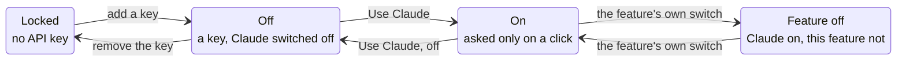

# Claude

Version 0.5 · Size M · Touches core, app, ui

## Why

Two things in the app are easier said than set: what a week was like, and
how long to stay awake. A language model does both well. But an app that
keeps a laptop awake has no business talking to a server on its own, so the
whole of this is built around two rules. **AI is a choice**, made three times
over and visible every time. And **it costs next to nothing**: the smallest
model, asked for a line or two, with a hard cap on every answer.

## The three locks

| Lock        | Default | Where it is                                                   |
| ----------- | ------- | ------------------------------------------------------------- |
| An API key  | none    | Settings → Claude; kept in the OS credential store            |
| Use Claude  | off     | Settings → Claude, and **Switch it on** wherever a feature is |
| The feature | on      | a switch beside the feature's name, where the feature is      |

A feature is never hidden. Without a key it is shown locked, with a lock and
`Locked: no API key yet.` **Add a key**. With a key and Claude off it says
`Claude is switched off.` **Switch it on**. With its own switch off it says
what it would do. Only with all three open does it show something to click,
and beside that, what clicking sends.

Nothing is ever sent on the app's own initiative: no request at launch, on a
timer, or in the background. Every request begins with a click.

## Experience

Claude's features sit in one frame wherever they are (`ClaudeGroup`): a
small `CLAUDE` chip that says once, for all of them, whether they can be
used. Under it each feature (`ClaudeFeature`) has its name, its own switch
and a line on what it does, so what Claude could do is seen before any of it
is switched on.

| Feature                 | Where                             | Asks with      | Sends                                           | Gives back                                     |
| ----------------------- | --------------------------------- | -------------- | ----------------------------------------------- | ---------------------------------------------- |
| **The day, in a line**  | Almanac, under the month          | Read this day  | the one day being read                          | one sentence                                   |
| **This week, in words** | Almanac, under the month          | Read this week | the week being read, one line a day             | two or three sentences                         |
| **Ask the almanac**     | Almanac, under the month          | Ask            | your question and the month in view             | one or two sentences                           |
| **Tell the sun**        | Home, under the rule, with Until… | Ask            | the sentence typed, and the local date and time | `Awake for 2 hours`, with **Start** and **No** |

Tell the sun never starts anything on its own: it shows what it understood
and waits. While a plan is being typed, Home's two rows and its doors step
aside to give it room.

Days are sent as the pane shows them: hours, first and last touch, time
over, the night, whether a day was leave or set by hand. A month leaves out
the days still to come. Nothing else in the almanac leaves the machine.

### Hide AI

Settings → Claude → **Hide AI**, off by default, so a new install sees the
features, locked. On, every one of them is gone from Home and the Almanac,
and Settings → Claude is one row: `AI is hidden` and a button, **Enable
AI**. Hidden, nothing can be asked either, whatever else is set.

## What it costs

| Lever          | Setting                                                                |
| -------------- | ---------------------------------------------------------------------- |
| the model      | `claude-haiku-5-5`, the smallest and cheapest                          |
| thinking       | `{"type": "disabled"}`: no token is spent on anything but the answer   |
| effort         | `low`                                                                  |
| the answer     | capped: 120 tokens for a line, 300 for a few sentences, 200 for a plan |
| what is sent   | capped: 6,000 characters of days, 300 of question; refused, never cut  |
| a second model | none: no fallback                                                      |
| asking twice   | answered from memory for the session, by what was asked                |
| asking unasked | never: no request at launch, on a timer or in the background           |

At the list price when this was written ($0.10 per million tokens in, $0.50
out), the largest request the app can make, a question about a full month,
is about 1,500 tokens in and 300 out: about a thirtieth of a cent. A day in
a line is a tenth of that.

## Settings

Settings → new section **Claude**, after **Almanac**.

| Field                | Type   | Default | UI                                                                                    |
| -------------------- | ------ | ------- | ------------------------------------------------------------------------------------- |
| `ai.enabled`         | `bool` | `false` | **Use Claude**: `Off, nothing is ever sent to Anthropic.`                             |
| `ai.week_in_words`   | `bool` | `true`  | **This week, in words** (also beside the feature)                                     |
| `ai.tell_the_sun`    | `bool` | `true`  | **Tell the sun** (also beside the feature)                                            |
| `ai.day_in_a_line`   | `bool` | `true`  | **The day, in a line** (also beside the feature)                                      |
| `ai.ask_the_almanac` | `bool` | `true`  | **Ask the almanac** (also beside the feature)                                         |
| `ai.hidden`          | `bool` | `false` | **Hide AI**: `Takes every AI feature out of sight. One button here brings them back.` |
| (not a setting)      |        |         | **API key**: a password field and Save; then `A key is saved.` Remove                 |

The key is not in `settings.json`. It goes from the field to the app in one
call and into the OS credential store (Windows Credential Manager, macOS
Keychain); the window is only ever told whether there is one.

## Rust

### core/ai.rs (new, pure)

Builds request bodies and reads response bodies; no network.

| Item                      | What                                                                                        |
| ------------------------- | ------------------------------------------------------------------------------------------- |
| `MODEL`                   | `claude-haiku-5-5`                                                                          |
| `body(system, text, cap)` | what every request shares: the model, thinking disabled, `effort: low`, `max_tokens: cap`   |
| `day_request(digest)`     | one sentence of at most twenty words                                                        |
| `week_request(digest)`    | two or three sentences (say night, never slept; no advice)                                  |
| `ask_request(q, digest)`  | one or two sentences, from the lines given and nothing else                                 |
| `plan_request(s, now)`    | `output_config.format` a JSON schema: `kind`, `minutes`, `time`, `say`                      |
| `text_of(response)`       | the text blocks; `stop_reason: "refusal"` is an error, checked before the content is read   |
| `understood(response)`    | the plan; a length of no minutes or a time that is not one reads as `unclear`               |
| `AiError`                 | `NoKey`, `Off`, `BadKey` (401), `Busy` (429, 529), `Declined`, `TooLong`, `Empty`, `Failed` |

Thinking is switched off and effort is low, since every job here is a
sentence or two from a few lines. Input over the cap is refused, never cut.

### app/ai.rs (new)

- `KeyStore` trait; `OsKeyStore` over the `keyring` crate.
- `Claude::unlock(settings, feature)`: the key, only if all three locks are
  open and Claude is not hidden. `Claude::ask(key, body)`: one POST to
  `/v1/messages` over the HTTPS client the updater already ships, with
  `x-api-key` and `anthropic-version`. The key is not logged.
- Raw HTTP, because there is no official Anthropic SDK for Rust; the shapes
  are the documented ones.

## UI

`claude.ts` (pure): `gateOf`, `planOf`, `nowLocal`. `ClaudeGate.svelte`,
`TellTheSun.svelte`; the week section in `Almanac.svelte`; Settings →
Claude. `almanac.ts::weekDigest` lays out what is sent.

## IPC

| Command        | Args                 | Returns                                    |
| -------------- | -------------------- | ------------------------------------------ |
| `ai_status`    |                      | `{ has_key }`                              |
| `set_ai_key`   | `key \| null`        | `{ has_key }`                              |
| `ai_read_day`  | `digest`             | the line, or a sentence saying why not     |
| `ai_read_week` | `digest`             | the words, or a sentence saying why not    |
| `ai_ask`       | `question`, `digest` | the answer, or a sentence saying why not   |
| `ai_plan`      | `sentence`, `now`    | `Understood`, or a sentence saying why not |

## Tests

Core: the bodies name the model, ask for low effort and send no thinking or
sampling parameters; the schema's shape; nothing and too much are refused
before sending; a refusal is not read; a plan is read; half an answer is
unclear; statuses map to errors. App, with a key kept in memory: locked
without a key whatever the switches; off by default with one; each feature's
switch; removing the key; the window learns only `has_key`. UI: the gate's
four states; a plan from what was understood; the digest; the copy says
locked and off differently and names Anthropic wherever something is sent.

## Docs

Guide, architecture (security posture: the app now makes a second kind of
request, only when asked), design, changelog, roadmap, handoff.

## Resource impact

Nothing at rest and nothing at launch beyond one read of the credential
store when the window opens. One HTTPS request per click. `keyring` is the
one new crate; `reqwest` and `rustls` were already built for the updater.
The exe's growth is to be measured at the next release build.

## Acceptance

- [ ] No key: both features show locked, with the lock and Add a key.
- [ ] Add a key: both say Claude is switched off, with Switch it on.
- [ ] Switch it on: Read this week returns two or three sentences; Tell the
      sun understands `two hours` and `until half six`, and starts only on
      Start.
- [ ] A wrong key says `Anthropic did not accept that API key.`
- [ ] Each feature's switch turns only that feature off.
- [ ] Use Claude off: no request is made, by any path.
- [ ] The key is in the OS credential store and not in `settings.json`.

## Commits

1. `docs(specs): claude, as a choice`
2. `feat(app): Claude behind three locks, and a break reminder`
3. `feat(ui): Claude where its features are, a month as CSV`
4. `docs: Claude, the break reminder and CSV`

## Out of scope

Choosing a larger model, streaming the answer, a chat, a conversation that
remembers, anything sent without a
click, other providers, keys shared between machines, a monthly or yearly
reading, cost shown in the app.

---

_Keep me awake · [Akshay Bajpai](https://akshaybajpai.com)_
