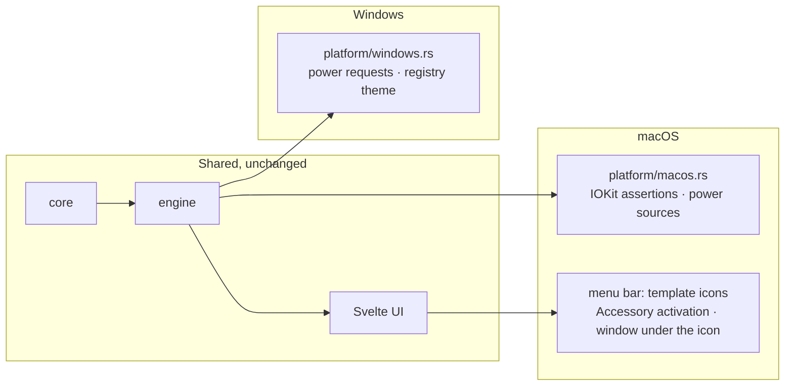

# macOS

Parallel track · Size L · Touches build, platform, app, tray, ui, ci, docs

Built on Akshay's personal Mac, in parallel with the Windows 0.3 work. Both
machines push to `main`; pull before you start, update
[`HANDOFF.md`](../HANDOFF.md) when you stop.

## Why

The same working day happens on a Mac. The engine, the schedule, the design
and the copy are already platform-free; what is missing is a thin IOKit layer,
a menu bar that behaves like a Mac's, and a build that produces a `.app`. One
codebase, one look, two operating systems.

## Experience

Keep me awake is a **menu bar app** on macOS: no Dock icon, no app switcher
entry, one sun in the menu bar. Click it and the window drops down beneath it
like a popover; close the window and the sun stays. Everything else, the
horizon, Paper and Night, the rule, the schedule, the whispers, is identical.



### What a Mac user sees differently

| Surface           | Windows                                  | macOS                                                                       |
| ----------------- | ---------------------------------------- | --------------------------------------------------------------------------- |
| Icon              | tray, white or ink by taskbar theme      | menu bar, **template image**; macOS tints it for light, dark and Mica       |
| Left click        | opens the window where it last was       | opens the window **centred under the menu bar icon**                        |
| Right click       | menu                                     | menu (Control-click opens the window: tray-icon reports it as a left click) |
| Dock / Cmd-Tab    | taskbar entry while the window is open   | none: `ActivationPolicy::Accessory`                                         |
| Window chrome     | custom title bar, our minimise and close | same bar; **Cmd+W** closes to the menu bar, **Cmd+M** minimises             |
| Settings shortcut | `Ctrl+,`                                 | `Cmd+,`                                                                     |
| Default hotkey    | `Ctrl+Alt+K`                             | `Cmd+Alt+K` (shown as `⌘⌥K`)                                                |
| Proof it is awake | `powercfg /requests`                     | `pmset -g assertions`                                                       |
| UI sans           | Segoe UI Variable                        | the system font (SF Pro via `-apple-system`)                                |
| Toasts            | Windows notification centre              | Notification Center; only from a bundled `.app`, not from `tauri dev`       |
| Launch at sign-in | `HKCU\...\Run`                           | a LaunchAgent in `~/Library/LaunchAgents`, written by the plugin            |
| Quit              | tray menu, Settings                      | tray menu, Settings, **Cmd+Q**                                              |

Copy that names the OS or the tray reads correctly on both: see
**UI → copy** below. Nothing in the window should say "taskbar" or "Windows"
on a Mac.

## Settings

No new fields. `DEFAULT_HOTKEY` becomes platform-dependent:

```rust
pub const DEFAULT_HOTKEY: &str = if cfg!(target_os = "macos") { "Cmd+Alt+K" } else { "Ctrl+Alt+K" };
```

`SETTINGS_VERSION` stays at 1: a settings file carried from one OS to the
other keeps its stored hotkey, which is the right behaviour.

## Rust

### Cargo.toml

```toml
[target.'cfg(target_os = "macos")'.dependencies]
core-foundation = "0.10"   # CFString/CFDictionary for IOKit; already pulled in by tauri on macOS
```

IOKit itself is linked by hand: three power-assertion functions and four
power-source functions declared in `extern "C"` blocks under
`#[link(name = "IOKit", kind = "framework")]`. No `objc2`, no `cocoa`; the
window and menu bar work goes through Tauri's own API.

### platform/macos.rs (new; the only other `unsafe`)

Mirrors `windows.rs` one struct for one struct.

```rust
const REASON: &str = "KeepMeAwake is keeping this Mac awake";   // shows in `pmset -g assertions`

/// Two IOPMAssertions, created and released to match `GuardState`.
pub struct MacPowerGuard { system: Option<IOPMAssertionID>, display: Option<IOPMAssertionID>, current: GuardState }
impl PowerGuard for MacPowerGuard { .. }   // idempotent; Drop releases both
impl MacPowerGuard { pub fn new() -> Result<Self, PlatformError>; }

/// IOPSCopyPowerSourcesInfo → first power source → state, current and max capacity.
pub struct MacBattery;
impl BatteryProbe for MacBattery { .. }

/// Pure, tested: ("AC Power" | "Battery Power", current, max) → BatteryState.
pub fn decode_power_source(state: &str, current: Option<i64>, max: Option<i64>) -> BatteryState;
```

| `GuardState`    | Assertion                                                                         |
| --------------- | --------------------------------------------------------------------------------- |
| `system: true`  | `kIOPMAssertionTypePreventUserIdleSystemSleep` (`"PreventUserIdleSystemSleep"`)   |
| `display: true` | `kIOPMAssertionTypePreventUserIdleDisplaySleep` (`"PreventUserIdleDisplaySleep"`) |
| both false      | both released                                                                     |

Calls: `IOPMAssertionCreateWithName(type, kIOPMAssertionLevelOn, name, &mut id)`
and `IOPMAssertionRelease(id)`. A non-zero `IOReturn` becomes
`PlatformError::Os { call, detail }` with the code formatted in hex. Each
`unsafe` block carries a `SAFETY:` comment; the module header states the
invariants (ids are only ever those IOKit handed back; released once).

`TaskbarTheme` is not implemented on macOS: the icon is a template image and
the system tints it. `make_taskbar()` keeps returning `DarkTaskbar` there.

No `IOPSNotificationCreateRunLoopSource`: the 30 s battery poll while awake is
kept for parity and simplicity. Note this in the resource budget.

### platform/mod.rs

```rust
#[cfg(windows)] pub mod windows;
#[cfg(target_os = "macos")] pub mod macos;
```

`PlatformError::Os` doc comment: "A Win32 or IOKit call failed."

### app/mod.rs

- `make_platform()` gains a `#[cfg(target_os = "macos")]` arm building
  `MacPowerGuard` (falling back to `NullPowerGuard` with an error log, as on
  Windows) and `MacBattery`.
- In `setup`, on macOS: `app.set_activation_policy(ActivationPolicy::Accessory)`
  before any window exists.
- `watch_taskbar_theme` stays a no-op off Windows.

### app/window.rs

- **Main thread.** AppKit requires windows to be created on the main thread.
  `show_main` currently hops to a fresh thread and lets Tauri marshal; on macOS
  use `app.run_on_main_thread(move || create(&app))` instead. Keep the thread
  on Windows (documented deadlock). Both paths behind `cfg`.
- **Under the icon.** `TrayIconEvent::Click` carries the icon's `rect`
  (position and size in physical pixels) and the window's monitor. Add
  `place_under(window, rect)`: x centred on the icon, y at the bottom of the
  menu bar, clamped to the monitor's work area. Pure arithmetic in
  `core::placement::under_icon(icon: Rect, window: Size, work_area: Rect) -> Point`
  with tests (centre, left edge, right edge). Windows keeps the remembered
  position and does not call it.
- **Cmd+W / Cmd+M.** With `decorations: false` there is no system close, so
  the UI handles them: `App.svelte` key handler maps `Meta+w` → close to tray
  (same path as Esc) and `Meta+m` → minimise, macOS only.

### app/mod.rs, quitting

Tauri builds a default app menu on macOS whose **Quit** item calls
`app.exit(0)`, which arrives as `ExitRequested { code: Some(0) }` and is not
vetoed. Verify by hand that **Cmd+Q** quits and releases the assertions, and
that closing the last window does not (code `None`, vetoed, as today).

### app/tray.rs

- `icon_as_template(cfg!(target_os = "macos"))`.
- `icon_bytes` on macOS returns the **template** set regardless of `light`:
  `icons/tray/{on,off,paused}-template.png`, pure black with alpha, exported
  from the existing `design/tray-*.svg` at 44 × 44 (22 pt @2x) with the fill
  swapped to `#000000`. One `include_bytes!` trio behind `cfg`, so the Windows
  binary does not carry them and vice versa.
- Tooltip and menu labels unchanged; the menu's **Open Keep me awake** item
  stays (Control-click users).

### app/hotkey.rs

- `NEEDS_MODIFIER` becomes platform text: Windows `Ctrl, Alt, Win`; macOS
  `Cmd, Ctrl, Alt`.
- `parse` already accepts `Cmd`/`Super`; add a test for `Cmd+Alt+K`.
- `TAKEN` on macOS: the plugin returns an error when the combination is held by
  the system (`Cmd+Space`) or another app; the same text fits.

### Autostart

`tauri-plugin-autostart` with `MacosLauncher::LaunchAgent` and the existing
`--hidden` argument. Verify the plist lands in `~/Library/LaunchAgents/` and
that sign-in launches hidden.

## UI

### Platform flag

`src/lib/platform.ts` (new): `export const isMac: boolean` from
`navigator.platform` / `userAgentData`, with an injectable `detect(ua)` pure
function and tests. No IPC; the webview already knows.

### copy.ts

Copy is written once and resolved through `isMac`:

| Key               | Windows                                             | macOS                                           |
| ----------------- | --------------------------------------------------- | ----------------------------------------------- |
| TIPS `Ctrl+,`     | `Ctrl+,` · Settings                                 | `⌘,` · Settings                                 |
| TIPS tray rows    | `Tray · left click` / `Tray · right click`          | `Menu bar · click` / `Menu bar · right click`   |
| TIPS (mac only)   |                                                     | `⌘W` · Close to the menu bar; `⌘Q` · Quit       |
| Esc tip           | `Back, or close to the tray`                        | `Back, or close to the menu bar`                |
| Title bar close   | `Close to tray (Esc). The sun stays up.`            | `Close to the menu bar (⌘W). The sun stays up.` |
| Settings → Window | `Close to tray` row label and hint                  | `Close to the menu bar`                         |
| Settings → About  | `Holds a Windows power request… powercfg /requests` | `Holds a power assertion… pmset -g assertions`  |
| Settings → Hotkey | `Needs at least one of Ctrl, Alt, Win.`             | `Needs at least one of ⌘, ⌃, ⌥.`                |
| Horizon tips      | any that say "tray" or "Windows"                    | resolved the same way                           |

`HotkeyField.svelte` renders accelerators with Mac glyphs on macOS
(`Cmd` → `⌘`, `Ctrl` → `⌃`, `Alt` → `⌥`, `Shift` → `⇧`, joined without `+`),
and records `Meta` as `Cmd`. A pure `displayAccelerator(acc, isMac)` in
`src/lib/hotkey.ts` with tests. The stored string stays in the plugin's
`Cmd+Alt+K` form on both platforms.

Tests in `copy.test.ts` pin that no macOS string contains `tray`, `taskbar`
or `Windows`, and no Windows string contains `⌘` or `menu bar`.

### Type

`tokens.css`: `--font-ui: 'Segoe UI Variable Text', 'Segoe UI', -apple-system, system-ui, sans-serif;`.
SF Pro renders a touch wider than Segoe at 12–13 px; check the rule's stop
labels and the status line at 340 px, and adjust letter-spacing in a
`@supports (-webkit-touch-callout: none)`-free way: a `[data-platform="mac"]`
attribute on `<html>` set from `platform.ts`, used only for type metrics.
Fraunces is bundled and identical on both.

### Scene

Unchanged. Screenshot Paper and Night on the Mac at 380 × 600 and compare with
the Windows captures side by side before calling the type done.

## Build

### tauri.conf.json

```json
"bundle": {
  "targets": ["nsis", "msi", "app", "dmg"],
  "macOS": {
    "minimumSystemVersion": "12.0",
    "signingIdentity": null,
    "entitlements": null,
    "dmg": { "windowSize": { "width": 540, "height": 380 } }
  }
}
```

Tauri bundles only the targets that apply to the host, so the Windows build is
unaffected. The DMG background is a design task: the horizon with the app icon
on the left and the Applications alias on the right, Paper palette, 540 × 380
@2x, saved as `design/dmg-background.png` and referenced via
`bundle.macOS.dmg.background`.

Build for Apple Silicon by default; `npm run build -- --target universal-apple-darwin`
when an Intel machine asks for it. (Rosetta does not help here: it runs Intel
code on Apple Silicon, not the reverse, so an arm64-only build does not open
on an Intel Mac.)

### Signing and notarization

Unsigned at first. An unsigned `.app` opens with right-click → Open or
`xattr -d com.apple.quarantine`; the guide says so. Notarization needs an
Apple Developer account (open question for Akshay, alongside the Windows
certificate). When it exists: `APPLE_CERTIFICATE`, `APPLE_CERTIFICATE_PASSWORD`,
`APPLE_SIGNING_IDENTITY`, `APPLE_ID`, `APPLE_PASSWORD`, `APPLE_TEAM_ID` as
repository secrets; `tauri-action` handles the rest.

## CI

- `ci.yml`: the `rust` and `build` jobs become a matrix over
  `[windows-latest, macos-latest]`. The placeholder `dist` step uses
  `mkdir -p dist` with `shell: bash` so it runs on both.
- `release.yml`: matrix over the same two runners; `tauri-action` uploads
  `.exe`, `.msi`, `.dmg` and `.app.tar.gz` to the same draft release.

## Docs

- `README.md`: "A small Windows **and macOS** app…"; Install gains a Mac line.
- `guide.md`: **Tray** becomes **Tray and menu bar**; **Where things are** and
  **When it will not hold** get macOS rows (`~/Library/Application Support/dev.bajpai.keepmeawake/`,
  `~/Library/Logs/dev.bajpai.keepmeawake/`, `pmset -g assertions`;
  clamshell with no external display sleeps regardless, by design).
- `architecture.md`: platform table gains a macOS column; the layer diagram
  gains `platform/macos.rs`; on-disk table gains macOS paths.
- `design.md`: type table notes SF Pro on macOS and the template icon rule.
- `development.md`: already has **Setup (macOS)**; add the Mac screenshot and
  driving notes if the tooling changes.
- `resource-budget.md`: a macOS column with measured numbers
  (Activity Monitor → Memory, `footprint <pid>`; CPU over an idle minute;
  `.app` size).
- `roadmap.md`, `CHANGELOG.md` (Unreleased → Added: macOS).
- `CLAUDE.md` and `specs/BRIEF.md`: the `unsafe` rule names both platform
  files (already done).

## Resource impact

Same engine, same no-polling rule. Expect a smaller idle footprint than
Windows (no WebView2 loader thread; WKWebView is in-process only while the
window is open). Measure and record. The 30 s battery poll while awake carries
over; IOKit notifications would remove it and are noted under Later.

## Acceptance

- [ ] `npm run verify` is green on the Mac.
- [ ] Toggle on: `pmset -g assertions` lists `KeepMeAwake is keeping this Mac awake`
      under `PreventUserIdleSystemSleep` (and `PreventUserIdleDisplaySleep`
      when the display switch is on). Toggle off: gone. Quit while awake: gone.
- [ ] Unplug below the threshold: Paused, assertions released; plug in: back.
- [ ] No Dock icon at any point; the window drops down centred under the menu
      bar icon on the first click, and reopens there after a close.
- [ ] Menu bar icon is legible on a light menu bar, a dark menu bar and over a
      busy wallpaper, in all three states.
- [ ] `⌘⌥K` toggles with the window closed; recording `⌘⇧K` works; `⌘Space`
      is refused with "That combination is already taken."; `⌘,` opens
      Settings; `⌘W` closes to the menu bar; `⌘Q` quits.
- [ ] Timer toast appears from the bundled `.app` (not expected from `tauri dev`).
- [ ] Launch at sign-in writes a LaunchAgent and starts hidden after a sign-out.
- [ ] Schedule: a window that starts in one minute raises the sun; the status
      line and the menu bar menu read as on Windows.
- [ ] No string in the window says tray, taskbar or Windows; the Tips table
      shows Mac glyphs.
- [ ] Paper and Night screenshots at 380 × 600 under `docs/assets/` with a
      `-mac` suffix, compared with the Windows ones for type and spacing.
- [ ] `npm run build` yields `KeepMeAwake.app` and a `.dmg` with the horizon
      background; the `.app` opens after `xattr -d com.apple.quarantine`.
- [ ] Resource numbers recorded; CI matrix green on both runners.

## Commits

1. `build: compile and bundle for macOS` (Cargo target deps, bundle targets,
   `cargo check` green on the Mac)
2. `feat(platform): hold IOKit power assertions on macOS`
3. `feat(platform): read the battery from IOKit power sources`
4. `feat(app): run as a menu bar app and create the window on the main thread`
5. `feat(app): drop the window beneath the menu bar icon`
6. `feat(brand): template menu bar icons`
7. `feat(app): macOS default hotkey and modifier copy`
8. `feat(ui): platform-aware copy, glyphs and type stack`
9. `feat(ui): Cmd+W, Cmd+M and Cmd+, on macOS`
10. `brand: DMG background`
11. `ci: build and test on macOS`
12. `docs: macOS in the guide, architecture, design, budget and changelog`

## Out of scope

Linux (the `cfg(not(windows))` fallbacks compile there; a D-Bus
`org.freedesktop.ScreenSaver` inhibitor is the Later item), Intel-only builds,
notarization, Homebrew cask (joins the winget-scoop spec as "Homebrew" when
signing exists), Touch Bar, Shortcuts.app actions, sleep detection via
`NSWorkspace` (0.4, alongside the Windows one).

---

_Keep me awake · [Akshay Bajpai](https://akshaybajpai.com)_
