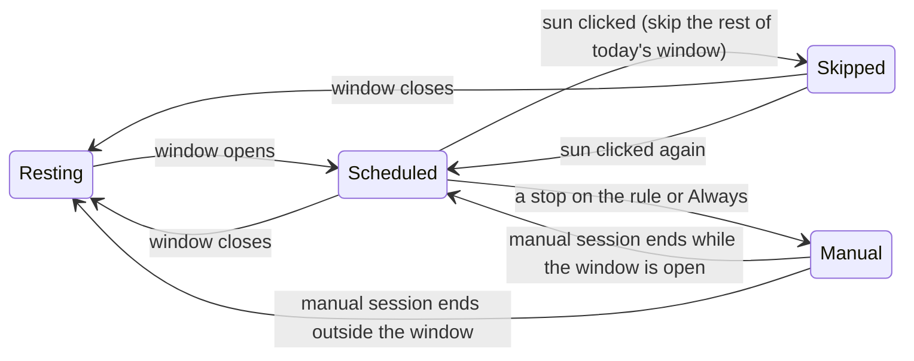

# Schedule

Version 0.2 · Size L · Touches core, engine, app, tray, ui

## Why

Most days the laptop should simply be awake during working hours and free to
sleep outside them, without anyone touching the app. A schedule turns the app
from a thing you operate into a thing you set once.

## Experience

A schedule is one window of time on chosen weekdays, for example 09:00–18:00
Monday to Friday. Overnight windows (22:00–06:00) are allowed and span the day
boundary.



Precedence, highest first: **manual session** (anything set via sun, rule,
tray, hotkey) → **skip** → **schedule** → **resting**. A manual session never
shortens because a window closes; the window simply resumes being relevant
once the manual session ends.

### Home pane

| Element     | Scheduled (window open)                                                            | Window closed, schedule on                             |
| ----------- | ---------------------------------------------------------------------------------- | ------------------------------------------------------ |
| Sun         | on the arc, travelling across the window (zenith at the start, horizon at the end) | below the line                                         |
| Status word | **Awake**                                                                          | **Resting**                                            |
| Status line | `Until 6:00 pm · on schedule`                                                      | `Your laptop sleeps as usual. Awake again at 9:00 am.` |
| Rule        | no stop active; stops still work and override                                      | unchanged                                              |
| Sun click   | skips the rest of today's window; whisper `Skipped until 6:00 pm.`                 | starts the default plan (unchanged)                    |

While skipped: word **Resting**, line `Skipping today's schedule until 6:00 pm.`;
clicking the sun un-skips (`Back on schedule.`).

### Settings pane

New section **Schedule**, placed between **Waking** and **Battery**:

| Row             | Control                                           | Hint                                              |
| --------------- | ------------------------------------------------- | ------------------------------------------------- |
| Keep a schedule | switch                                            | `Awake during these hours, resting outside them.` |
| Days            | seven toggle pills `M T W T F S S` (Monday first) | none                                              |
| From / Until    | two `<input type="time">` side by side            | `Overnight is fine: 10:00 pm until 6:00 am.`      |

Rows below the switch are disabled (dimmed, `inert`) while the switch is off.
"Begin as" (Startup) gains no new option; a schedule that is on simply applies
at launch.

### Tray

- Status line uses the same text as the status line above.
- New item under the toggle: **Skip today's schedule** / **Back on schedule**,
  shown only while the schedule is on and today has a window.

## Settings

Add to `Settings` (all defaulted; no version bump):

```rust
pub struct Schedule {
    pub enabled: bool,          // false
    pub days: [bool; 7],        // Mon..Sun, default [true,true,true,true,true,false,false]
    pub start_minutes: u16,     // minutes after local midnight, default 540 (09:00)
    pub end_minutes: u16,       // default 1080 (18:00); end < start means overnight
}
pub schedule: Schedule,
```

`sanitized()` clamps both minute fields to `0..=1439` and, if they are equal,
disables the schedule (a zero-length window is meaningless).

TypeScript mirror: `schedule: { enabled: boolean; days: boolean[]; start_minutes: number; end_minutes: number }`.

## Rust

### core/schedule.rs (new, pure)

Local-time arithmetic needs a calendar. Add `chrono = { version = "0.4", default-features = false, features = ["clock", "std"] }`
(small; already a transitive dependency of tauri). All functions take a
`chrono::DateTime<Local>` or `NaiveDateTime` so tests can pass fixed times.

```rust
pub struct Window { pub start: DateTime<Local>, pub end: DateTime<Local> }

/// The window containing `now`, if any, honouring overnight spans and weekdays
/// (an overnight window belongs to the day it starts on).
pub fn current_window(s: &Schedule, now: DateTime<Local>) -> Option<Window>;

/// The next window start strictly after `now`, within the next 8 days.
pub fn next_window(s: &Schedule, now: DateTime<Local>) -> Option<Window>;

/// Next moment the answer to `current_window` can change: the end of the
/// current window, else the next start. Used as an engine deadline.
pub fn next_boundary(s: &Schedule, now: DateTime<Local>) -> Option<DateTime<Local>>;
```

DST: compute in local time via `Local.from_local_datetime(...)`; on an
ambiguous/missing local time pick the earliest valid instant and add a test.

### core/session.rs

Add a `skip_until: Option<Instant>` to the engine `State` (not to `Session`;
skipping is about the schedule, not the manual session). Clear it when it
passes.

### core/snapshot.rs

Add:

```rust
pub struct ScheduleState {
    pub enabled: bool,
    pub in_window: bool,                    // a window is open right now
    pub skipped: bool,                      // and the user skipped it
    pub window_start_unix_ms: Option<u64>,
    pub window_end_unix_ms: Option<u64>,
    pub next_start_unix_ms: Option<u64>,
}
pub schedule: ScheduleState,
```

`Mode` gains a fourth variant `Scheduled`. `Snapshot.mode` is `Scheduled` when
no manual session is active, the window is open and not skipped. `plan_secs`
and `remaining_secs`/`ends_at_unix_ms` are filled from the window in that case
so the UI's sun arc works unchanged.

### engine

- `State` gains `skip_until`.
- `step()` computes `active = session.is_active() || schedule_active(now)`, where
  `schedule_active` is `current_window(..).is_some() && !skipped`. Pass `active`
  to `policy::decide` as today.
- `policy::next_deadline` gains the schedule boundary: `min(session deadline,
battery poll, next_boundary)`.
- New engine methods: `skip_today()` / `unskip()`; `toggle()` becomes: manual
  active → off; else if in window and not skipped → skip; else if skipped →
  unskip; else → start default plan.
- Emit `EngineEvent::ScheduleStarted` / `ScheduleEnded` (notifications spec
  uses them).

### app

- Tray: new menu id `skip` with the label above; `status_line` handles the
  new mode and the skipped state.
- Commands: `skip_schedule`, `resume_schedule` (both return `Snapshot`).

## UI

- `types.ts`, `format.ts` `statusText` for the new mode/skip cases (copy above
  goes in `copy.ts`).
- `Scene.svelte`: mode `scheduled` is treated as timed for sun position.
- `DurationRule.svelte`: `activeStop` is `null` while scheduled.
- `Settings.svelte`: Schedule section; a new `DayPills.svelte` component
  (seven toggle buttons, `aria-pressed`, 28 × 28, ink when on); time inputs
  reuse the `until` input style.
- `copy.ts`: whispers `Skipped until {time}.`, `Back on schedule.`; horizon tip
  `A schedule keeps the sun up for you. Settings → Schedule.` appended to
  `HORIZON_TIPS`.

## IPC

| Command           | Args | Returns    |
| ----------------- | ---- | ---------- |
| `skip_schedule`   |      | `Snapshot` |
| `resume_schedule` |      | `Snapshot` |

## Tests

Rust: `current_window` inside/outside/at edges, overnight spanning midnight,
weekday off, DST gap day; `next_window` across a weekend; `next_boundary`;
engine: window opens → guards held, closes → released, manual session outlasts
window, skip releases and un-skip restores, deadline wakes exactly at the
boundary (ManualClock), tray `status_line` for scheduled and skipped.

UI: `statusText` for scheduled and skipped; `DayPills` toggles and reports; the
store's `toggle` path is unchanged (engine decides).

## Docs

Guide (Settings table, status lines, tray item), architecture (policy table
gains a column, state diagram gains Scheduled), roadmap, changelog.

## Resource impact

One extra deadline; no polling. `chrono` adds ~100 KB to the binary. Record in
the budget.

## Acceptance

- [ ] Enable a schedule that starts in one minute; the sun rises at that
      minute without touching the app, `powercfg /requests` lists the request.
- [ ] It sets at the end minute and the request disappears.
- [ ] An overnight window (now−1h until now+1h, tomorrow) is in window now.
- [ ] Clicking the sun during a window shows `Skipped until …`; clicking again
      returns to schedule.
- [ ] Picking 2h during a window keeps the laptop awake past the window's end.
- [ ] Launching the app inside a window starts awake; outside, resting with
      `Awake again at …`.
- [ ] Both themes screenshot for the Schedule section and the scheduled home pane.

## Commits

1. `feat(core): add Schedule settings and pure window arithmetic`
2. `feat(core): add Scheduled mode and ScheduleState to the snapshot`
3. `feat(engine): honour the schedule with skip, precedence and a deadline`
4. `feat(app): add skip/resume commands and the tray item`
5. `feat(ui): add the Schedule section with day pills and time fields`
6. `feat(ui): render scheduled and skipped states on the home pane`
7. `docs: schedule in the guide, architecture, roadmap and changelog`

## Out of scope

Multiple windows per day, per-day different hours, calendar integration.

---

_Keep me awake · [Akshay Bajpai](https://akshaybajpai.com)_
