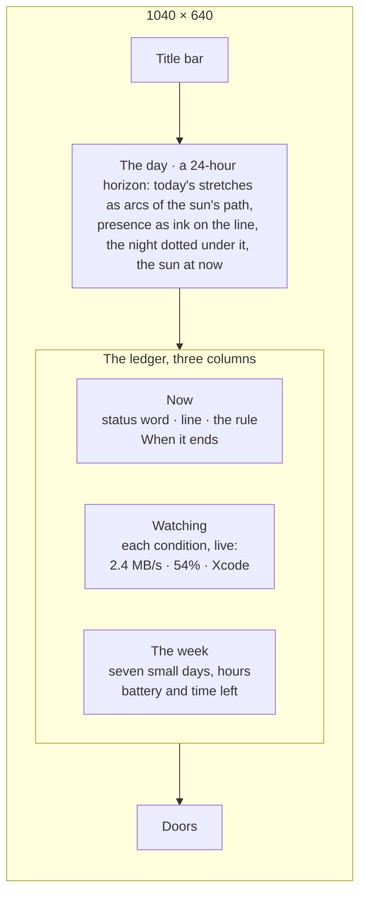

# The wide window

A third size for the window, beside the mini window: the horizon widened
into a whole day, with everything the app knows laid out under it. Same
place, more of it.

## Why

The 380 px window is a remote control. Some people keep the app open on a
second screen, or want to see in one look why the laptop is awake, what it
is watching, and how the day went. The roadmap's _Sky log_ (history drawn,
not listed) belongs here: a window wide enough to draw a day.

## Experience

The title bar gains a button between the mini window and the Almanac (two
corners pulling apart; `Wide window (Ctrl+E / ⌘E)`). The wide window is
1040 × 640, resizable down to 860 × 560, and remembers that it was wide.
The same button, or the shortcut, or Esc, brings back the usual window.

**The day.** The scene, but its width is the day (from the turn of the day
the almanac uses, or midnight without it). Each stretch the sun was up
today, from history, is the sun's arc drawn across its hours in the
afterglow's colour; the stretch running now is drawn in ink up to the sun,
which sits at _now_: above the line while awake, its crown showing while
resting, dimmed under the cloud bar while paused. Under the line, the
almanac's presence is ink and the night is dotted, exactly as in the
Almanac. Four hour labels and nothing else; no axes. Clicking the sun does
what it always does.

**Now.** The status word and its line at the size Home uses, the rule, and
**When it ends** as a segmented control, so the plan and its ending are
set in one place.

**Watching.** Each condition of [stay-awake-while](stay-awake-while.md) as
a row: a dot (filled in the sun's colour for the one holding the laptop
awake, an ink ring for one that is on and quiet, a hairline for one that
is off), its name, its live reading (`2.4 MB/s`, `54%`, `Xcode`), and its
switch. Apps are listed by name. With nothing on, the column says
`Nothing is being watched. Switch a row on to stay awake while it happens.`

**The week.** Seven small days, Monday first: a hairline each with the
stretches as ink and the total at the right (`6h 40m`), today marked. Under
it, with a battery, the charge as a hairline filled to the percent and
`about 3h 10m left`; without one, `On mains power`.

The doors line closes the window as on Home.

At 860 px the columns narrow; the day's labels drop to two. The window
never scrolls as a whole; the week column scrolls if it must.

## Settings

`wide: Option<bool>`, default `None`: the window reopens at the size last
chosen. Until something is chosen, a machine without a battery opens wide
and a laptop standard (the owner's call). Opened wide that way, an ink bar
across the top suggests the standard window (`Switch to the standard
window`, `Keep wide`); either answer is stored and the bar goes.

## Rust

`window::set_wide(app, window, on)`, mirroring `set_mini`: sizes, min
size, resizable, centred on the same display; `set_wide` and `set_mini`
are exclusive. Command `set_wide { on }`.

## UI

`Wide.svelte` (layout), `DaySky.svelte` (the day, one SVG built from
history and almanac spans, recomputed when they or the minute change),
`Watching.svelte`, `WeekStrip.svelte`. `lib/sky.ts` (pure): stretches
clipped to a day and mapped to arcs; hours to x. The store already holds
the snapshot, history and almanac.

## Resource impact

| Thing                   | Cost                                                                            |
| ----------------------- | ------------------------------------------------------------------------------- |
| the sun moving with now | one tick a minute, only while the wide window is shown and visible              |
| the day                 | one SVG of at most a few dozen paths, rebuilt on a change, never animated       |
| live readings           | none of its own: they come in the snapshot from the engine's existing 30 s poll |
| memory                  | the same webview; nothing is kept while the window is closed                    |

`prefers-reduced-motion` stops the sun's travel; `content-visibility` keeps
the hidden panes out of layout.

## Tests

`sky.ts`: stretches across midnight, across the turn of the day, running
now, clipped at both ends; hours to x at both widths. Component: the
watching column's three dot states and its empty line.

## Acceptance

Open wide, resize to 860, close and reopen: still wide. Paper and Night,
screenshots at 1040 × 640.

## Commits

1. `feat(app): a wide window, remembered`
2. `feat(ui): the day drawn as a 24-hour horizon`
3. `feat(ui): the wide window's ledger`

## Out of scope

Several days drawn in the panorama; dragging to set a timer.

---

_Keep me awake · [Akshay Bajpai](https://akshaybajpai.com)_
